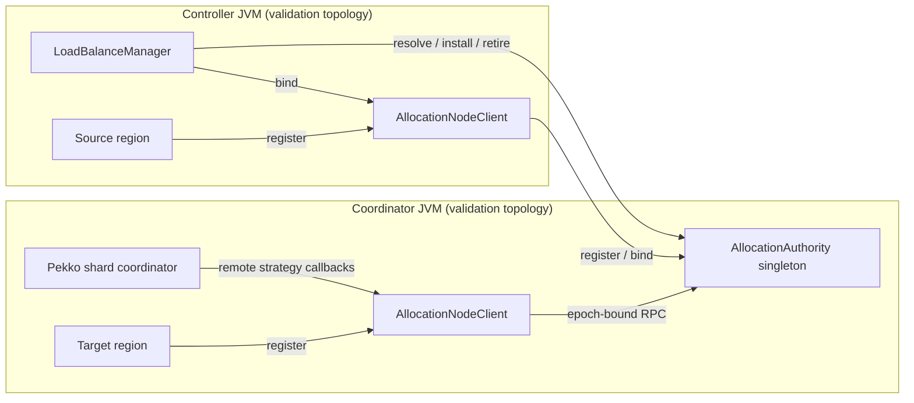

# Distributed allocation authority — implementation contract

The enabled custom allocation path must not depend on a mutable object shared
between the LoadBalanceManager JVM and Pekko's shard-coordinator JVM. Default
distributed execution with custom balancing disabled keeps its existing path.

## Ownership and startup

1. An ActorSystem extension starts an allocation-authority singleton manager,
   singleton proxy, and node client on every enabled JVM before region creation.
2. The factory installs a remote strategy adapter for each physical actor type.
   The adapter has transport handles, not placement-intent maps.
3. Each node client registers its actual local region, canonical address, and
   client incarnation with the authority. An ACK gates successful callbacks.
4. The authority owns registrations, callback-derived allocations, controller
   binding, and all explicit migration intents. It has a fresh authority epoch;
   clients pin that epoch and reject replacement rather than silently resetting.

## Exchanges

| Exchange | Required reply and completion condition |
|---|---|
| Region registration | Correlated ACK after identity validation; conflicts are rejected. |
| Allocation callback | Correlated target or explicit failure, using the actual coordinator callback's eligible regions. Explicit placement cannot fall back. |
| Rebalance callback | Correlated shard set; an intent remains until controller retirement, so a lost response cannot consume it. Already-arrived and in-progress shards are excluded. |
| Controller binding | One controller incarnation binds to the authority epoch before manager readiness. Replacement is rejected. |
| Resolve placement | Asynchronous source/target resolution for all requested physical types, based on registered regions and the latest accepted callback cohort. |
| Install intent | One atomic request validates and installs every type of a logical-shard move, then ACKs. The manager starts its completion monitor after installation ACK. |
| Retire intent | Correlated controller retirement after observed placement and accepted restore; idempotent duplicates cannot clear a later intent. |

Callback matrices travel as typed rows containing ActorRef, canonical address, and
shard IDs. They are not JSON maps with ActorRef keys. Request IDs correlate replies;
per-adapter callback sequence numbers reject stale index updates. A change of
callback owner during the supported stable run fails closed. This is not
coordinator/authority restart or split-brain recovery.

## Migration path and acceptance

Implement transport/authority and cold-codec tests first; wire enabled factory
startup next; replace manager-local preflight and command mutation with actor
requests; then validate with independent JVMs. Existing local allocator tests
remain a reference path when custom balancing is disabled in the test fixture.
No default setting is switched on.

Those implementation steps are now wired into `AllocationRuntime`,
`AllocationNodeClient`, `RemoteShardAllocator`, `AllocationAuthority`, the factory,
and LoadBalanceManager. The reference allocator remains for the local test path;
enabled production regions always install the remote adapter, even on the
controller's own JVM. Native callbacks that arrive before registration ACK fail
explicitly and can be retried by Pekko; they cannot select a local fallback.

Fresh placement evidence triggers `StartEntity` for the expected cohort at each
target. This is necessary even without buffered traffic: with remember-entities
disabled, physical handoff does not itself recreate idle entities. Native start
ACKs are consumed but do not count as model restoration. The existing final-save,
store confirmation, observed placement, and window-close barriers remain in force.

The separate-process acceptance must place the controller and active shard
coordinator in different JVMs, use actual independent registries, move a live
shard, restore through SnapshotManager, and verify state and source/target
ownership before normal resume. Its first fixture uses hash shard IDs so it does
not conceal the separate, still-open entity-to-spatial-shard directory problem.
Papers must distinguish allocator/registration evidence from complete spatial
membership, progressive input, failure recovery, and accounted-runtime migration.

See [the separate-JVM validation record](DISTRIBUTED_ALLOCATION_VALIDATION_2026_10_25.md)
for executable evidence, the first rejected run, and the remaining boundaries.
