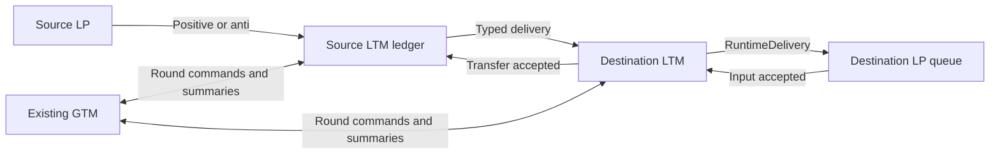

# Optimistic accounting owned by LTMs

The production `OptimisticGlobalTimeManager.props` selects
`AccountedOptimisticGlobalTimeManager`. It occupies the existing global-time-manager
singleton and creates `AccountedOptimisticLocalTimeManager` workers. There is no
separate production `AccountedRuntimeCoordinator` actor. The older centralized
classes remain available for compatibility tests and baseline comparisons.

Each simulation still chooses one policy before startup; every actor uses that
policy until the run ends. This implementation changes transport ownership and
round aggregation, without changing the model's synchronization policy.

The production path now also uses
[startup execution limits and safe fossil collection](BOUNDED_OPTIMISTIC_EXECUTION.md).
Queued work determines the frozen timestamp minimum; reply obligations remain
separate completion/retirement constraints rather than pinning GVT at the old send tick.

Hybrid dynamic routing can now participate through
[accounted routing LPs](ACCOUNTED_ROUTING.md). Link costs, route/mode queries and
correlated replies use these same owner ledgers and rollback rules; unaccounted
shared caches remain rejected.

At a proven truncated final cut, `CommitRuntime.finalHorizon` authorizes
[read-only horizon reporting](HORIZON_AND_TRANSIT_REPORTING.md) before the same
report-receipt/flush barrier. It neither dispatches a model event nor changes GVT.

## Ownership and data delivery

The GTM fixes LTM membership, assigns typed logical process IDs to owners and waits
for registration acknowledgements. Numeric IDs belonging to different models use
different private scheduler handles. Each owner watches its actual LP actors; the
GTM watches workers. Uncoordinated participant loss fails the run.

An LP receives `RuntimeJoined(..., distributed=true)` and sends model interactions,
anti-messages, schedule controls and committed reports to its owning LTM. The GTM
rejects per-message routing commands rather than silently forwarding them.
Diagnostic per-event LVT notifications are also disabled in these LTMs.

The source LTM records a token before transmission. The destination records its
own acceptance token, sends the event to the actual LP, and acknowledges the
source only after the LP has queued the positive or cancellation. Model replies
are separate causal events; transport acceptance never waits for a business reply.
Both positive and anti-message identities retain model, run, incarnation and send
counter independently of the stable logical event order.

Spontaneous dispatches go directly from an LTM to its owned LP with an acceptance
token. Schedule replacement and completion are applied by that same owner, in the
LP's message order, before its subsequent freeze acknowledgement. A discarded
obsolete dispatch can still release its exact slot while a frozen LP accepts it;
that transport cleanup is accounted before the cut is collected.

Topology registration may send messages during loading. They use the same ledgers
and queue into frozen LPs. The owner establishes the finite execution horizon
before resuming startup work; future queued input remains pending for explicit
horizon truncation. Deterministic progressive input now uses
[acknowledged enrollment windows](PROGRESSIVE_OPTIMISTIC_RUNTIME.md). The GTM
includes the next unloaded tick in its cut and caps execution at accepted input.
Loading the next cohort takes place between execution windows, while all LPs are frozen.

## Global safety without a central message ledger

1. **Freeze:** the GTM sends a new round to every LTM. Each LTM stops dispatching
   and freezes all owned LPs. An LP processes earlier routes before its freeze ACK
   on the same LP-to-owner channel. Its owner waits for every LP ACK, every local
   input acceptance and every outgoing transfer acceptance before acknowledging
   the GTM. Frozen LPs keep accepting queued input and control messages.
2. **Collect:** after all LTMs acknowledge, the GTM requests fresh summaries. An
   early worker freeze ACK is not reused as its snapshot. A later cross-LTM
   delivery must already have been accepted before its source could acknowledge
   freezing; therefore fresh collection follows its delivery causally. Every LTM
   now collects actual LP queues, cancellations, pending self-events, callbacks and
   reply counts, plus local undispatched schedules and future-horizon work. Accepted
   dispatches are represented by LP queues; a scheduler slot awaiting a reply does
   not add its historical timestamp to the minimum. Orphaned slots fail the run.
3. **Commit:** the GTM validates a nondecreasing minimum and broadcasts GVT. Only
   events strictly below GVT commit. LPs flush surviving reports to their owners;
   each owner waits for its LP commit ACKs and actual sink receipts before sending
   one commit summary. A blocked obligation without a timestamp is a failure.
4. **Retire:** each owner physically retires only LPs authorized by that committed
   round. An ordinary terminal LP must have its terminal and latest processed
   events strictly below GVT and no pending work. It stays available before that
   point. Final-cut retirement distinguishes settled completion from truncation.
5. **Resume or finish:** the GTM waits for all owner retirement summaries. Ordinary
   rounds resume LPs and dispatch. At the final cut it additionally waits for an
   asynchronous ReportManager flush covering the actual sink references collected
   from owners. Only then does it publish successful completion.

GVT remains a paused-round protocol. The algorithm relies on the stated frozen
membership during collection/commitment/retirement and per-sender ordering, not a network delay bound,
idle polling or simultaneous snapshots. No callback blocks a Pekko thread.
Progressive enrollment happens after retirement and before resumption. Arbitrary
live producers and ownership migration remain unsupported. Model-caused birth now
has a separate [cancellable lifecycle adapter](RUNTIME_ACTOR_BIRTH.md): membership
may grow during freezing only under its source-ledger/newborn-freeze ordering proof;
collection, commitment and retirement retain fixed membership.

## Model reporting and costs

`LinkMetricsState` is part of serialized `LinkState`. `LinkMetricsReporter` reads
and updates that state through a callback, so cumulative and per-tick counters
restore with an earlier checkpoint. Replaying an entry or exit therefore does not
inflate committed SUMO `loaded`/`ended` values. Prometheus operation counters are
diagnostic execution counters and are not rollback transactions.

Node's capacity and signal-wait maps declare Integer JSON content types as well
as Long keys. The shared mapper otherwise widens erased integer map values to
Longs, making replay fail on Int arithmetic. This model serialization correction
is shared by both policies.

See [the validation record](DISTRIBUTED_OPTIMISTIC_VALIDATION_2026_10_23.md) for the
tested artifact, independent scenario acceptance and measured limitations.

Per-message ledger and ACK work is distributed across LTMs. GTM round traffic
depends on the number of LTMs rather than directly on the LP/event population;
each LTM still traverses its own LPs when freezing and collecting. The slowest
worker and sink can hold a round. Pauses, model state, input queues and participant
traversal remain scale limitations. Execution windows, event budgets and committed
history collection now reduce retained speculative work; they are not a hard
heap-byte cap or evidence of city-scale throughput.

`[LTM-ACCOUNTING]` records cumulative transfer and receipt counts plus remaining
ledger sizes. `[ACCOUNTED-ROUND]` records freeze, snapshot, commit and retirement
durations in nanoseconds. These permit measuring coordination costs independently
of heartbeat intervals and cluster startup. Model messages and their ACKs must not
appear in the GTM's routing path.

## Cross-JVM follow-up (2026-10-24)

The [two-JVM validation](MULTI_JVM_POLICY_VALIDATION_2026_10_24.md) exercises real
Artery transport with one owner per process. Independent cold codecs now cover
unlisted classes; pool workers use explicit class constructors. Each node installs
its own immutable scenario resource settings before shard initialization, and
warm-up workers acknowledge readiness before receiving targets. The record keeps
multi-host partitions, recovery/migration, distributed live API updates and capacity
claims separate from this bounded validation.
