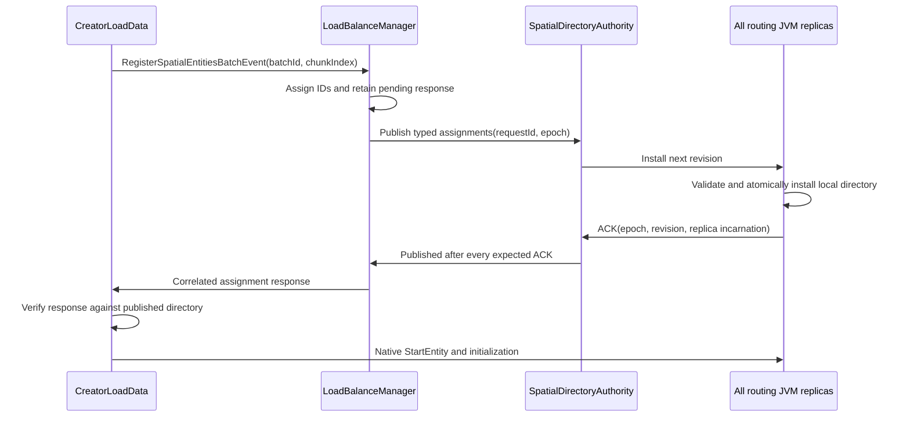

# Distributed spatial assignments

Custom balancing uses one spatial-directory singleton and one replica per routing
JVM. `AllocationRuntime.start()` starts this directory before enabled region
creation. Disabled custom balancing keeps the existing local/hash path.

The directory publishes **creation assignments**, not a live actor roster.
Production conservative runtime owners separately provide initialized/live
membership at a globally closed migration cut. Retired directory entries never
become snapshot obligations. Spatial strategies use a fixed initial grid and
append capacity buckets without rewriting published IDs.

## Ownership and publication

Each row contains an entity ID, assigned shard ID, full actor class, and creation
coordinates. IDs and their rows are immutable for this run. The authority owns an
epoch, consecutive committed revisions, registered replica incarnations, publication
receipts and one in-flight publication. Local replicas publish immutable snapshots
into the process registry for synchronous native shard extraction.

The first publication fixes the cohort to the current Up members. Every member
must have a registered, hydrated replica before publication can start. Registration
validates the replica's address, ActorRef and incarnation. Hydration also needs its
own matching acknowledgement before readiness. A publication waits for every
replica in that fixed cohort; unknown/stale ACKs cannot remove an obligation.
Publications serialize, including duplicate requests queued behind an active one.
Receipts return the original revision for a matching repeated request.

An install validates the entire batch before applying it. Epoch changes, revision
gaps, conflicting repeated revisions, changed assignments, and conflicts with old
local mappings are rejected. Getters expose one immutable directory snapshot;
creation coordinates also populate the existing position cache. The authority
commits and acknowledges only after all installs are accepted. A node may hold
an installed revision before global acceptance; creation remains blocked until
the complete barrier closes.

## Routing and failure

Enabled `ActorCreatorUtil.createShardRegion` extractors require a published row
whose full class matches that region. Both envelopes and native `StartEntity`
use the same check. Missing metadata cannot silently choose a hash shard. The
disabled factory retains its previous behavior.

Creator responses are checked against the active batch/chunk index before any
registry writes. Matching responses must cover exactly that chunk, contain valid
coordinate arrays, and agree with the published directory. A late response cannot
overwrite routing for a later chunk. The old ten-second fallback which created
hash-routed actors is removed. Enabled proxy creation also no longer performs a
blocking actor lookup or selects hash routing on lookup failure.

Registration/publication are consistency-critical creation exchanges. Their waits
do not hold modeled spontaneous events open or add Time Manager round-trips. The
authority never needs the waiting creator to answer its installation ACKs. Successful
publication ends in the existing correlated assignment response. Validation and
publication failures take the fatal-stop path and cannot produce normal creation
success. Future results return through `pipeTo(self)`; strategy and pending-response
state change only on the manager's actor thread.

Replica/authority loss, changed epoch/incarnation, and cluster membership changes
after publication fail closed and notify the controller. Publication ask timeouts
are failures, never evidence of installation. Ordinary simulation does not resume
from a failed migration/publication. Independent restart, singleton failover,
partitions, repeated runs and live member enrollment require coordinated recovery;
this protocol does not reconstruct that state. A registration during a migration
wave is rejected, and migration cannot cross a safe boundary with a publication
still pending.

## Scope and costs

Every routing JVM retains all published rows. Steady-state publications carry a
chunk delta to each replica; hydration transfers the complete committed directory.
Receipts and immutable assignments remain for the run. This introduces replicated
metadata and a per-chunk all-member ACK barrier. The bounded tests establish no
city-scale memory, startup-throughput or latency claim. Position-cache clearing
does not remove the immutable assignment rows or their retained coordinates.

Model-created actors publish their assignments before native creation, using the
same acknowledged barrier as progressive/eager input. Conservative batch closure
waits for birth initialization. During an active migration wave, new publication
is rejected; a safe cut with an unfinished publication aborts rather than guessing.

Migration uses the frozen live cohort supplied by runtime owners and validates
its actor classes against this directory. The supported adapter preserves the
accepted input queue and logical runtime ownership across physical relocation.
Optimistic migration, independent recovery and live geometric repartition remain
outside this protocol. See the current production acceptance in LOAD_BALANCING.md.

See [Step 9](LOAD_BALANCING.md#step-9--acknowledged-spatial-directory-publication-2026-10-25)
for verification and the independent-JVM fixture's limits.
