# Load-balance strategies — steps, communications and diagrams

Reference for every load-balance strategy in the engine, the shared machinery
beneath them, and each message exchange from shard assignment to migration
resume. It describes the code in
`src/main/scala/core/actor/manager/loadbalance/` as read on 2026-11-12.

Companion documents: [LOAD_BALANCING.md](LOAD_BALANCING.md) (fix history, test
evidence, scope limits), [DISTRIBUTED_ALLOCATION_DESIGN.md](DISTRIBUTED_ALLOCATION_DESIGN.md),
[DISTRIBUTED_SPATIAL_DIRECTORY.md](DISTRIBUTED_SPATIAL_DIRECTORY.md),
[LOAD_BALANCING_LITERATURE.md](LOAD_BALANCING_LITERATURE.md).

> **Status.** Custom balancing is **disabled by default**
> (`htc.load-balance-manager.enabled = false`). When it is off, the engine uses
> Pekko's hash sharding (`id.hashCode % 1000`) and the manager never plans
> migrations. Everything in sections 4–9 describes the enabled path.

## Contents

1. [Strategy selection and overview](#1-strategy-selection-and-overview)
2. [Component map](#2-component-map)
3. [Strategy comparison](#3-strategy-comparison)
4. [Phase A — shard assignment at creation](#4-phase-a--shard-assignment-at-creation)
5. [The four strategies](#5-the-four-strategies) (includes [5.5 quadtree and kd-tree in depth](#55-the-quadtree-and-the-kd-tree-in-depth))
6. [Phase B — load observation](#6-phase-b--load-observation)
7. [Phase C — planning (shared planner + predictor)](#7-phase-c--planning-shared-planner--predictor)
8. [Phase D — migration protocol](#8-phase-d--migration-protocol)
9. [Distributed control plane](#9-distributed-control-plane)
10. [Failure handling](#10-failure-handling)
11. [Configuration reference](#11-configuration-reference)
12. [Limits and caveats](#12-limits-and-caveats)

---

## 1. Strategy selection and overview

`htc.load-balance-manager.strategy` (env `HTC_LOAD_BALANCE_STRATEGY`) is parsed by
`LoadBalanceSettings.read` into `LoadBalanceStrategyEnum`, and `StrategyFactory`
instantiates the matching `BalancingStrategy`.

| Config value | Enum | Class | `None` returned? |
|---|---|---|---|
| `hybrid` (default) | `Hybrid` | `HybridStrategy` | no |
| `geo-affinity` | `GeoAffinity` | `GeoAffinityStrategy` | no |
| `type-aware` | `TypeAware` | `TypeAwareStrategy` | no |
| `default` | `Default` | `DefaultStrategy` | no |
| `disabled` | `Disabled` | — | yes: no strategy, no periodic jobs |
| anything else | — | — | `LoadBalanceSettings.read` throws `IllegalArgumentException` |

Every strategy answers the same questions, so `LoadBalanceManager` (LBM) is
strategy-agnostic:

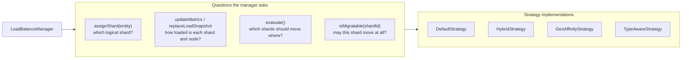

There are two independent decisions, which is the key to reading the rest of
this document:

* **Where does an entity live?** Decided once at creation by `assignShard`. The
  result (a *logical shard ID*) is published and then immutable for the run.
* **Which node hosts a logical shard?** Decided at runtime by `evaluate()`
  producing `MigrationPlan`s, executed by the migration protocol.

---

## 2. Component map

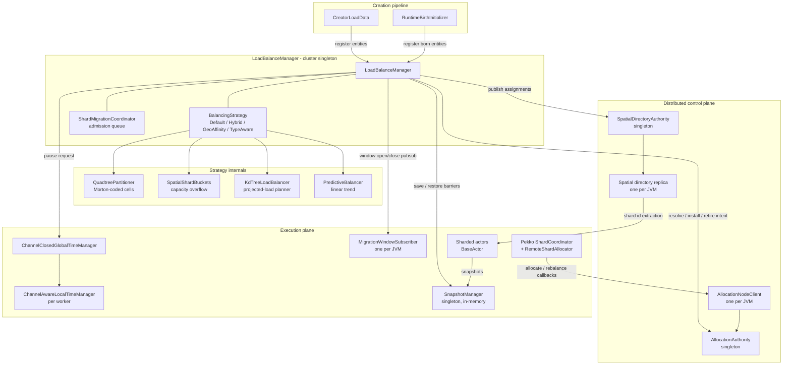

---

## 3. Strategy comparison

| | `default` | `hybrid` | `geo-affinity` | `type-aware` |
|---|---|---|---|---|
| **Grouping principle** | none (hash) | geography | geography, split by static/dynamic | actor class |
| **Shard ID** | `hash % 1000` | `qt-shard-{depth}-{morton}[-bucket-N]` | `static-` or `dynamic-` + hybrid ID | `{type}-shard-{N}` |
| **Spatial structure** | none | quadtree, fixed grid of depth `initial-depth` (default 2) | same as hybrid | none |
| **Capacity handling** | none | overflow bucket at `max-actors-per-shard` | same, per namespace | sequential bucket fill per type |
| **Static infra** | not distinguished | classified; shard becomes `Static`/`Dynamic`/`Mixed` | separate `static-*` namespace, never `Mixed` | classified per shard, pinned |
| **Migratable shards** | none | `Dynamic` only (`Mixed` is pinned) | every non-`static-` shard | `Dynamic` only |
| **Target selection** | n/a | least projected load | load **plus** geographic affinity score | least projected load |
| **`evaluate()`** | always `Nil` | shared planner | shared planner + affinity score | shared planner |
| **Prediction** | no | yes (if `prediction.enabled`) | yes | yes |
| **Who moves shards** | Pekko only | LBM + custom allocator | LBM + custom allocator | LBM + custom allocator |

All three non-default strategies reuse the same planner (`KdTreeLoadBalancer`),
trigger rule and predictor; they differ only in shard-ID design, migratability
and, for GeoAffinity, the target ranking function.

---

## 4. Phase A — shard assignment at creation

Entities are registered with the LBM before their actors are created. The LBM
performs a **logical assignment only**: it maps entity → shard ID. It does not
create shards or actors. `CreatorLoadData` (or `RuntimeBirthInitializer` for
model-born actors) uses the returned IDs for routing.

### 4.1 Reference path (custom balancing off, or local test path)

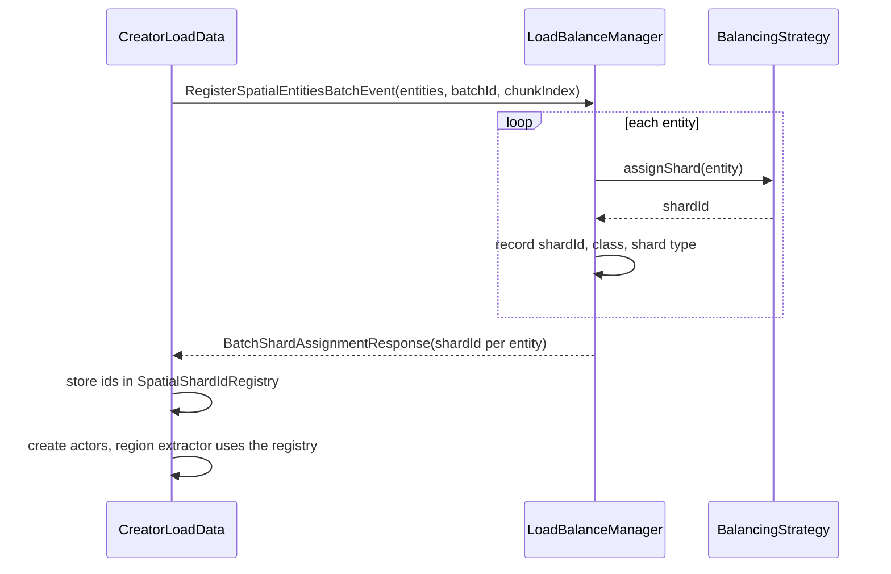

### 4.2 Distributed path (custom balancing enabled)

Routing rows must be replicated to every JVM **before** the creator is released,
because every JVM extracts shard IDs locally and synchronously.

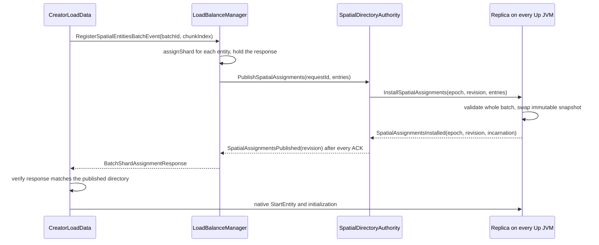

Rules enforced on this path:

* The first publication fixes the cohort to the current `Up` members. A later
  membership change fails the run closed.
* Publications serialize. A repeated request returns its original revision.
* Enabled shard-ID extractors require a published row whose actor class matches
  the region. There is no silent hash fallback and the old 10 s hash-routed
  fallback timer is removed.
* A registration while a migration wave is open, or a migration reaching its safe
  boundary while a publication is pending, is rejected and fails the run.
* A validation error (bad coordinates, class metadata missing, shard namespace
  changed) takes the fatal-stop path: no partial assignment response is sent.

---

## 5. The four strategies

### 5.1 `default` — delegate to Pekko

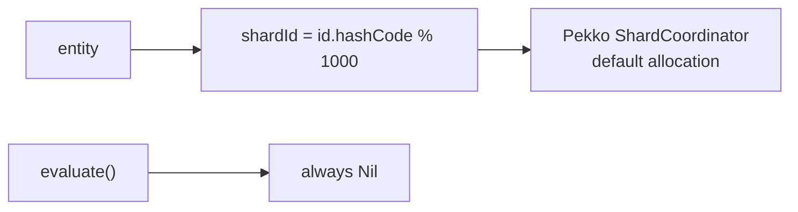

* `assignShard`: `(spatialEntityId.hashCode % 1000).toString`.
* `getShardForPosition(x, y)`: `(x.hashCode*31 + y.hashCode) % 1000`.
* `updateMetrics`, `initialize`: no-ops. `getAssignments` is empty.
* `evaluate()` never plans migrations. No migration protocol ever runs.
* Use when spatial locality does not matter and Pekko's balancing is enough.

### 5.2 `hybrid` — geographic cells, capacity buckets, projected-load placement

Two levels: a fixed geographic grid decides *what an entity is grouped with*;
a load planner decides *which node hosts each group*.

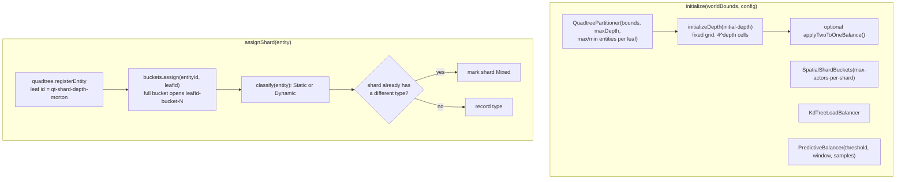

Key properties:

* **IDs are stable.** Published entity→shard rows never change; capacity overflow
  *adds* `-bucket-N` shards for new entities instead of rewriting old ones.
  `SpatialShardBuckets.assign` rejects an entity whose base cell changes.
* **No live refinement.** `evaluate()` does not split/merge quadtree cells, since
  that would invalidate published routing. The quadtree's refinement code exists
  and is unit-tested, but the production path keeps the initial grid.
* **Pinning.** `isMigratable` is `getShardType == Dynamic`. A shard that mixes
  infrastructure (Node, Link, signal, stop, station…) with vehicles becomes
  `Mixed` and is **never** moved. The downside: in hybrid, co-located
  infrastructure pins vehicles that share its cell.
* **Evaluation** runs the shared pipeline in
  [section 7](#7-phase-c--planning-shared-planner--predictor); target ranking is
  "least projected load".

### 5.3 `geo-affinity` — separated namespaces and affinity-ranked targets

Same quadtree/buckets/planner as hybrid, with two changes.

**(1) Separated namespaces** remove `Mixed` shards entirely:

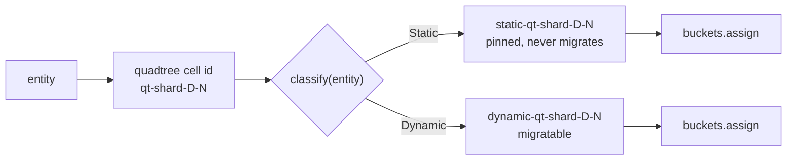

`isMigratable(id) = !id.startsWith("static-")`. Infrastructure and vehicles in the
same quadrant therefore sit in different shards, and only vehicle shards move.

**(2) Affinity scoring** ranks candidate target nodes. The planner first keeps only
candidates whose move *strictly improves* load balance; affinity then orders them:

```
score(node) = (1 - α) · (1 - load(node) / Σ candidate loads)  +  α · affinity(node, shard)

affinity = 1.0   node already hosts the static shard of the same quadrant
           0.5   node hosts a static shard of an adjacent quadrant
           0.0   no geographic relation
α = geo-affinity.weight  (default 0.4;  0 = pure load,  1 = pure affinity)
```

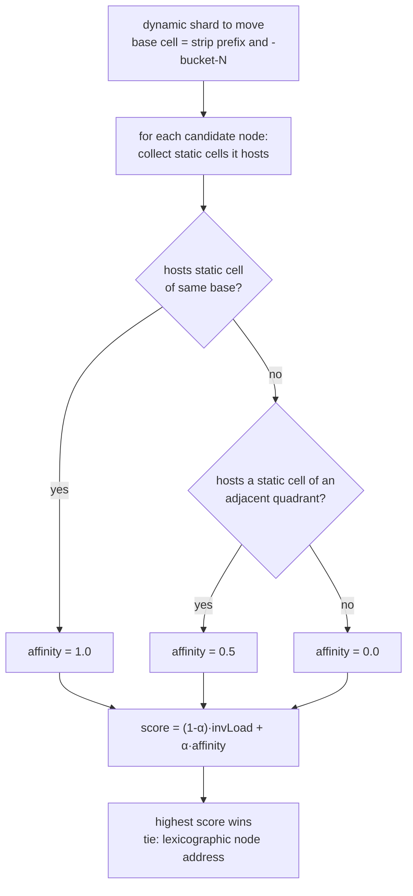

Affinity never overrides the load constraint, so a node that would not reduce
imbalance is never chosen, however close it is geographically.

### 5.4 `type-aware` — one shard family per actor class

No geometry. Entities of the same class are packed together.

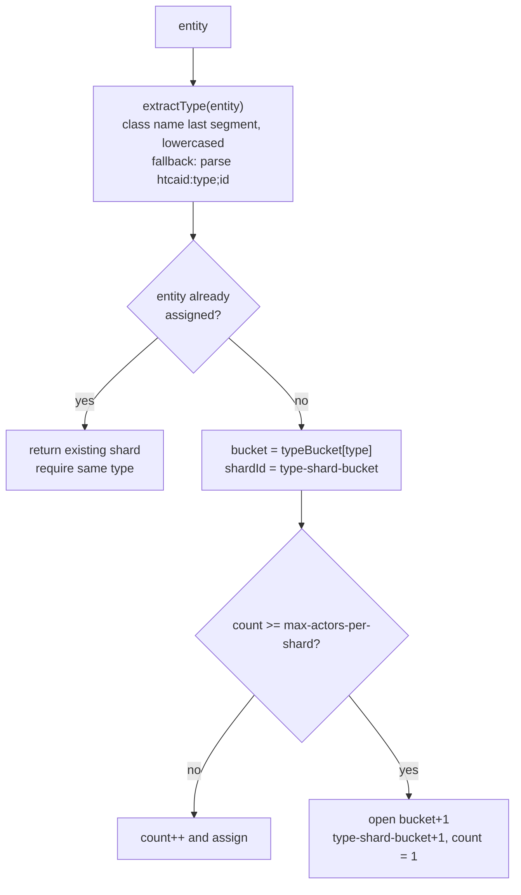

* IDs: `car-shard-0`, `car-shard-1`, `node-shard-0`, `person-shard-399`…
* Fill-first: a bucket takes entities until full, then the next opens. 20 M persons
  at 50 000 per bucket gives about 400 buckets.
* `shardTypes` records the class-based `Static`/`Dynamic`; node/link/signal
  buckets are pinned, vehicle and person buckets move.
* `getShardForPosition` returns `unknown-shard-{hash}`. Callers must use
  `assignShard`.
* Runtime planning uses the same shared planner. Weights are entity counts, so
  balance means "similar numbers of live actors per node".

### 5.5 The quadtree and the "kd-tree" in depth

Hybrid and GeoAffinity combine two components with **different jobs**. Config and
logs call them "Level 1" and "Level 2".

| | Level 1: `QuadtreePartitioner` | Level 2: `KdTreeLoadBalancer` |
|---|---|---|
| Question answered | *Which logical shard does this entity belong to?* | *Which cluster node should host each logical shard?* |
| Input | entity coordinates (x, y) | shard weights and current shard→node map |
| Output | shard ID such as `qt-shard-2-7` | list of `(shard, sourceNode, targetNode)` moves |
| When it runs | once per entity, at creation | every rebalance tick |
| Is it a tree? | yes, a region quadtree | **no**, flat maps despite the name |
| Geometry | yes | none |
| Used by | Hybrid, GeoAffinity | Hybrid, GeoAffinity, TypeAware |

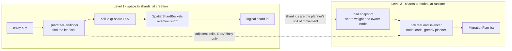

The only bridge between the two is the **shard ID**. The quadtree decides
membership once and never moves an entity afterwards. The planner then moves whole
shards between nodes and never looks inside one. The one place geometry reaches the
planner is GeoAffinity's score, via `getAdjacentShardIds`
([5.5.4](#554-adjacency-geoaffinitys-only-use-of-geometry-at-runtime)).

#### 5.5.1 Quadtree: structure and shard IDs

A region quadtree recursively splits a rectangle into four equal quadrants. Here the
root covers `htc.load-balance-manager.world-bounds`. Each leaf **is** one geographic
shard cell.

* Quadrant order and child index: **NW = 0, NE = 1, SW = 2, SE = 3**.
* Morton (Z-order) code of a child: `(parentCode << 2) | childIndex`, so the code
  spells the path from the root, two bits per level.
* Shard ID: `qt-shard-{depth}-{mortonCode}`. Depth is part of the ID because a path
  of leading NW (zero) moves gives the same code at different depths; the ID
  `qt-shard-2-0` and the root `qt-shard-0-0` would otherwise collide.

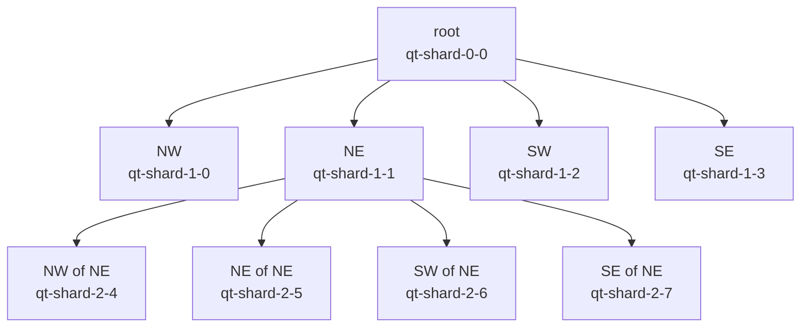

Worked ID: a point in the south-east of the north-east quadrant descends NE (1) then
SE (3), giving `(1 << 2) | 3 = 7` at depth 2, so `qt-shard-2-7`.

With the default `quadtree.initial-depth = 2`, `initializeDepth(2)` pre-splits the
whole tree into a uniform **4² = 16-cell grid** (depth 8 would be 65 536 cells; the
setting is capped at `min(max-depth, 8)`). It requires an empty tree. The grid then
stays fixed for the run.

#### 5.5.2 Quadtree: point location

`registerEntity` and `getShardForPosition` both descend from the root, choosing one
child per level, so a lookup costs **O(depth)**, not O(cells).

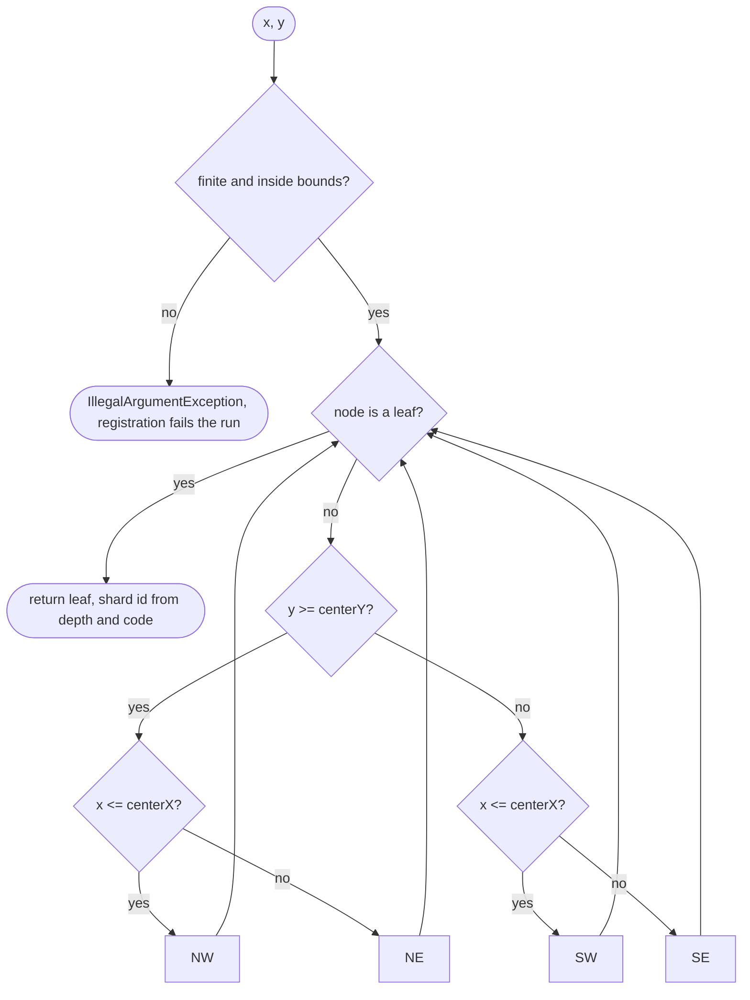

Boundary rule, so every point has exactly one cell: a point **on a vertical
midline goes west** (`x <= centerX`) and a point **on a horizontal midline goes
north** (`y >= centerY`). Points outside the world bounds are rejected before any
state changes.

For each registered entity the quadtree also keeps its coordinates, its leaf's
entity set, and entity↔shard maps, so re-registering or moving an entity updates
both its old and new leaf.

#### 5.5.3 Quadtree: refinement operations (implemented, not in the live path)

The class implements adaptive refinement, but **no strategy calls it during a run**.
Splitting or merging cells would change the shard ID of entities that were already
published to every JVM's routing directory.

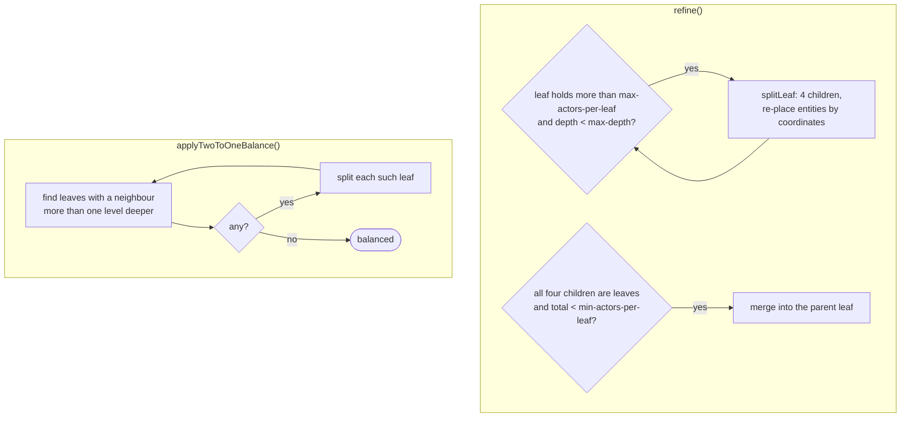

* **2:1 balance** (after Sundar et al., 2008, in 2-D) guarantees adjacent leaves
  differ by at most one level, avoiding abrupt density jumps across boundaries. Each
  pass works on one topology snapshot and repeats until none remain.
* At the default uniform grid, the balance call at `initialize` is a **no-op**
  because every leaf already has the same depth.
* These operations are covered by `QuadtreePartitionerSpec` as components. Enabling
  them in production needs a coordinated republication of the directory
  ([LOAD_BALANCING.md](LOAD_BALANCING.md), Steps 8–9).

What replaced adaptivity: when a cell accumulates `max-actors-per-shard` entities,
`SpatialShardBuckets` gives **new** entities in that cell the ID
`qt-shard-D-M-bucket-1`, then `-bucket-2`, and so on. Existing entities keep their
IDs. A cell can therefore become several shards, and the planner can place those on
different nodes.

#### 5.5.4 Adjacency: GeoAffinity's only use of geometry at runtime

`getAdjacentShardIds(baseId)` finds the leaf by ID, then collects every leaf whose
bounds **intersect** it (touching an edge or a corner counts), excluding itself.
GeoAffinity calls it from `affinityScore` to ask: does the candidate node already
host a static shard in a neighbouring cell?

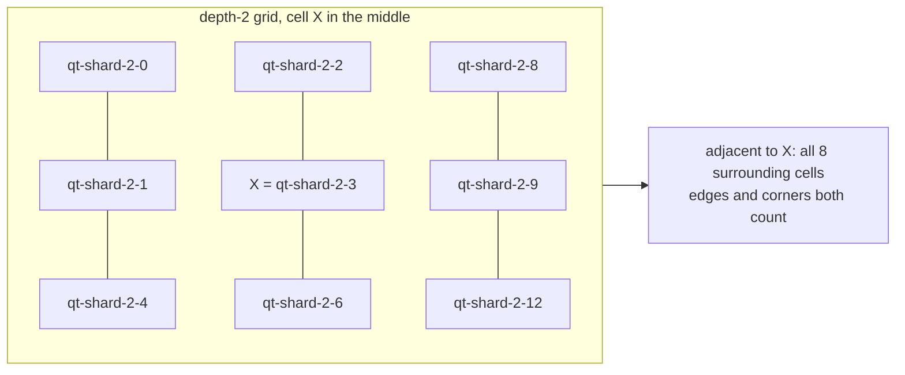

#### 5.5.5 Kd-tree: what the class really is

`KdTreeLoadBalancer` is **not a kd-tree**. It holds three flat maps and no spatial
index. The name and the `kdtree.*` config keys are historical. Its source says "the
historical class name is retained for callers". Because the quadtree already did
the spatial work, this class only does arithmetic on loads.

| State | Meaning |
|---|---|
| `shardMetricsMap` | shardId → latest `ShardMetrics` (weight = live entity count) |
| `shardAssignment` | shardId → node currently hosting it |
| `clusterNodes` | known `Up` nodes (so an empty node still counts as load 0) |

| Method | Behaviour |
|---|---|
| `replaceSnapshot` | Atomically replaces all three maps. Requires metrics and assignments to cover the **same** shard set and every owner to be a known node |
| `getNodeLoads` | Sum of shard weights per node. Nodes with no shards appear with 0 |
| `getImbalanceRatio` | `max/min` of node loads (1 with fewer than two nodes, `Double.MaxValue` if min≈0 and max>0) |
| `rebalance(eligible, score)` | The greedy planner of [7.4](#74-the-planner-kdtreeloadbalancerrebalance) |
| `recordNodeAssignment` | Records a shard's new owner (from the allocator index, or after a verified move) |
| `removeNode` | Drops the node **and all assignments on it** |
| `improvesPlacement` | Checks whether moving one shard to a target strictly narrows the gap |

TypeAware uses this class **without** a quadtree, which shows how little it depends
on geography.

#### 5.5.6 Worked example of the planner

Three nodes, four shards of the given weights (entity counts). The default score is
"lowest load wins". A candidate is only valid if
`load(source) − load(candidate) > shardWeight`.

| Start | A | B | C |
|---|---|---|---|
| shards | s1=40, s2=30, s3=20 | s4=10 | none |
| load | 90 | 10 | 0 |

Imbalance ratio is `Double.MaxValue` because C is empty, which exceeds 1.5, so the
planner runs. Shards are visited heaviest first:

| Shard (weight) | Source load | Valid candidates (`source − cand > w`) | Chosen | Loads afterwards (A, B, C) |
|---|---|---|---|---|
| s1 (40) | A = 90 | B: 80 > 40 ✓, C: 90 > 40 ✓ | **C**, lowest load | 50, 10, 40 |
| s2 (30) | A = 50 | B: 40 > 30 ✓, C: 10 > 30 ✗ | **B** | 20, 40, 40 |
| s3 (20) | A = 20 | B: −20 ✗, C: −20 ✗ | stays | 20, 40, 40 |
| s4 (10) | B = 40 | A: 20 > 10 ✓, C: 0 > 10 ✗ | **A** | 30, 30, 40 |

Result: `s1 → C`, `s2 → B`, `s4 → A`, giving 30 / 30 / 40 from 90 / 10 / 0. Two things
this shows: the plan is **greedy** (it does not search for an optimum), and a shard
that sat on a lightly loaded node (s4) can move once earlier moves change the
projected loads. With GeoAffinity the only difference is the *ranking* among valid
candidates, never which candidates are valid.

#### 5.5.7 End to end for one entity

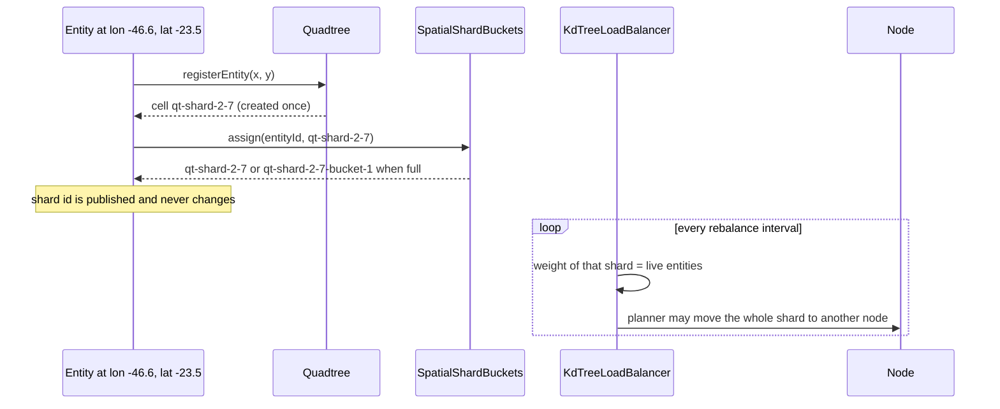

#### 5.5.8 Practical consequences

* **Set the world bounds to the scenario's extent.** The default is the whole globe
  (`-180..180`, `-90..90`). At depth 2 each cell then spans 90° × 45°, so a single
  city falls inside **one** cell. The quadtree stops separating anything
  geographically and hybrid reduces to arrival-order buckets of
  `max-actors-per-shard`. Override with `HTC_LB_WORLD_MIN_X/MIN_Y/MAX_X/MAX_Y`.
* **Pick `initial-depth` for the number of nodes**, not for the number of
  entities: 16 cells over 2 nodes gives the planner 8 movable pieces per node on
  average. Too coarse leaves it nothing to balance with. Too fine multiplies
  the shard count and the per-shard migration overhead.
* **Only whole cells (or buckets) move.** One very dense cell becomes at most
  `ceil(entities / max-actors-per-shard)` shards, and the planner can only
  split that load across nodes at bucket granularity.
* **Nonspatial actors** are placed at the configured world centre, so they cluster
  in one cell unless the strategy separates them by class (TypeAware) or namespace
  (GeoAffinity).
* **Cost notes.** Point location is O(depth). `getAdjacentShardIds` scans all leaves
  to find the cell by ID, and `affinityScore` rescans the assignment map for each
  candidate of each shard, so GeoAffinity planning cost grows with
  *shards × nodes × leaves*. That is negligible at 16–256 cells and worth measuring
  at very deep grids.

---

## 6. Phase B — load observation

The strategy cannot plan without an accurate picture of who hosts what. The LBM
rebuilds that picture from Pekko itself every
`metrics.interval-seconds` (default 5 s).

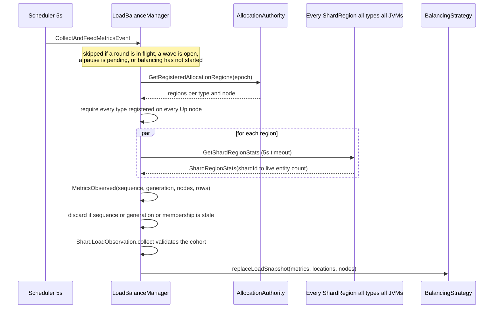

Acceptance rules (`ShardLoadObservation.collect`): every type reports from every
node, no duplicate rows, no failed shard collection, no negative counts, and each
logical shard appears on exactly one node. Any violation discards the round and
bumps `loadObservations{failed}`; nothing is partially applied.

**Weight = live entity count.** `ShardMetrics.totalWeight = count`. It is a
workload proxy, not CPU time or message rate. Idle nodes participate with zero
load. In the local (non-distributed) path the LBM queries its own
`ClusterSharding` regions instead of asking the authority.

`replaceLoadSnapshot` also feeds the predictor's history (when prediction is on).

---

## 7. Phase C — planning (shared planner + predictor)

### 7.1 Triggering

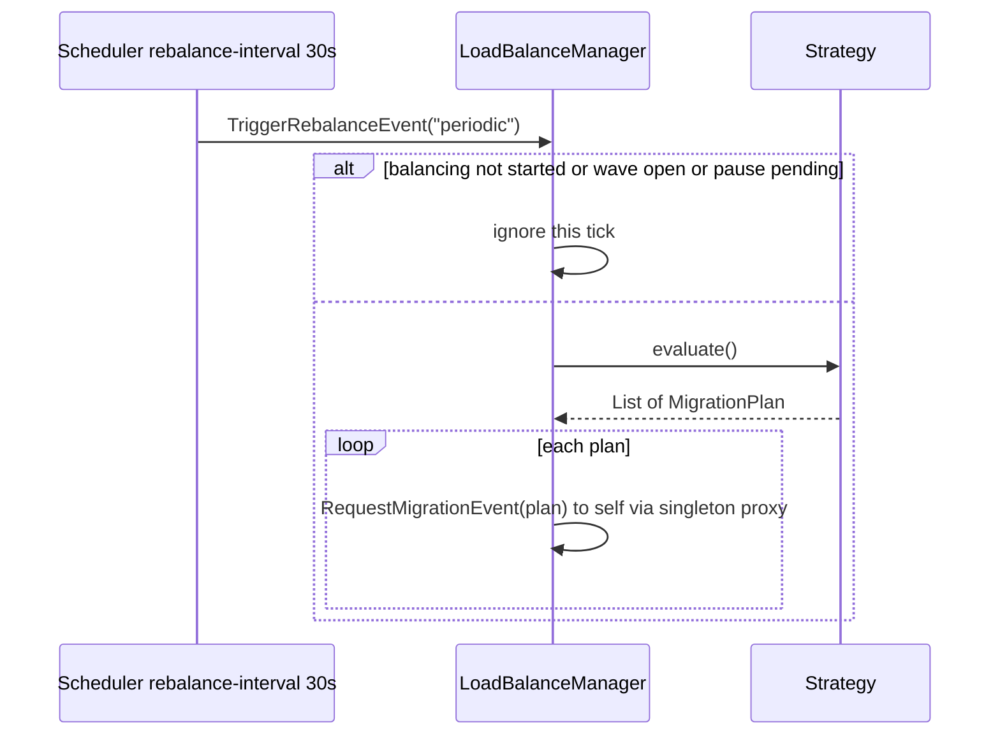

### 7.2 `evaluate()` for hybrid, geo-affinity and type-aware

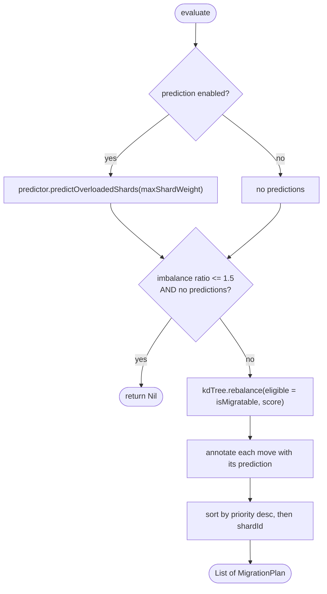

* **Imbalance ratio** = `max node load / min node load`. With fewer than two nodes
  it is 1. If the minimum is about 0 and the maximum is not, it is `Double.MaxValue`.
* **Prediction does not choose moves.** The planner decides *what moves*. The
  predictor only (a) can wake the planner when the ratio is fine but a shard is
  trending up, and (b) labels the resulting plan's reason and priority.

| Condition on the moved shard | `MigrationReason` | `priority` |
|---|---|---|
| Already at or above `load-threshold` | `ReactiveOverload` | 10 |
| Predicted to cross within the window | `PredictiveOverload` | 5 |
| Neither (pure imbalance) | `Rebalance` | 1 |

`NodeJoin` and `NodeLeave` exist in the enum but no strategy emits them.

### 7.3 The predictor

`PredictiveBalancer` keeps up to `flow-vector-samples` metric snapshots per shard.

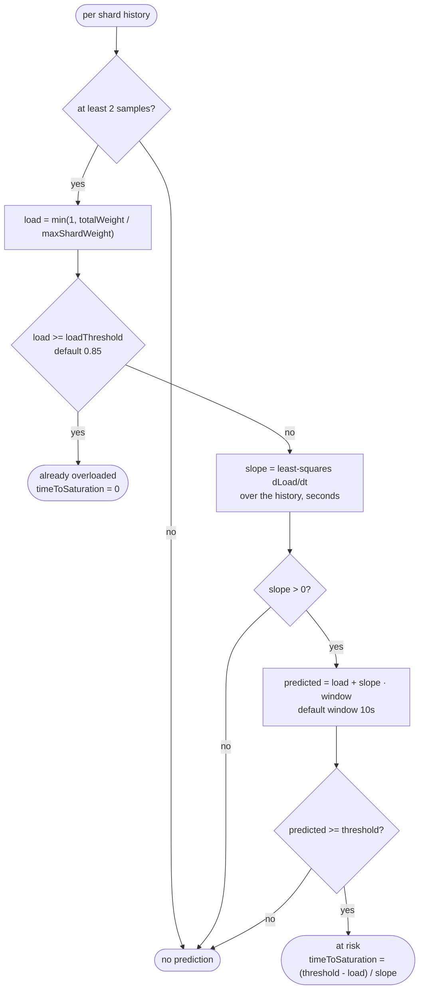

`maxShardWeight` is `max-actors-per-shard`. Results sort by soonest saturation.
`FlowVector` (mean dx, dy of movers) is stored and mergeable but is **not** used
by the current threshold prediction.

### 7.4 The planner (`KdTreeLoadBalancer.rebalance`)

The class name is historical: there is no kd-tree. It is a deterministic greedy
planner on projected node loads.

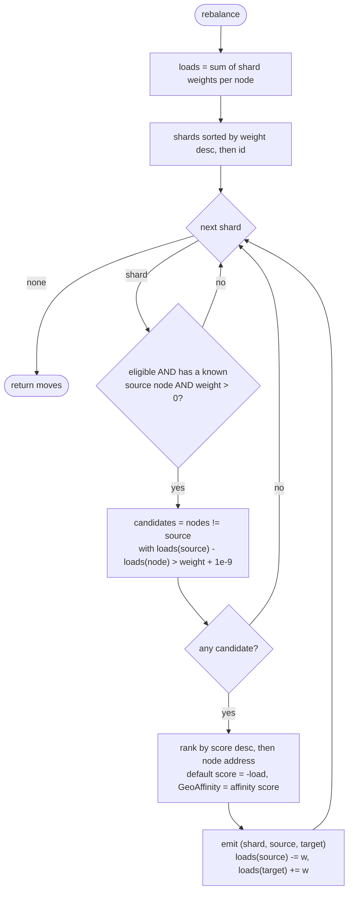

Guarantees:

* Every accepted move **strictly reduces squared node load**, so the plan cannot
  oscillate within a pass.
* Observed ownership is not mutated during planning, only the local projection.
* A shard moves at most once per pass, and a heavy shard is considered first.
* Fully deterministic given the same snapshot.

---

## 8. Phase D — migration protocol

Executing a plan is a distributed, barrier-based protocol. Nothing advances on a
timer or on missing evidence; any failure stops the run (see section 10).

### 8.1 End-to-end view

```mermaid
sequenceDiagram
  autonumber
  participant L as LoadBalanceManager
  participant G as ChannelClosedGlobalTimeManager
  participant W as ChannelAwareLocalTimeManager workers
  participant A as AllocationAuthority
  participant SM as SnapshotManager
  participant PS as MigrationWindowSubscriber on each JVM
  participant X as Source actors
  participant SC as Pekko ShardCoordinator
  participant Y as Target actors

  Note over L: RequestMigrationEvent admitted by the coordinator
  L->>G: RequestMigrationPauseEvent(shardIds, targetNodes, requestId)
  G->>W: FreezeConservativeMigration(epoch, requestId, targets, round)
  W->>X: FreezeConservativeProcess for live LPs in the planned shards
  X-->>W: ConservativeProcessFrozen
  W-->>G: ConservativeMigrationFrozen(members)
  G-->>L: MigrationSafeEvent(tick, liveMembers, requestId)

  rect rgb(235,245,255)
  Note over L,A: Resolving
  L->>A: ResolveAllocationPlacement(shard, source, target, types)
  A-->>L: AllocationPlacementResolved(source and target region per type)
  end
  rect rgb(235,255,240)
  Note over L,SM: Registering
  L->>SM: RegisterMigrationBatchEvent(batchId, entityIds)
  SM-->>L: MigrationBatchRegisteredEvent
  end
  rect rgb(255,250,230)
  Note over L,X: Saving
  L->>X: PrepareForMigrationEvent(shardId, targetNode, batchId)
  X->>X: capture snapshot, freeze and retain ordinary input
  X->>SM: SaveMigrationSnapshotEvent
  SM-->>L: MigrationSnapshotsReadyEvent(entityIds)
  end
  rect rgb(255,240,240)
  Note over L,PS: Opening
  L->>PS: pubsub MigrationWindowOpenEvent(batchId)
  PS->>PS: isMigrationActive = true
  PS-->>L: MigrationWindowAckEvent(open) from every Up node
  end
  rect rgb(245,235,255)
  Note over L,Y: Restoring
  L->>A: InstallAllocationIntent(batchId, attemptId, targets)
  A-->>L: AllocationIntentInstalled
  SC->>A: rebalance and allocate callbacks
  A-->>SC: shard set and explicit target region
  SC->>X: handoff, MigrationHandoffStopEvent
  X->>X: drain retained input, final snapshot
  X->>SM: SaveFinalMigrationSnapshotEvent(revision)
  SM-->>X: FinalMigrationSnapshotSavedEvent
  X->>X: stop
  L->>Y: GetShardRegionStats on exact source and target regions
  L->>Y: StartEntity for the cohort once placement is observed
  Y->>SM: QueryMigration
  SM-->>Y: restore offer, snapshot and token
  Y->>Y: apply state, run onMigrationRestore
  Y->>SM: MigrationRestoredAckEvent
  SM-->>L: MigrationRestoreAcceptedEvent
  L->>A: RetireAllocationIntent
  A-->>L: AllocationIntentRetired
  end
  rect rgb(235,245,255)
  Note over L,PS: Closing
  L->>PS: pubsub MigrationWindowCloseEvent
  PS->>PS: isMigrationActive = false
  PS-->>L: MigrationWindowAckEvent(close) from every Up node
  end
  Note over L: queue empty and no active migrations
  L->>G: MigrationCompleteNotifyEvent(requestId)
  G->>W: ResumeConservativeMigration
  W->>Y: EndConservativeProcessMigration
  W-->>G: ConservativeMigrationResumed
  G->>G: collect(), normal simulation resumes
```

### 8.2 Step table

| # | Step | Actor(s) | Evidence required before advancing |
|---|---|---|---|
| 1 | Admission | LBM, `ShardMigrationCoordinator` | Shard not already active or queued. At most `migration.max-concurrent` (default 3) active, others FIFO |
| 2 | Pause request | LBM → GTM | Single outstanding request; GTM may decline with `ConservativeMigrationDeclined` if finalizing |
| 3 | Freeze | GTM → workers → LPs | Closed causal batch; every selected live LP acks `ConservativeProcessFrozen`; no in-flight events |
| 4 | Safe boundary | GTM → LBM | `MigrationSafeEvent` with the authoritative live cohort, validated against the directory classes and the planned source node |
| 5 | Classify plans | LBM | `Static`/`Mixed` plans are **skipped** (correlated completion, no movement). Plans with no live members are retired. Dynamic plans form a wave |
| 6 | Resolve | LBM ↔ AA | Source and target are distinct `Up` members; exactly one observed source owner and one registered target region per physical type; group contains no pinned infrastructure |
| 7 | Register batch | LBM ↔ SM | SM ACKs batch ID and expected entity set |
| 8 | Save snapshots | LBM → entities → SM | Every expected source captured an immutable snapshot, froze ordinary input, and SM stored all of them |
| 9 | Open window | LBM → pubsub → every JVM | Every `Up` node ACKs; `isMigrationActive` is true everywhere |
| 10 | Install intent | LBM ↔ AA | One atomic install of every physical type of the logical move |
| 11 | Handoff | Pekko coordinator ↔ AA | Coordinator callbacks receive the explicit target region, never a fallback |
| 12 | Final cut | sources ↔ SM | Retained input drained in order, final snapshot revision ACKed by SM before the source stops |
| 13 | Verify placement | LBM → regions | One observation **round** shows every type absent from the source and present at the target, no failed collection |
| 14 | Start and restore | LBM → target → SM | Native `StartEntity` for known cohort, target applies state and runs `onMigrationRestore` *before* ACKing |
| 15 | Accept restore | SM → LBM | SM validated sender, entity, batch, token, revision. LBM counts only SM's acceptance, not raw target ACKs |
| 16 | Retire intent | LBM ↔ AA | Placement **and** restores accepted for the logical shard |
| 17 | Close window | LBM → pubsub | All planned shards completed; every `Up` node ACKs close |
| 18 | Resume | LBM → GTM → workers | Queue and bookkeeping empty; all workers ACK `ConservativeMigrationResumed` |

### 8.3 LBM wave state machine

```mermaid
stateDiagram-v2
  [*] --> Idle
  Idle --> AwaitingPause: plan admitted
  AwaitingPause --> Resolving: MigrationSafeEvent
  AwaitingPause --> Idle: ConservativeMigrationDeclined
  Resolving --> Registering: DestinationsResolved ok
  Registering --> Saving: MigrationBatchRegistered
  Saving --> Opening: MigrationSnapshotsReady matches expected set
  Opening --> Restoring: window open ACK from all nodes
  Restoring --> Closing: all restores accepted and all shards placed
  Closing --> Idle: window close ACK from all nodes
  Idle --> [*]: stop

  Resolving --> Failed: any error
  Registering --> Failed: any error
  Saving --> Failed: capture or save error
  Opening --> Failed: invalid ACK set
  Restoring --> Failed: restore or placement failure
  Failed --> [*]: StopSimulationEvent to TimeManager and SimulationManager
```

When a wave closes, the manager runs `continueMigrationQueue()`: if more admitted
plans wait, it requests the next safe boundary **without resuming the simulation**
in between. It only sends `MigrationCompleteNotifyEvent` when the queue and active
bookkeeping are empty.

### 8.4 Admission queue (`ShardMigrationCoordinator`)

```mermaid
flowchart TB
  R([requestMigration plan]) --> A{"shard active or queued?"}
  A -- yes --> AM[AlreadyMigrating]
  A -- no --> C{"active count >= max-concurrent?"}
  C -- no --> ST["Started<br/>owns an active slot"]
  C -- yes --> Q["Queued at FIFO position"]
  ST --> EX[execute]
  EX --> DONE["completeMigration(shardId, success)"]
  DONE --> NX{"pending queue non-empty?"}
  NX -- yes --> PR["dequeue and start next<br/>already admitted, not re-requested"]
  NX -- no --> IDLE([idle])
  PR --> EX
```

Completion is correlated by **batch ID + attempt UUID**, and only the LBM itself
may send it. Late, duplicate, stale or forged completions are ignored, so a
delayed message from an earlier move of the same shard cannot release a later
reservation.

### 8.5 Time-manager side

```mermaid
stateDiagram-v2
  direction LR
  [*] --> Collecting
  Collecting --> Executing: chooseBatch
  Executing --> Collecting: batch complete
  Executing --> FreezingMigration: batch complete and migration pending
  Collecting --> FreezingMigration: Paused and migration pending
  FreezingMigration --> Migrating: every worker reported ConservativeMigrationFrozen
  Migrating --> ResumingMigration: MigrationCompleteNotifyEvent from the requester
  Migrating --> ResumingMigration: another request arrives
  ResumingMigration --> FreezingMigration: all resumed and request pending
  ResumingMigration --> Collecting: all resumed
  ResumingMigration --> Paused: all resumed and manual pause
  Executing --> Stopping: horizon reached
  Stopping --> Draining
  Draining --> Finished
```

A migration is only ever started at a closed causal batch, so there are no
spontaneous events in flight. If the run is finalizing, the GTM declines the request
and the LBM clears its plans and cancels its schedulers.

### 8.6 Entity-level lifecycle (`BaseActor`)

```mermaid
stateDiagram-v2
  [*] --> Running
  Running --> Frozen: PrepareForMigrationEvent
  note right of Frozen
    snapshot captured
    ordinary messages retained with original senders
    control messages still handled
  end note
  Frozen --> Running: AbortMigrationPreparationEvent, retained input replayed
  Frozen --> Draining: MigrationHandoffStopEvent
  Draining --> Draining: late input accepted, drain again
  Draining --> FinalSave: retained queue empty
  FinalSave --> Draining: input arrived while awaiting the ACK
  FinalSave --> Stopped: FinalMigrationSnapshotSavedEvent matches revision
  Frozen --> Stopped: save failure during handoff, reported to LBM
  Stopped --> [*]
```

On the **target**, a recreated entity stashes ordinary input while
`awaitingMigration`, queries the SnapshotManager, applies the snapshot, runs
`onMigrationRestore()`, and only then confirms.

### 8.7 SnapshotManager restore handshake

```mermaid
sequenceDiagram
  participant Y as Target actor
  participant SM as SnapshotManager
  participant L as LoadBalanceManager
  Y->>SM: QueryMigration(entityId, batchId)
  alt final cut not yet saved
    SM-->>Y: rejected, target stops
    SM-->>L: preparation failure
  else offered
    SM->>SM: bind offer to target ref, batch, random token, final revision
    SM-->>Y: MigrationContextEvent(snapshot, token, revision)
    Y->>Y: apply state, restore references, onMigrationRestore
    Y->>SM: MigrationRestoredAckEvent(token, revision)
    SM->>SM: check sender, entity, batch, token, revision, offer not failed
    SM-->>L: MigrationRestoreAcceptedEvent
    SM->>SM: release full snapshot, keep a lightweight receipt
  end
  Note over Y,SM: Duplicate query from the same target returns the same offer<br/>A competing target or newer revision is rejected<br/>A repeat after completion gets MigrationRestoreAlreadyAcceptedEvent
```

---

## 9. Distributed control plane

Two singleton authorities keep **every JVM's local view consistent** with the
controller's, since the Pekko shard coordinator and the LBM can sit on different
JVMs.

### 9.1 Allocation authority — startup and runtime

```mermaid
sequenceDiagram
  participant R as ShardRegion per type per JVM
  participant N as AllocationNodeClient
  participant A as AllocationAuthority
  participant L as LoadBalanceManager
  participant SC as ShardCoordinator
  Note over N,A: before any region is created
  N->>A: RegisterAllocationRegion(typeName, region, address, incarnation)
  A-->>N: AllocationRegionRegistered
  L->>A: BindAllocationController(epoch, controllerId)
  A-->>L: AllocationControllerBound
  L->>L: AllocationBound(epoch), notify SimulationManager LoadBalanceReady
  Note over SC,A: during the run
  SC->>N: allocateShard(shardId, region cohort)
  N->>A: AllocateShardRequest(epoch, sequence, regions)
  A-->>N: AllocateShardReply(region) or rejection
  N-->>SC: target region
  SC->>N: rebalance(regions, inProgress)
  N->>A: RebalanceShardsRequest(sequence, inProgress)
  A-->>N: RebalanceShardsReply(shards with active intent)
  N-->>SC: shards to hand off
```

| Exchange | Purpose | Failure behaviour |
|---|---|---|
| `RegisterAllocationRegion` / ACK | Region identity, address, incarnation | Callback before ACK fails explicitly, Pekko retries. No local fallback |
| `BindAllocationController` / ACK | Binds one controller incarnation to an authority epoch | Replacement rejected |
| `AllocateShardRequest` / `Reply` | Initial placement | Explicit intent is strict. Only unplanned shards use least-shards |
| `RebalanceShardsRequest` / `Reply` | Which shards Pekko should hand off | An intent is **not consumed** until retired, so one lost reply is harmless |
| `ResolveAllocationPlacement` / `Resolved` | Preflight source and target for all types | Reject if owner missing or ambiguous, or source equals target |
| `InstallAllocationIntent` / `Installed` | Atomically install all types of a move | Rejected installs stop the run |
| `RetireAllocationIntent` / `Retired` | After placement and accepted restore | Idempotent, stale retirements cannot clear a later intent |

Callback sequence numbers reject stale index updates. A changed epoch, callback
owner, region identity or controller **fails closed**.

In the non-distributed reference path, `LoadBalanceShardAllocator` plays this role
in-process: `desiredAllocations`, `shardsToRebalance` and a `regionIndex` replaced
atomically per callback, with one child allocator per physical actor type
(`forType(typeName)`).

### 9.2 Placement verification loop

```mermaid
flowchart TB
  S([intent installed]) --> P["PlacementPoll(shard, batch, attempt)"]
  P --> Q["round++, query exact source and target regions<br/>GetShardRegionStats, 5s timeout each"]
  Q --> J["join all results of this round"]
  J --> V{"every type: absent at source,<br/>present at target, no failed shards?"}
  V -- yes --> OK["verified, send StartEntity for the cohort"]
  V -- no --> W["wait 500 ms"]
  W --> P
  OK --> M{"all expected restores accepted by SM?"}
  M -- yes --> RET["RetireAllocationIntent"]
  M -- no --> M
  RET --> CE["MigrationCompleteEvent(batchId, attemptId)"]
```

There is **no retry cap and no timeout-based success**. Evidence from different
rounds never accumulates.

### 9.3 Spatial directory

See [4.2](#42-distributed-path-custom-balancing-enabled). Summary of obligations:

| Message | From → To | Meaning |
|---|---|---|
| `RegisterSpatialReplica` | JVM replica → authority | Replica hydrates with the committed directory |
| `PublishSpatialAssignments` | LBM → authority | New creation rows |
| `InstallSpatialAssignments` | authority → replicas | Epoch, consecutive revision, entries |
| `SpatialAssignmentsInstalled` | replica → authority | ACK with incarnation |
| `SpatialAssignmentsPublished` | authority → LBM | Every replica ACKed |
| `SpatialDirectoryFailed` | authority → replicas and LBM | Fail closed |

The directory records **creation assignments** only. It is not a live roster. The
live cohort comes from the time-manager freeze (`MigrationSafeEvent.liveMembers`).

---

## 10. Failure handling

Principle: no timer, retry limit or missing ACK ever grants permission to proceed.

```mermaid
flowchart TB
  F(["failMigrationPreparation(reason)"]) --> A1["migrationFailed = true"]
  A1 --> A2["abortPreparedSources:<br/>AbortMigrationPreparationEvent to frozen sources"]
  A2 --> A3["clear wave, queues, placement attempts,<br/>pending publications"]
  A3 --> A4["cancel rebalance and metrics schedulers"]
  A4 --> A5["StopSimulationEvent to TimeManager<br/>and SimulationManager"]
```

| Fault | Outcome |
|---|---|
| Spatial registration invalid | Fatal stop, no partial response |
| Publication or replica failure, membership change | `SpatialDirectoryFailed`, fatal stop |
| Missing SnapshotManager, source route, or capture exception | Preparation failure, fatal stop |
| Live cohort not on planned source, duplicate cohort | Fatal stop |
| Source or target not `Up`, ambiguous region ownership | Resolve rejected, fatal stop |
| Pinned infrastructure in a dynamic group | Resolve rejected, fatal stop |
| Authority epoch/owner/controller changed | `AllocationAuthorityFailure`, fatal stop |
| Source fails final save during handoff | Reports and stops directly, target gets no restore |
| Metrics round stale, partial or contradictory | Round discarded, the next one retries. No effect on running state |
| Conservative runtime finalizing | `ConservativeMigrationDeclined`, plans cleared, schedulers cancelled |
| Target disappears after handoff begins | Allocation fails. No automatic alternate destination |

---

## 11. Configuration reference

All under `htc.load-balance-manager` in `application.conf`.

| Key | Env var | Default | Used by |
|---|---|---|---|
| `enabled` | `HTC_LOAD_BALANCE_ENABLED` | `false` | master switch |
| `strategy` | `HTC_LOAD_BALANCE_STRATEGY` | `hybrid` | strategy choice |
| `metrics.interval-seconds` | — | `5.0` | observation cadence |
| `rebalance-interval-seconds` | `HTC_LB_KDTREE_REBALANCE_INTERVAL` | `30.0` | planning cadence |
| `world-bounds.{min,max}-{x,y}` | `HTC_LB_WORLD_*` | `-180/-90 .. 180/90` | quadtree root; must be finite with positive extent |
| `quadtree.initial-depth` | `HTC_LB_QUADTREE_INITIAL_DEPTH` | `2` | fixed grid depth, at most `min(max-depth, 8)` |
| `quadtree.max-depth` | `HTC_LB_QUADTREE_MAX_DEPTH` | `8` | tree depth limit, 0..31 |
| `quadtree.max-actors-per-shard` | `HTC_LB_QUADTREE_MAX_ACTORS` | `10000` | bucket capacity, predictor normalizer |
| `quadtree.min-actors-per-shard` | `HTC_LB_QUADTREE_MIN_ACTORS` | `100` | merge threshold (unused by live path) |
| `quadtree.enable-two-to-one-balance` | `HTC_LB_QUADTREE_21_BALANCE` | `true` | applied at init |
| `kdtree.load-threshold` | `HTC_LB_KDTREE_LOAD_THRESHOLD` | `0.85` | predictor overload threshold, 0 < t ≤ 1 |
| `geo-affinity.weight` | `HTC_LB_GEO_AFFINITY_WEIGHT` | `0.4` | α in the affinity score, 0..1 |
| `prediction.enabled` | `HTC_LB_PREDICTION_ENABLED` | `true` | predictor on/off |
| `prediction.prediction-window-seconds` | `HTC_LB_PREDICTION_WINDOW` | `10.0` | look-ahead |
| `prediction.flow-vector-samples` | — | `100` | history length, at least 2 |
| `migration.max-concurrent` | `HTC_LB_MIGRATION_MAX_CONCURRENT` | `3` | coordinator admission limit |
| `migration.window-open-ack-timeout-ms`, `restore-ack-timeout-ms` | `HTC_LB_MIGRATION_*` | `5000`, `30000` | **not consumed**, legacy |
| `migration.state-store` | `HTC_LB_MIGRATION_STATE_STORE` | `inmemory` | legacy selector, active store is SnapshotManager memory |

Strategy values accepted by `LoadBalanceSettings`: `hybrid`, `type-aware`,
`geo-affinity`, `default`, `disabled`. The comment in `application.conf` lists only
three of them.

Observability: `ManagerMetrics` exposes the active strategy, planned/completed
migrations by source and target node, migration duration, rebalance evaluations,
and load-observation counters. Log tags: `[LOAD-BALANCE-METRICS]`,
`[MIGRATION-FREEZE]`, `[MIGRATION-TIMING]`, `[SIMULATION-FAILED]`.

---

## 12. Limits and caveats

* **Load is a count proxy.** Weight is live entity count per shard. It ignores
  message rate, per-type CPU cost and link traffic. A node with equal actor count
  can be far more loaded.
* **No live repartitioning.** Hybrid and geo-affinity use a fixed grid. Dense
  cells grow by adding buckets, which may be placed on different nodes from the
  rest of their cell.
* **Hybrid pins mixed cells.** Infrastructure sharing a cell with vehicles makes
  the shard `Mixed`, hence immovable. GeoAffinity avoids this by namespace split.
* **Conservative path only.** The migration protocol is wired through the
  conservative channel runtime. Accounted conservative and optimistic/Time Warp
  migration are not enabled by it.
* **Stable membership, single run.** Joins after the first publication, node loss,
  authority or singleton failover, and repeated runs fail closed. There is no
  recovery path.
* **Snapshots are in memory.** The save ACK means "accepted into SnapshotManager's
  heap", not durable storage. The Redis store class is not the active path.
* **Prediction is thin.** A linear trend on entity counts; flow vectors are
  collected but unused in the decision. It annotates and wakes the planner, and
  does not choose moves.
* **`TypeAwareStrategy.selectLeastLoaded`** is private and unused. Target choice
  goes through the shared planner.
* **Quadtree refinement and 2:1 balance** are implemented and tested as
  components, but live refinement is not enabled because it would rewrite
  published shard IDs.
* **No throughput claims.** Evidence in [LOAD_BALANCING.md](LOAD_BALANCING.md)
  is correctness-oriented (unit, actor and two-JVM tests). Pause duration,
  heap and city-scale cost remain unmeasured.

### Source index

| Concern | Files (under `src/main/scala/core/`) |
|---|---|
| Strategy contract, config | `actor/manager/loadbalance/strategy/BalancingStrategy.scala`, `LoadBalanceSettings.scala`, `StrategyFactory.scala` |
| Strategies | `strategy/DefaultStrategy.scala`, `HybridStrategy.scala`, `GeoAffinityStrategy.scala`, `TypeAwareStrategy.scala` |
| Spatial | `spatial/QuadtreePartitioner.scala`, `SpatialShardBuckets.scala`, `KdTreeLoadBalancer.scala`, `ShardLoadObservation.scala` |
| Prediction | `prediction/PredictiveBalancer.scala` |
| Orchestration | `actor/manager/loadbalance/LoadBalanceManager.scala` |
| Admission | `migration/ShardMigrationCoordinator.scala` |
| Window protocol | `migration/MigrationWindowSubscriber.scala` |
| Snapshots | `migration/MigrationSnapshot.scala`, `MigrationStateStore*.scala`, `actor/BaseActor.scala` |
| Allocation | `allocation/LoadBalanceShardAllocator.scala`, `AllocationAuthority.scala`, `AllocationRuntime.scala`, `AllocationProtocol.scala` |
| Spatial directory | `allocation/SpatialDirectoryAuthority.scala`, `SpatialDirectoryRuntime.scala`, `SpatialDirectoryProtocol.scala`, `SpatialShardIdRegistry.scala` |
| Time-manager freeze | `actor/manager/time/ChannelClosedGlobalTimeManager.scala`, `ChannelAwareLocalTimeManager.scala` |
| Classification | `entity/control/loadbalance/SpatialEntityClassification.scala` |
| Region wiring | `util/ActorCreatorUtil.scala` |
