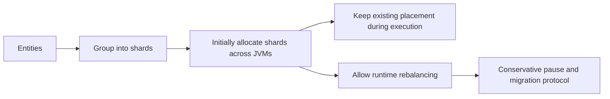

# Load distribution, rebalancing, snapshots, and algorithm attribution

Baseline reviewed against commit `eda5a47` on 2026-10-25. This document explains
the strategies and their research provenance; subsequent corrections are recorded
below. Custom balancing remains disabled by default.

For papers applying these algorithm families to mobility, spatial agents, and
discrete-event simulation, see [Applied Load-Balancing Literature](LOAD_BALANCING_LITERATURE.md).
That companion separates application evidence from the foundational references here.

## Fix progress

### Step 1 — migration queue admission and wave sequencing (2026-10-25)

The queue-promotion gap is fixed. A coordinator-promoted plan already owns an
active slot; LoadBalanceManager now enqueues it directly for execution rather than
requesting admission a second time. Active and waiting shard IDs are deduplicated,
non-positive concurrency is rejected, and inactive completion notifications do
not alter bookkeeping or cause an additional resume.

Admitted work arriving during an open migration wave waits until that wave's
restore/window-close barrier finishes. The manager then requests the next safe
boundary without resuming ordinary simulation advancement in between. Final
resume also waits for active migration bookkeeping to finish. Unsolicited
migration-safe notifications cannot overwrite an open wave.

Validation: **7 tests passed** in `ShardMigrationCoordinatorSpec` and
`LoadBalanceManagerMigrationQueueSpec`. The regression first failed on the original
code: the manager resumed after the first wave while the promoted plan was rejected
as already migrating. Coverage includes FIFO promotion after success/failure,
admission limits/deduplication, abort cleanup, three queued waves, new admission
during a wave, duplicate/inactive completions, and late handoff notifications.
The full `sbt test` run also passed: **660 tests in 137 suites** on 2026-10-25.

The actor tests run the real manager on a one-member Pekko cluster with probes
providing Time Manager, handoff, and entity-restore notifications. They establish
queue/phase sequencing, not physical shard relocation or snapshot preservation.
At this step, completion messages still identified shards without attempt correlation;
Step 6 separately adds that correlation and placement evidence. Other review findings remain open and custom balancing remains
disabled by default.

### Step 2 — shard handoff without model destruction (2026-10-25)

The custom allocator path in `ActorCreatorUtil.createShardRegion` was changed to
Pekko's `PoisonPill` as its handoff stop message (extended in Step 3 below).
Relocation stops the source actor without
calling `onDestruct`, completing private-vehicle trips, answering PT unload
barriers, incrementing the model destruction counter, or requesting passivation
again from a shard that is already handing off. Explicit `DestructEvent` retains
the normal model cleanup path. This introduces no new application control message
or serializer registration.

`ShardHandoffLifecycleSpec` exercises the actual factory, allocator, shard
coordinator, entity termination and re-creation on a one-member Pekko cluster.
Its fixtures subclass the real Car and Person and preserve their destruction
handlers, observing emitted effects. It covers an active Car with an owner/trip
and a Person with a boarded-Bus reply identity. After handoff, the existing
`MigrationContextEvent` restore path receives the captured snapshot. Model state
and reply metadata survive; a later explicit destruction still completes the
owner notification or answers the unload barrier.

Both regressions failed before the fix: `DestructEvent` entered model cleanup and
then sent `Passivate` to the already-handing-off shard, where it was unhandled.
Entities did not stop within the test's ten-second bound. After the fix, the two
new tests pass, as do the destruction/passivation and Step 1 regressions: **11
tests in four suites**. The cluster tests serialize their use of JVM-local load
balancing registries so parallel suite execution cannot replace each other's
allocator.
Full `sbt test` also passed: **662 tests in 138 suites** on 2026-10-25.

This is a bounded shard lifecycle scenario, not a full LBM/SnapshotManager
migration wave or a multi-JVM relocation acceptance test. The snapshot is supplied
explicitly; Step 3 addresses save readiness and source freezing separately.
Cross-process delivery remains unvalidated. Snapshot comparison normalizes the existing restore hook's Lamport
clock merge; exact clock restoration is outside this correction. No optimistic
migration support or independent recovery is established by this test.

### Step 3 — acknowledged snapshot preparation and source freezing (2026-10-25)

The source-to-stop lost-update window (Gap C) and the timed save-readiness guess
are corrected for the controlled conservative migration path. The protocol now
uses the following barriers:

| Phase | Required evidence before advancing |
|---|---|
| Register | SnapshotManager acknowledges the batch ID, expected entity set, and controller registration. Sources are notified only after this ACK. |
| Save | Every expected source captures its immutable snapshot and freezes ordinary incoming messages. SnapshotManager acknowledges readiness only after storing every distinct expected entity. |
| Open | Every expected cluster node acknowledges the migration window. Only then may the allocator request actual handoff. |
| Final cut | At actual handoff each source drains its retained input in order and sends a final snapshot. It stops only after SnapshotManager acknowledges that final revision. |
| Restore | Every expected entity confirms application; Step 4 makes SnapshotManager validate that confirmation before notifying the controller. |
| Close | Every expected node acknowledges window closure; queue/handoff bookkeeping must also finish before simulation resume. |

There is no save-delay timer. A duplicate prepare resends the original captured
snapshot, and identical duplicate saves do not count twice. Unregistered,
foreign, mismatched, or conflicting saves and conflicting/overlapping batch
registrations are rejected. The controller ignores stale, duplicate, or premature
ACKs that do not match its current batch, phase, and expected membership.

Source freezing happens at `BaseActor.aroundReceive`, outside the subclass's
normal receive logic. It retains messages and original senders rather than
mutating model state after initial capture. The factory now uses
`MigrationHandoffStopEvent` instead of `PoisonPill`: once Pekko has entered handoff
and the region is buffering the shard, the source drains retained inputs locally
with their original senders. It then captures and saves a **final** snapshot and
waits for its correlated save ACK before stopping directly. The initial snapshot
is a preparation checkpoint; the final snapshot includes the applied source tail.

Returning earlier frozen inputs to the region would risk putting them behind
newer inputs that the region already buffered. Local draining includes those
earlier effects in the final state instead. A late accepted input while the save
ACK is outstanding requires another drain and final revision before stop. Stale
or duplicate ACKs cannot skip that drain or replace a newer revision. Target-side
migration initialization continues to stash ordinary input until restore. Modeled
sends must continue to use sharded transport; this does not make stale direct
actor references safe after handoff.

A preparation failure stops the simulation instead of authorizing handoff or
resume. Missing storage, missing source routes, and capture exceptions are
explicit failures. Frozen sources receive a correlated abort so ordinary
shutdown can proceed. This abort is for a stopping run; it does not implement
recovery and resumption from a partially prepared batch. No timeout grants
permission to proceed with missing state or ACKs. The old window-open delay
setting and internal timer message have been removed; the existing ACK-timeout
settings remain unused and are now described accurately in configuration.

At final handoff, region-routed aborts would themselves be buffered. A source
whose final capture/save fails therefore reports the failure and stops directly.
SnapshotManager rejects a target query for a registered entity until its final
cut exists, retaining the preparation checkpoint without returning it as a valid
restore. It notifies both target and controller; an awaiting target stops. This
also prevents Pekko's own forced handoff termination from authorizing an initial,
stale checkpoint when the source did not finish saving. An active-window target
without a SnapshotManager proxy also stops rather than performing normal init.

Validation covers the save set and rejection paths, ordered controller phases,
failure without resume, independent codecs for the new control messages, and a
bounded real Pekko shard handoff that preserves frozen inputs' original sender,
waits for the final save ACK, and restores the resulting state on the replacement
actor without applying the retained effects twice. Initial/final capture failure,
premature target query, final revision validation, and correlated abort are also
exercised. The Car/Person lifecycle regressions from Step 2
continue to cover explicit restore and subsequent legitimate destruction.

Focused validation: **27 tests in five suites passed** on 2026-10-25:

```bash
sbt 'testOnly *SnapshotManagerPreparationSpec *LoadBalanceManagerMigrationQueueSpec *IndependentRuntimeCodecSpec *ShardHandoffLifecycleSpec *ShardMigrationCoordinatorSpec'
```

Final full regression: **676 tests in 139 suites passed** with `sbt test` on
2026-10-25. `git diff --check` also passes.

The protocol serializes the source state at preparation and again at final cut;
late accepted inputs can require additional final revisions. Retained-input
memory grows with the frozen tail, and SnapshotManager still handles saves in a
single actor. No migration throughput, pause-duration, or heap-bound claim is
established by these correctness tests.

Scope: the save ACK establishes acceptance into SnapshotManager's **in-memory**
map, not durable storage. The source buffer is transient transport state and has
no independent-restart guarantee or hard memory bound. The handoff fixture uses
one cluster member; its input-forwarding case leaves the JVM-wide migration flag
off to avoid affecting unrelated suites and supplies the final restore context
explicitly. Step 4 subsequently connects the Car/Person cases to the real store.
This is not a full multi-JVM migration acceptance
result. Complete distributed membership, allocator installation, target selection,
restore retention (addressed separately in Step 4), and failure recovery remain separate concerns. Custom rebalancing
remains disabled by default, and accounted conservative/Time Warp migration is
not enabled by this correction.

### Step 4 — snapshot retention until confirmed target application (2026-10-25)

`SnapshotManager.handleQueryMigration` previously removed state when sending a
restore response. It now retains the final snapshot and binds an offer to the
target ActorRef, batch, random restore token, and final snapshot revision. A
repeated query from that same target returns the same offer. A competing target
cannot replace it. Once offered, a newer final snapshot revision is rejected
rather than silently changing the state that the target is confirming.

The target applies model state and runtime references, performs its existing
registration/initialization steps, and runs `onMigrationRestore` **before** sending
`MigrationRestoredAckEvent` to SnapshotManager. Previously that ACK went directly
to LoadBalanceManager before the callback ran. A duplicate context with the same
confirmation identity resends the ACK without reapplying the snapshot, resetting
subsequent model changes, or repeating the callback. A decode, validation, or
restore-hook failure reports failure and stops the target; there is no success
ACK or fresh-initialization fallback.

SnapshotManager releases the full snapshot only after checking the target's
sender ActorRef, entity, batch, token, revision, and nonfailed offer. It then sends
`MigrationRestoreAcceptedEvent` to LoadBalanceManager. The controller's window
close barrier counts these store acceptance notifications and ignores raw target
ACKs. A batch remains active until every expected target has confirmed. Stale,
foreign, and mismatched confirmations cannot release state. A valid failure marks
the offer failed and retains its snapshot; a later success ACK cannot override it.

The store keeps a lightweight receipt for the latest completed migration of each
entity until simulation shutdown. A duplicate query from that completed target
gets `MigrationRestoreAlreadyAcceptedEvent`, never `NoPendingMigrationEvent`.
Duplicate queries/ACKs can resend the store's acceptance notification to the
controller; its existing batch/phase/entity checks make that notification
idempotent. The latest completed target's query also cannot take the next
batch's offer. A different incarnation querying completed state is rejected:
retaining a snapshot does not authorize independent actor restart or re-execution
of possibly emitted restore effects.

The codec regression exposed an existing missing serializer binding for
`MigrationContextEvent`: it fell back to disabled Java serialization. It now has
an explicit Jackson CBOR binding. The independent-codec test covers the new
confirmation fields, runtime ActorRefs, and a nonempty reporter map. All nodes
must use the same executable/configuration; legacy uncorrelated restore contexts
do not authorize a successful confirmation.

The confirmation is application-level evidence that synchronous restore and its
hook returned successfully. It does not establish durable storage, successful
receipt of every external effect emitted by a hook, coordinated failure recovery,
or multi-JVM migration acceptance. The active store and receipts remain singleton
memory. Receipt space grows with the number of distinct migrated entities, rather
than retaining every full snapshot or migration attempt. Process-wide migration
flags and distributed membership/allocator ownership still require their separate
acceptance work. Custom rebalancing remains disabled by default; the accounted
conservative and optimistic runtime migration boundaries remain unchanged.

Validation covers repeated queries, retention before confirmation, invalid
confirmation identities/senders, partial batches, competing targets, failed
offers, successive migrations, immutable offered revisions, duplicate target
contexts, restore-hook/decode failures, controller rejection of raw target ACKs,
and independent codecs for the new confirmation controls. The bounded real
single-member Car/Person shard handoff fixtures now query the real SnapshotManager
and complete its confirmation path. They still leave the JVM-wide migration flag
off for parallel-suite isolation and explicitly initiate the target query; this
does not establish the complete distributed window/startup protocol.

Validation on 2026-10-25: **32 focused tests in six suites passed**, followed by
**686 tests in 141 suites** with `sbt test`. `git diff --check` also passes.

```bash
sbt 'testOnly *SnapshotManagerPreparationSpec *SnapshotManagerRestoreSpec *MigrationRestoreProtocolSpec *LoadBalanceManagerMigrationQueueSpec *ShardHandoffLifecycleSpec *IndependentRuntimeCodecSpec'
```

### Step 5 — enforce the planned destination per physical shard type (2026-10-25)

`triggerPekkoHandoff` previously selected the first indexed region containing any
shards. It now resolves `MigrationPlan.targetNode` for every physical actor type
represented in the logical shard. Preflight occurs after the Time Manager pause
and before source preparation: source and target must be Up members, entity/class
membership must be known, each type must have exactly one observed source owner
at `sourceNode`, and exactly one registered target region at `targetNode`.
An idle target region is eligible. A source equal to the target, missing or
ambiguous ownership/registration, or a logical group containing pinned
infrastructure causes the run to stop. Static-only plans retain their existing
skip behavior; mixed infrastructure migration is rejected.

Preflight records the concrete region references. After the window-open ACKs,
the manager resolves them again and verifies that they still match before
requesting handoff. The allocator honors an explicit destination even when
least-shards placement would prefer another region. If that destination is
absent from a later allocation callback, allocation fails rather than selecting
an alternative node. Unplanned initial allocations retain the fallback heuristic.

Pekko shard IDs are scoped by actor type. The factory now installs
`root.forType(typeName)` rather than sharing one allocator's command maps between
all shard coordinators. Each child owns its desired destinations, pending
requests, and callback-derived region index, so a Bus callback cannot consume a
Car request with the same shard ID. Dynamic logical groups spanning multiple
physical types resolve every type before source preparation. Clearing the root
clears child state while preserving the child instances already held by Pekko.

The region index is replaced atomically by each complete callback snapshot;
regions absent from that snapshot no longer linger as destination candidates.
Idle regions remain present with empty shard sets. The factory records the full
cluster address of each local region so local-scope ActorRefs can be resolved
without confusing ActorSystems in the same JVM. Requests skipped because Pekko
already reports their shard in progress remain pending for the next callback.

Validation includes allocator tests for strict targets, unplanned fallback,
idle/local-address resolution, stale-region removal, type isolation, cancellation,
in-progress requests, and ambiguous targets. A bounded real two-member cluster
test runs the production manager, allocator, factory, shard coordinator, source
final-save barrier, SnapshotManager restore, and store confirmation path. The
shard starts on the source and the selected target has no shards. Its live actor
moves to the requested member with its value **23** preserved; region-state
queries prove source absence and target ownership. Negative manager cases cover
an unavailable type-specific target and pinned/multiple-type membership.

Test scope: the two ActorSystems share one JVM and its allocator registry. The
fixture explicitly supplies the conservative pause response, both node window
ACKs, and the target query while leaving the JVM-wide migration flag off for
parallel-suite isolation. Both regions start before loading the first entity so
Pekko's replicated coordinator can obtain its initial quorum. This is evidence
for destination selection and real cluster relocation, not separate-process
allocator authority or the complete distributed startup/window protocol.

Remaining work includes distributed allocator installation/ownership and complete
membership discovery. A target disappearing after handoff begins can fail
allocation; no node-loss recovery or automatic alternate destination is provided.
At completion of Step 5, the migration monitor still treated consumed requests
and its retry limit as completion. Step 6 replaces those notifications with
observed placement and accepted-restore evidence. Custom rebalancing remains
disabled by default; accounted conservative and optimistic migration remain
outside this path.

Validation on 2026-10-25: **47 focused tests in nine suites passed**, followed by
full `sbt test`: **696 tests in 143 suites passed**. The final relocation case also
checks that repeated source-node ACKs cannot replace the target-node ACK at
either window barrier. `git diff --check` passes.

```bash
sbt 'testOnly *LoadBalanceShardAllocatorSpec *ShardMigrationDestinationSpec *LoadBalanceManagerMigrationQueueSpec *ShardHandoffLifecycleSpec *SnapshotManagerPreparationSpec *SnapshotManagerRestoreSpec *MigrationRestoreProtocolSpec *IndependentRuntimeCodecSpec *ShardMigrationCoordinatorSpec'
```

### Step 6 — observed placement, accepted restore, and correlated completion (2026-10-25)

The old `monitorMigrationCompletion` checked whether Pekko had consumed an
allocator request, then emitted success. After 20 checks it emitted success even
if that request remained pending. `handleMigrationComplete` identified only a
shard ID, allowing a delayed notification from an earlier move to release a slot
reserved for a later move of that shard. These paths have been removed.

Each handoff now creates a fresh attempt UUID tied to its migration batch. The
preflight destination record includes both the physical source and target region
ActorRefs for each actor type. A monitor round queries those exact regions with
Pekko's `GetShardRegionState`. The round qualifies only when **every** represented
type reports its shard absent from the source and present at the planned target,
with no failed shard-state collection in either response. Missing target shards,
source ownership still present, partial responses, unexpected replies, and query
failures do not establish arrival. Evidence is joined within a single round;
positive results from different rounds cannot accumulate into success.

Queries run asynchronously and return their result through `pipeTo(self)`.
Mutable attempt state, queue promotion, counters, and window transitions change
only on the manager's actor thread. Each attempt has at most one observation
round in flight. Even if one query fails immediately, that round waits for the
other queries to return or fail before starting another. Incomplete rounds poll
again after 500 ms. The five-second per-query timeout only makes evidence
incomplete; there is **no retry limit or elapsed-time grant of success**.

An attempt may complete only after observed placement **and** SnapshotManager's
accepted restore confirmations for all expected entities in that logical shard.
The entity set is captured for the wave rather than reread when an ACK arrives.
The manager emits an internal `MigrationCompleteEvent` containing batch and
attempt IDs. Its receiver checks those identities, verified/queued state, and
the self sender before retiring admission and updating statistics. Unknown,
uncorrelated, duplicate, and stale completions cannot finish another attempt.
Local poll/results also carry the batch, attempt, and observation round.

The distributed window closes only after every planned logical shard has passed
that completion gate and every expected restore is accepted. Queue promotion
still reserves admitted work, which waits for the current window's close ACKs
before requesting the next safe boundary. Normal simulation resume remains
behind all those barriers. Failure/shutdown cancels pending polls and ignores
in-flight results; shutdown no longer reports normal migration completion.
Prepared sources receive their correlated abort before shutdown clears routing
metadata. Static-only plans retain their explicit skip path with correlated
bookkeeping; a skip is not reported in logs as observed physical movement.

Validation covers placement before restore and restore before placement, failed
and partial queries, source presence, missing targets, no overlapping rounds
after one failed query, every physical type, cross-round evidence isolation,
repeat moves of one shard with stale attempt/batch/round messages, forged or
legacy completions, queue sequencing, failure/shutdown, and static skip behavior.
The completion fields round-trip through independent codecs. The real two-member
relocation fixture now uses this monitor as well as source final-save and store
restore confirmation; actual source/target region-state assertions still verify
the move and preserved value 23.

Scope remains the controlled conservative migration path. The two-member fixture
shares one JVM/allocator registry and supplies pause/window ACKs and the target
query explicitly. Separate-process allocator authority, complete distributed
membership, and coordinated restart/node-loss recovery remain unvalidated.
An unreachable region can leave placement unverified until the run is stopped;
the monitor does not reconstruct ownership or choose a substitute destination.
Observations are evidence from a round, not a fault-tolerant ownership lease.
No performance or pause-duration claim follows from these tests: monitoring
adds two queries per physical type per round, and its handoff-to-confirmation
duration excludes earlier preparation. Legacy coordinator averages include
admission wait and static skip bookkeeping. Custom rebalancing remains disabled;
accounted conservative/optimistic migration support is unchanged.

Validation on 2026-10-25: **53 focused tests in nine suites passed**, followed by
full `sbt test`: **702 tests in 143 suites passed**. `git diff --check` passes.

```bash
sbt 'testOnly *LoadBalanceShardAllocatorSpec *ShardMigrationDestinationSpec *LoadBalanceManagerMigrationQueueSpec *ShardHandoffLifecycleSpec *SnapshotManagerPreparationSpec *SnapshotManagerRestoreSpec *MigrationRestoreProtocolSpec *IndependentRuntimeCodecSpec *ShardMigrationCoordinatorSpec'
```

### Step 7 — allocation authority and region registration across JVMs (2026-10-25)

The enabled factory path now installs a per-type `RemoteShardAllocator` on every
JVM before region creation, independently of the LoadBalanceManager's location
or startup order. An ActorSystem extension starts an allocation-authority
singleton/proxy and a node client. Region registration carries the actual region
ActorRef, canonical address, and client incarnation. Acknowledgement gates
successful callbacks; a not-yet-registered callback fails explicitly and can be
retried by Pekko. It does not select a worker-local fallback. Disabled custom
balancing retains the previous path and the extension remains passive.

The authority owns registrations, callback-derived allocations, retained
placement intents for the current run, and controller binding. Allocation and
rebalance callbacks reach it through actor messages from whichever JVM actually
hosts the shard coordinator. There is no authoritative allocator object copied
into each worker. Repeated rebalance replies do not consume an intent, so loss of
one reply cannot discard the command. Already-arrived and in-progress shards are
excluded. Explicit placements stay strict; only unplanned initial allocations
use least-shards placement.

The controller binds its incarnation to an authority epoch before announcing
readiness. Source/target preflight becomes an asynchronous request. One authority
operation installs all physical types of a logical move atomically; its ACK
precedes monitoring. After placement and store-accepted restoration, correlated
retirement ACK precedes admission completion and window closure. Actor-thread
handlers own state changes. Callback sequence numbers reject stale index updates;
changed authority epochs, callback owners, region identities, or controllers fail
closed rather than silently resetting a run. This is a stable-membership,
single-run protocol; it adds no independent restart/failover recovery.

Separate-process validation reproduced an additional idle-entity gap: physical
handoff with no buffered input did not recreate the entity, leaving restore ACKs
pending forever. In the enabled distributed path, fresh placement evidence now
causes the controller to send native `StartEntity` requests for its known target
cohort. Native start ACKs are consumed and cannot count as restored state. The
real JVM-local window flag causes target startup to query SnapshotManager
automatically. The window subscriber creates its proxy without a blocking actor
lookup, and ordinary cluster-member transitions no longer restart the bound
controller through an unhandled MatchError.

The [design contract](DISTRIBUTED_ALLOCATION_DESIGN.md) and
[separate-JVM validation record](DISTRIBUTED_ALLOCATION_VALIDATION_2026_10_25.md)
describe the exchanges and reproduction. The accepted fixture places the
production controller actor in one process and the active Pekko coordinator in
another. Both use independent registries, with `ShardAllocatorRegistry` absent;
the actor reaches the requested JVM with value 23 preserved and both migration
windows closed. Unit/codec coverage includes registration readiness, stale
callback sequences, repeated callbacks, strict placement, atomic installation,
idempotent/stale retirement, epoch/owner replacement, and disabled startup.

Scope: the fixture pins a production controller actor rather than testing its
singleton election, supplies the conservative safe-boundary response with a
TestProbe, and uses hash routing with controller-provided entity membership.
The worker's spatial registry is empty. It validates allocation ownership and
registration over independent JVMs; it does not establish full traffic migration,
distributed spatial assignments/live cohort discovery, progressive enrollment,
node-loss recovery, repeated runs, or accounted conservative/optimistic migration.
Callback matrices cross the authority once per native callback; no throughput or
pause-latency claim is made. Custom balancing remains disabled by default.

Validation on 2026-10-25: **63 focused tests in ten suites** and full `sbt test`
with **712 tests in 144 suites** pass. The final separate-JVM launch in
`/tmp/htc-allocation-authority-20261025-3/` passes with a content-hashed, unchanged
classpath and zero engine errors in both pre-teardown execution logs. The
[validation record](DISTRIBUTED_ALLOCATION_VALIDATION_2026_10_25.md) preserves
scope, commands, addresses, hashes, rejected evidence, and remaining gaps.
`git diff --check` and Python launcher compilation also pass.

### Step 8 — spatial membership invariants and shared classification (2026-10-25)

Normal quadtree registration now populates leaf membership and retains actual
coordinates. Re-registration, movement within/across leaves, and removal update
both leaf sets and lookup maps. Density refinement recursively distributes entities
by their coordinates, merges sparse siblings, and rebuilds entity/shard indexes.
Balancing splits preserve entities and each pass observes its current topology;
the former stale-root recursion could fail to converge. Neighbor detection uses
shared edges/corners and compares complete shard IDs. Depth is now part of
`qt-shard-{depth}-{mortonCode}`, preventing collisions between paths with leading
zero quadrants. This changes the dormant custom spatial ID format; no recovery
compatibility with old assignments is claimed. Invalid coordinates and tree
configurations are rejected before a registration is changed.
The component retains a coordinate tuple and leaf membership per entity, and
explicit refinement rebuilds its indexes. No city-scale memory or runtime claim
is established by these bounded correctness tests.

Hybrid, GeoAffinity, and LoadBalanceManager now share one class-based classifier.
The final class-name component determines infrastructure status; package names and
opaque numeric IDs cannot override supplied metadata. Null/blank metadata retains
the legacy ID fallback, including `rail_link`. GeoAffinity counts actual prefixed
memberships separately, so co-located infrastructure and vehicles no longer each
inherit the whole region's count. Repeated registrations are deduplicated and
strategy reinitialization clears membership/classification.

Registration validation errors use the manager's existing fatal-stop path rather
than escaping to actor supervision, which would erase previously published
assignments on restart. A failed batch publishes no partial assignment response;
the Time Manager and SimulationManager receive stop requests and later registration
messages cannot advance the failed run. Tests cover both single and batch requests.

Protocol review: successful creation registration requires its existing correlated
assignment response; it is independent of model spontaneous-event completion.
Invalid registration aborts the run and cannot be acknowledged as a successful
assignment or cause normal resume. No new reply wait, model interaction, scheduling
control, or timeout recovery was introduced. The existing CreatorLoadData fallback
timer and complete distributed creation/abort acceptance remain outside this step.

**Topology integration remains gated.** Once registration replies have exposed
shard IDs to the creation pipeline, `evaluate()` must preserve them. Its previous
refinement calls would silently invalidate routing as soon as leaf population
started working. Those calls are removed. The repaired refinement component is
tested independently; at Step 8 the strategies retained their initial root topology
(one geographic shard for Hybrid, separate static/dynamic namespaces for
GeoAffinity). Step 10 replaces that initial root with a configured fixed grid
and stable overflow buckets. This does not establish useful adaptive geographic partitioning or
spatial load distribution at scale. A coordinated initial-partition publication
and live membership directory across every routing JVM are prerequisites for
enabling refinement in the production path. `enableTwoToOneBalance` does not
authorize live directory changes.

Validation on 2026-10-25: **31 focused tests in three suites** and full `sbt test`
with **732 tests in 146 suites** pass. The first regression run failed **13 of
14 tests** against the previous implementation. Final coverage adds repeated
insert/move/remove/refine/balance operations with a fixed seed, deterministic
boundary handling, coincident points/depth limits, invalid configurations,
membership replacement/reinitialization, namespace counts, class-metadata
precedence, stable published IDs across evaluations, and fatal single/batch
registration rejection. The existing migration-wave actor cases also pass.
`git diff --check` passes. This is component and actor-protocol evidence; no new
separate-JVM spatial-directory or full traffic-migration acceptance is claimed.

```bash
sbt 'testOnly *QuadtreePartitionerSpec *SpatialStrategySpec *LoadBalanceManagerMigrationQueueSpec'
sbt test
```

### Step 9 — acknowledged spatial directory publication (2026-10-25)

The enabled factory now starts a directory authority and per-JVM replicas before
region creation. LoadBalanceManager retains each registration response until all
Up routing JVMs have installed its typed assignments. Publications have an authority
epoch, consecutive revisions, request identities and replica incarnations. Replica
hydration gates readiness; partial, stale or wrong-sender ACKs cannot count as a
complete publication. Duplicate receipts retain their original revision. Registry
installs validate the complete batch before swapping the local immutable snapshot.

Enabled envelope and native `StartEntity` routing require a published entity/type
row. CreatorLoadData verifies its current batch/chunk before writing registries,
checks the exact returned cohort against the directory, and no longer creates
hash-routed actors when the old assignment timer expires. Enabled proxy creation
is nonblocking. Invalid replies/publications abort instead of restarting with lost
creation state or claiming success. Future completions re-enter the manager through
actor messages. Enrollment cannot overlap migration preparation. Default-disabled
behavior is retained.

The [directory contract](DISTRIBUTED_SPATIAL_DIRECTORY.md) describes ownership,
ACK obligations, atomic installation and failure handling. The first publication
fixes cluster membership; later joins, replica replacement, authority loss and
epoch changes fail closed. There is no independent failover/restart recovery.
The directory records immutable **creation assignments**. It distributes the
membership previously visible only to individual creators, but does not establish
a live initialized/retired actor roster. Lifecycle-aware cohort closure, progressive
enrollment, adaptive partition publication, full traffic migration, and accounted
runtime migration remain open. Every JVM retains all rows and coordinates; scale
and publication-barrier costs remain unmeasured. Custom balancing remains disabled.

Validation on 2026-10-25: **34 focused tests in four suites** and full `sbt test`:
**745 tests in 147 suites** pass. Independent JVMs accept a production GeoAffinity
assignment before creation, move `dynamic-qt-shard-0-0` to the requested worker,
restore value 23, route from both JVMs to the same restored actor, and close both
migration windows. An explicit published-hash regression also passes. Both runs
retain an unchanged content-hashed classpath and zero engine errors in captured
pre-teardown logs. See the [validation record](DISTRIBUTED_SPATIAL_VALIDATION_2026_10_25.md)
and [machine-readable results](validation/spatial-directory-2026-10-25.json).
Python launcher compilation and `git diff --check` pass. The fixture supplies the
pause response and a fixed counter cohort; it does not establish lifecycle-aware
membership, the full CreatorLoadData pipeline, or traffic migration.

### Step 10 — production conservative ownership, live metrics and traffic acceptance (2026-10-26)

The enabled path now runs through the production ChannelClosed GTM and its
ChannelAware owners. A correlated request waits for a closed causal batch, all
accepted input/birth initialization and committed terminal retirement. Owners
freeze the selected **live** LPs and return their physical identities; retired
creation-directory entries do not become snapshot obligations. A request during
the first progressive window waits for input acceptance. A terminal cut declines
late requests explicitly; the balancer clears those plans without reporting a
move or asking a finalizing runtime to resume.

A saved conservative frame includes the ordered accepted input queue, runtime
epoch/incarnation, owner/coordinator/source paths, finish/schedule generations,
lifecycle and horizon metadata. The logical owner keeps its schedule handle and
ledgers. It authorizes source termination and rebinds the planned physical
replacement before SnapshotManager can accept restore. All owner resume ACKs are
required; queued waves can arrive during resume, and manual pause remains intact.
Unexpected source loss before authorization is fatal. The manager sends its real
actor identity in the pause request rather than its singleton proxy.

The creation path waits for directory publication on all fixed routing JVMs.
This also covers station-created Bus/Subway actors before native creation.
Coordinate extraction accepts numeric/string node references and Person plans;
retained published node coordinates survive temporary cache clearing. Nonspatial
actors use the configured world center. SimulationManager waits for allocator
readiness and gives LBM the GTM proxy, not the singleton-manager container. The
enabled factory avoids unpublished warm-up dummy entities. Singleton proxies no
longer perform a blocking lookup of a freshly generated unique name.

Metrics now discover every registered physical region across all routing JVMs.
Complete observations replace prior locations and live counts on the manager
thread; partial/failed, membership-changing, stale or contradictory rounds are
discarded. Idle nodes participate with zero load. The planner is deterministic,
keeps observed ownership unchanged during evaluation, pins infrastructure, and
updates projected loads across strictly beneficial whole-shard moves. Count
weights remain a workload proxy, not measured CPU consumption.

Spatial strategies initialize a fixed grid before publication (default depth 2)
and append stable capacity buckets rather than rewriting existing entity IDs.
TypeAware deduplicates registrations, clears state on reinitialization and pins
infrastructure too. A shared startup reader rejects invalid strategy parameters, unusable world
bounds and nonpositive metrics intervals before any native regions are created;
SimulationManager consumes the same validated values. Custom Time Warp startup is rejected. CLI shard-startup failures
now stop metrics and terminate the ActorSystem rather than leaving an idle JVM.

The acceptance campaign includes actual eager/progressive CreatorLoadData,
production GTM/LTMs, native handoff, SnapshotManager and report sinks over
independent JVMs. The two-cohort fixture enrolls its second group at tick 10050
while the first group is travelling on long MESO roads. Acceptance requires actual
restore offers for Cars whose reported road interval contains the migration cut,
complete planned trips/distances, zero runtime errors and whole-report parity.
A passing report comparison alone cannot accept a failed runtime. The harness
separates runtime completion from reporter flushing during an abort and records
whether the executable changed during the run.

See [the retained campaign](DISTRIBUTED_LOAD_BALANCING_VALIDATION_2026_10_26.md)
for exact scope, commands, input/executable hashes, accepted cases and rejected
evidence. Default custom balancing remains **disabled**. Independent recovery,
changing routing membership, optimistic migration and live geometric
repartitioning remain separate protocols; city-scale costs and performance
benefits are not established by this engineering acceptance.

## Distribution and rebalancing are separate choices

HTC can execute a simulation across multiple JVMs without relocating existing
actors during execution. Distribution assigns entities to shards and shards to
cluster nodes. Runtime rebalancing changes the node hosting an existing shard.

The two execution choices are:

| Choice | Placement of existing entities | Runtime migration protocol |
|---|---|---|
| Distributed execution without rebalancing | Retained throughout normal execution | Not needed for performance-driven relocation |
| Distributed execution with rebalancing | Whole shards may move between nodes | Required to preserve state and resume execution |

Without rebalancing, newly loaded or model-created entities can still receive
their first allocation. Progressive input therefore does not itself imply
rebalancing. Moving a simulated vehicle between road Links also does not imply
moving its actor between JVMs. Recovery after worker failure is a separate concern;
fixed placement does not establish restart or failure-recovery support.

Three decisions should be described separately in experiments:

1. **Entity grouping:** which entities share a shard (hash, geographic region, or
   actor type).
2. **Initial node allocation:** which JVM receives each shard.
3. **Runtime rebalancing policy:** whether and when existing shards may move.

These are architectural dimensions, not three independently implemented settings
in the current configuration. In particular, custom strategies combine grouping
and migration planning. The enabled allocation authority retains one physical node for all actor types
sharing a logical shard. First allocation selects an eligible region using the
observed physical shard counts; a retained logical destination cannot silently
fall back to another node. Geographic grouping alone does not establish
geographic node placement.



The shipped configuration sets `htc.load-balance-manager.enabled = false` and
retains Pekko's distributed sharding. Its `rebalance-threshold = 100000` is intended
to suppress routine framework rebalancing. This large threshold is not a universal
prohibition against every possible framework relocation. Experimental claims of
"no rebalancing" should identify the effective configuration and cluster membership
conditions, and verify that no relocation occurred.

There are also two meanings of "disabled": disabling the LoadBalanceManager
entirely, and selecting `Disabled` inside an enabled manager. Neither means
single-JVM execution. `StrategyFactory` returns `None` for the latter; an enabled
manager still performs its startup/allocator registration.

Source: [configuration](../src/main/resources/application.conf),
[strategy factory](../src/main/scala/core/actor/manager/loadbalance/strategy/StrategyFactory.scala),
[shard creation](../src/main/scala/core/util/ActorCreatorUtil.scala), and
[allocator](../src/main/scala/core/actor/manager/loadbalance/allocation/LoadBalanceShardAllocator.scala).

## Scope of synchronization

The supported migration adapter targets the production conservative factory:
`ConservativeGlobalTimeManager.props` creates `ChannelClosedGlobalTimeManager`
and `ChannelAwareLocalTimeManager` workers. The GTM closes the current causal
batch, then each owner retires committed terminals, freezes selected live LPs and
acknowledges their identities and physical refs. Directory entries are routing
metadata; they do not establish that an actor is still alive.

SnapshotManager's registration, save, window-open, final-save, target-apply and
window-close barriers remain required. A conservative checkpoint also carries the
accepted ordered input queue, run/LP identity, owner/coordinator paths, scheduling
revision/generation and lifecycle/horizon metadata. Physical placement can change;
the logical runtime owner and its schedule handle remain fixed. That owner
authorizes source termination and validates the replacement before accepting its
new ActorRef. The target acknowledges restore only after owner rebind.

Every owner must acknowledge resume before further model execution. Queued waves
refreeze without advancing the model, and a user's manual pause stays effective.
Unexpected source loss before authorized handoff, an unplanned target, a changed
incarnation or an incomplete barrier fails the run. Timeouts cannot establish
successful migration.

Custom balancing rejects Time Warp at startup. Independent JVM restart,
controller failover and changing cluster membership require a separate recovery
protocol. Distributed optimistic execution with fixed placement is documented in
[Distributed Optimistic Runtime](DISTRIBUTED_OPTIMISTIC_RUNTIME.md).

Source: [production coordinator](../src/main/scala/core/actor/manager/time/ChannelClosedGlobalTimeManager.scala),
[runtime owner](../src/main/scala/core/actor/manager/time/ChannelAwareLocalTimeManager.scala),
[LoadBalanceManager](../src/main/scala/core/actor/manager/loadbalance/LoadBalanceManager.scala), and
[window subscriber](../src/main/scala/core/actor/manager/loadbalance/migration/MigrationWindowSubscriber.scala).

## Strategy overview

| Selection | Entity grouping | HTC-generated runtime migration plans | Attribution |
|---|---|---|---|
| `Disabled` | Normal routing fallback when no custom assignment exists | None | Configuration choice; cite Pekko for sharding |
| `Default` | Entity-ID hash buckets | None (`evaluate()` returns `Nil`) | Framework baseline, with HTC's extractor/wrapper |
| `Hybrid` | Fixed initial geographic grid with stable capacity buckets | Projected-load planning and optional overload prediction | HTC composition; published foundations below |
| `GeoAffinity` | Geographic grouping with separate static/dynamic namespaces | Hybrid planning with load/locality target scoring | HTC composition and scoring heuristic; foundations below |
| `TypeAware` | Sequential buckets per actor class | Projected-load planning and optional overload prediction | HTC grouping heuristic using shared balancing components |

These migration-plan entries describe the strategy layer. LoadBalanceManager and
the allocator must still execute each plan; a generated plan is not evidence of a
completed or correct relocation.

### Disabled

This removes custom balancing decisions while leaving cluster sharding available.
The normal extractor hashes entity IDs when no spatial/type assignment has been
registered. Pekko allocates shards across eligible regions. Whether framework
rebalancing occurs depends on its configuration and cluster events.

There is no separate research algorithm called HTC Disabled. Attribute the
distributed sharding mechanism to Apache Pekko [R1], and record HTC's configuration.

### Default

`DefaultStrategy.assignShard` computes the entity identifier's hash modulo 1000.
It does not inspect geography, vehicle motion, or actor type, and its evaluation
method generates no migration plans. Hashing aims to spread entity identifiers
across buckets; it does not directly equalize actor execution cost.

The strategy's intent is framework-style allocation. An enabled LoadBalanceManager
can register HTC's custom allocator, whose fallback is least-shard allocation and
whose rebalance method returns only explicitly requested moves. Consequently,
"Default strategy" and "manager disabled" should be recorded separately even
when both experiments have no custom runtime rebalancing.

For example, a car and a distant node may share a hash bucket without sharing any
geographic relationship. Shards are scoped to their Pekko actor-type region; equal
shard-ID strings across actor types do not imply a single physical shard.

Use Pekko's documentation [R1] as the framework reference. Do not call the current
modulo hash extractor consistent hashing or attribute it to a consistent-hashing
paper.

Source: [DefaultStrategy](../src/main/scala/core/actor/manager/loadbalance/strategy/DefaultStrategy.scala).

### Hybrid

The design combines geographic grouping with load-based migration planning:

1. An empty quadtree is subdivided to `initial-depth` before any assignment is published
   (default 2: sixteen cells). World bounds must cover the scenario.
2. Creation fills capacity buckets within each cell. Overflow appends
   `-bucket-N`; existing entity/shard IDs never change.
3. The shared planner proposes beneficial whole-shard node moves using live counts.
4. Optional prediction prioritizes load approaching a configured threshold.

The standalone partitioner supports split/merge/2:1 refinement, but live geometric
repartitioning is not integrated. `enableTwoToOneBalance` does not authorize a
published directory rewrite. Hybrid pins any bucket containing infrastructure;
GeoAffinity separates static/dynamic namespaces so dynamic actors in the same
cell remain movable. Actor geography at creation determines its grouping;
physical motion does not continuously regroup actors.

The geographic objective is to group nearby entities. The load objective is to
reduce unequal work between nodes. These objectives can conflict: moving a busy
shard may distribute work while increasing remote interaction traffic.

For example, vehicles near a city center are intended to share geographic shards.
If their hosting node becomes comparatively busy, a complete shard may be proposed
for relocation. The current code assigns geographic membership at creation; it
does not continuously regroup a moving vehicle by its changing physical position.

The code's explicit research attribution is Sundar, Sampath, and Biros [R3] for
2:1 refinement inspired by parallel linear octrees and adapted to 2D. Finkel and
Bentley [R2] provide quadtree background; their point-key retrieval structure is
not an exact specification of HTC's midpoint region subdivision. The complete
Hybrid strategy has no identified single source paper in the inspected code.

Source: [HybridStrategy](../src/main/scala/core/actor/manager/loadbalance/strategy/HybridStrategy.scala).

### GeoAffinity

This strategy adds two ideas to the Hybrid design:

- Separate `static-...` and `dynamic-...` shard-ID namespaces, intended to keep
  infrastructure separate from vehicles/persons in the same geographic region.
- A destination score combining lower load and proximity to infrastructure.

For a candidate node `p` and dynamic shard `s`, the code computes:

```text
score(p, s) = (1 - alpha) * (1 - load(p) / totalCandidateLoad)
              + alpha * affinity(p, s)
```

The current node is excluded. `totalCandidateLoad` is bounded below by `1e-10`.
Affinity is `1.0` when the candidate hosts the matching static shard, `0.5` for an
adjacent static shard, and `0.0` otherwise. Default `alpha` is `0.4`.

For example, a vehicle shard can favor a node hosting road infrastructure in its
region even when another candidate is somewhat less loaded. This locality score
is a proxy; it does not measure actual network traffic, graph edge cuts, or latency.
The score selects migration targets; it does not implement a corresponding initial
affinity-aware node-placement phase.

This exact score and namespace arrangement are HTC-specific implementation choices.
They have no identified external source in the inspected code. Cite the inherited
foundations [R2, R3], explain the formula as an HTC heuristic, and cite the HTC
release used. Similarity to locality-aware literature alone does not establish
derivation or novelty.

Source: [GeoAffinityStrategy](../src/main/scala/core/actor/manager/loadbalance/strategy/GeoAffinityStrategy.scala).

### TypeAware

This groups entities by their actor class rather than coordinates. A per-type
counter fills one bucket until `maxEntitiesPerShard`, then opens the next:
`car-shard-0`, `car-shard-1`, `person-shard-0`, and so on. Class metadata is preferred;
legacy ID parsing is a fallback.

With a bucket capacity of 10,000, 25,000 cars produce three buckets containing
10,000, 10,000, and 5,000 registrations. The resulting membership depends on creation
order. Entities in one bucket may be geographically distant.

It uses the shared projected-load planner and optional predictor. Both strategy
and manager pin infrastructure (including transit stops/stations and routing
services). Duplicate entity registration does not consume bucket capacity, and
reinitialization clears memberships and bucket indexes.

Pekko already maintains separate sharding regions per actor class. The specific HTC
addition is sequential, capacity-based bucket assignment and its use in the custom
balancing pipeline. No source paper for this complete rule was identified; describe
it as an HTC heuristic, not as an established named research algorithm.

Source: [TypeAwareStrategy](../src/main/scala/core/actor/manager/loadbalance/strategy/TypeAwareStrategy.scala).

## Shared algorithms and citation boundaries

### Quadtree and Morton-style identifiers

`QuadtreePartitioner` represents explicit branches/leaves and encodes successive
quadrants with `(parentCode << 2) | childIndex`. It is not a complete implementation
of the parallel linear-octree construction in [R3]. That paper supports the stated
refinement inspiration, not inherited scalability or correctness results for HTC.

Historical attribution of Morton ordering is to G. M. Morton, *A Computer Oriented
Geodetic Data Base and a New Technique in File Sequencing*, IBM, 1966. The original
IBM report could not be retrieved during this review. Its historical metadata is
recorded here as pending primary-source verification and is intentionally omitted
from the verified BibTeX set. Morton encoding is also discussed in [R3].

### The component named KdTreeLoadBalancer

The historical class name remains, but the implementation is a deterministic
scalar-load planner. It sorts shards by descending weight and stable ID, then
considers only targets for which `sourceLoad - targetLoad > shardWeight`.
Each accepted projected move strictly decreases the sum of squared node loads.
Projected loads are updated across the plan; idle registered nodes participate
with zero load. Planning does not change observed ownership. Strategies record
new placement only after migration completion or a fresh complete observation.

GeoAffinity scores only these beneficial candidates. Infrastructure stays pinned.
Whole indivisible shards can leave residual imbalance without a beneficial move.
The strategies evaluate ordinary balancing when max/min load exceeds `1.5`;
overload predictions can also initiate evaluation. This is an implementation
threshold, not a value established by the cited papers.

Bentley's k-d-tree paper [R4] is background for the historical name; HTC does not
implement that multidimensional search algorithm. Berger and Bokhari [R5] remain
related work, with no demonstrated derivation. Describe the current code as
**deterministic projected scalar-load planning**, not recursive partitioning or
a k-d tree. No optimality or simulation-speedup result is claimed.

Source: [KdTreeLoadBalancer](../src/main/scala/core/actor/manager/loadbalance/spatial/KdTreeLoadBalancer.scala).

### Prediction

The predictor normalizes shard weight by configured capacity, caps the result at
one, and estimates a time slope using ordinary least squares [R6]. It projects:

```text
predictedLoad = currentLoad + estimatedSlope * predictionWindowSeconds
```

With at least two observations, it identifies shards already at the configured
threshold, or predicted to reach it within the window. Defaults are a threshold of
`0.85`, a 10-second window, and up to 100 samples. These use wall-clock sample time,
not simulation tick time. The strategy prioritizes already-overloaded plans above
predicted overload, then ordinary rebalancing.

Although flow-vector history is retained, the overload decision uses the load
trend. Describe this as linear load extrapolation rather than motion-based traffic
prediction. The built-in collector queries every registered native region on every fixed Up
JVM and supplies live entity counts as weights; it does not measure CPU load.
Partial/failed query rounds, changed membership, stale pre-migration observations
and contradictory physical placement are discarded. Complete snapshots replace
stale metrics and assignments atomically. No external producer of
`UpdateLoadMetricsEvent` was found in the inspected main source tree.

Source: [PredictiveBalancer](../src/main/scala/core/actor/manager/loadbalance/prediction/PredictiveBalancer.scala),
[ShardMetrics](../src/main/scala/core/entity/control/loadbalance/ShardMetrics.scala), and
[metrics collection](../src/main/scala/core/actor/manager/loadbalance/LoadBalanceManager.scala).

## Snapshots and current evidence

Migration snapshots serialize typed model state plus clocks, event order,
relationships, awaited replies, lifecycle intent, and model-specific metadata.
SnapshotManager supplies runtime references during restore. Time Warp also reuses
the capture/restore hooks for local checkpoints, with event replay between full
checkpoints. This reuse does not establish optimistic shard-migration support.

SnapshotManager's active migration store is an in-memory map. The separate Redis
store is not wired into that path. Periodic persistent-actor snapshot saving is
commented out and the default Pekko snapshot-store plugin is empty. Consequently,
these snapshots should not be described as a validated distributed recovery system.
There is no identified research paper for HTC's specific snapshot schema or
migration-window protocol; cite the implementation/release and state its scope.

On 2026-10-25, the focused snapshot and route-serialization run passed **45 tests
in 10 suites**:

```bash
sbt 'testOnly *MigrationSnapshotSpec *LinkWaitMigrationSnapshotSpec *JsonUtilMovableRouteRoundTripSpec *JsonUtilBusSubwayRouteRoundTripSpec'
```

These tests establish the tested capture/restore and serialization cases, not
end-to-end distributed migration. Before migration results can be claimed, the
at that milestone, remaining gaps included full traffic acceptance and
incomplete distributed membership, metrics, and recovery. Step 10 implements the
production conservative membership/metrics path and records real traffic
acceptance separately. Independent recovery remains unsupported. Steps 1–7 above
correct queue promotion, model destruction at handoff, and the snapshot
readiness/source-freeze, acknowledged restore-retention, and planned-destination
and observed-completion protocols within their stated test scope.
Step 8 repairs quadtree population/refinement and unifies class-based classification,
while explicitly gating live topology changes on coordinated assignment publication.
See [Known Gaps](KNOWN_GAPS.md#shard-migration-silently-drops-actor-local-reply-state-currently-latent--migration-is-disabled)
for the history of the snapshot-to-stop lost-update window.

### Source-level findings retained from the review

These are findings about the dormant custom balancing/migration path at the
reviewed revision. They are not observed failures in the shipped no-custom-
balancing configuration. The 45 passing tests above do not exercise this complete
distributed protocol.

| Finding | Source and consequence |
|---|---|
| Handoff uses model destruction — fixed in Steps 2/3 | The custom factory uses a lifecycle-only handoff stop. Real shard handoff tests cover Car/Person cleanup suppression, destruction metrics, re-creation/restore, subsequent legitimate destruction, and acknowledged final capture after draining frozen input. |
| Snapshot storage readiness is not acknowledged — fixed in Step 3 | Batch registration and the complete saved set are explicitly acknowledged before window opening. Per-node open ACKs are a subsequent barrier. Store acceptance is memory-only. |
| Source state remains mutable after capture — fixed in Step 3 | `BaseActor` freezes ordinary input after initial capture, drains it at actual handoff with original senders, and awaits final-snapshot acceptance before stopping. Gap C is corrected for this controlled path; independent restart and complete cross-process migration remain unvalidated. |
| Restore consumes state before successful application — fixed in Step 4 | Queries retain state and bind a target/token/revision offer. A matching target ACK after the restore hook permits release and store notification to LBM. Receipts make duplicate queries idempotent. The active store is still memory-only; independent restart and durable recovery remain unsupported. |
| Planned destination is ignored during handoff — fixed in Step 5 | Preflight and handoff resolve the exact node and physical actor type, including idle regions. Typed child allocators isolate colliding shard IDs and reject unavailable explicit destinations instead of falling back. Real two-member, single-JVM relocation preserves state at the selected member; cross-process allocator authority remains unvalidated. |
| Queue promotion is submitted twice — fixed in Step 1 | Previously, `ShardMigrationCoordinator.completeMigration` started the next pending plan and LoadBalanceManager resubmitted it through admission. The promoted plan is now directly enqueued for execution; subsequent waves wait for the current wave to close. |
| Handoff monitor does not establish completion — fixed in Step 6 | Fresh source/target region-state queries must establish placement for every type in one round, and store-accepted restores must finish before correlated internal completion advances admission. Missing/failed evidence never turns into success by elapsed time. This does not establish node-loss recovery or cross-process ownership authority. |
| Quadtree population/refinement is disconnected — component corrected in Step 8 | Registration now retains leaf membership and coordinates; split/merge/balance preserve indexes and entities, with unique depth-qualified IDs. Strategy evaluation preserves published IDs until distributed assignment publication exists. Step 10 integrates a fixed initial grid and stable capacity overflow; live geometric repartition remains unsupported. |
| Strategy classification expects legacy IDs — fixed in Step 8 | Hybrid, GeoAffinity, and the manager share a class-based classifier with a legacy-ID fallback. GeoAffinity counts static/dynamic membership separately. |
| Metrics discovery and updates were incomplete — corrected in Step 10 | Every registered region in the fixed Up cohort is queried. Complete live-count observations replace old snapshots on the actor thread; partial/stale rounds are discarded and idle nodes included. Counts are not CPU measurements. |
| Allocator ownership is JVM-local — corrected in Step 7 | Enabled factories install remote adapters on every JVM; one cluster authority owns registrations, callback snapshots and placement intents. A separate-JVM fixture moves a live shard with controller and callback owner in different processes and no local allocator registry. Recovery and full traffic migration remain outside its scope. |
| Spatial assignment and live membership remain JVM-local — creation directory corrected in Step 9 | Assignments and full actor classes publish to every fixed-cohort routing JVM before creation. Step 10 obtains initialized/live membership from conservative owners after retirement, settles progressive/birth initialization and preserves those ledgers during relocation. Coordinated live topology changes remain unsupported. |

Relevant implementation: [actor construction](../src/main/scala/core/util/ActorCreatorUtil.scala),
[base snapshot capture](../src/main/scala/core/actor/BaseActor.scala),
[restore lifecycle](../src/main/scala/core/actor/SimulationBaseActor.scala),
[Car cleanup](../src/main/scala/model/hybrid/actor/Car.scala),
[Person cleanup](../src/main/scala/model/hybrid/actor/Person.scala),
[SnapshotManager](../src/main/scala/core/actor/manager/SnapshotManager.scala),
[migration coordinator](../src/main/scala/core/actor/manager/loadbalance/migration/ShardMigrationCoordinator.scala),
[manager](../src/main/scala/core/actor/manager/loadbalance/LoadBalanceManager.scala), and
[spatial partitioner](../src/main/scala/core/actor/manager/loadbalance/spatial/QuadtreePartitioner.scala).

## Use in a paper or thesis

For each experiment, report grouping strategy, initial allocation, runtime
rebalancing enabled/disabled, conservative/optimistic synchronization, node count,
input-loading mode, effective load metric, thresholds, and the code revision.
Separate first allocation of new entities from relocation of existing entities.
Compare identical grouping with and without relocation when measuring the effect
of rebalancing; changing grouping at the same time changes the comparison.

Suggested wording, to adapt to the configuration actually evaluated:

> HTC separates distributed actor placement from runtime shard rebalancing.
> Distributed runs can retain existing shard placement while allocating new entities
> as input becomes available. The optional migration protocol targets conservative
> execution and coordinates relocation at a simulation-time boundary. The custom
> strategy family combines geographic or actor-type grouping with projected scalar-load
> scalar-weight partitioning and optional linear load extrapolation. Geographic
> refinement draws on quadtree and balanced-octree literature [R2, R3]. The complete
> strategies are HTC-specific combinations; the current implementation and
> validation limits are reported separately from their design objectives.

Do not claim a novel algorithm solely because a strategy has an HTC name, or assign
authorship of an entire strategy to an author cited for one component. The inspected
code explicitly cites [R3]; the other references below were identified during this
review as foundations, framework documentation, or related work. That distinction
records provenance without inventing a development history.

## Research contribution and novelty assessment

### Present conclusion and scope

**This review does not establish that HTC proposes nothing new. It also does not
establish a new load-balancing algorithm.** It examines this subsystem, not the
whole PhD or every aspect of HTC's mobility models and runtime.

The current defensible description is an implementation of established algorithm
families with HTC-specific grouping, scoring, snapshot, and orchestration choices.
An unfamiliar combination or an exact formula for which no match was found is
not, by itself, evidence of a scientifically new method. Conversely, a system can
make a research contribution through a distinct architecture, a demonstrated
correctness result, or new experimental knowledge while using established
partitioning algorithms. Whether such a contribution is sufficient for the thesis
depends on its precise research question, differences from prior work, and evidence.

The following assessment is an interpretation of the inspected code and the
focused literature set, not an exhaustive novelty search or an acceptance judgment.

| Possible claim | What the inspected literature already establishes | Assessment for HTC now |
|---|---|---|
| Distribute a simulation without relocating existing partitions during a run | TRANSIMS adapts partition costs between runs; static placement is also studied in PDES [A3, A10]. | An execution option and experimental baseline; not a new principle. |
| Use geographic/quadtree partitioning for agents or traffic | dSUMO and Distributed MASON apply this family [A1, A2]. | An established technique. HTC's particular refinement/integration needs separate description and validation. |
| Balance work while preserving locality | SEMSim Traffic and PATRIC address computation/communication tradeoffs [A5, A6]. | An established objective. The exact GeoAffinity score is an HTC heuristic with unestablished novelty and effectiveness. |
| Predict load before balancing | A-RESCUE and spatial PDES use predictive workload information [A7, A11]. | An established objective. Regression is a standard method; a new traffic-specific predictor has not been demonstrated here. |
| Group work using actor/model classes | Class-informed placement has prior work [A10], although its grouping differs. | No exact TypeAware bucket match was found. Simple sequential bucketing alone is a weak basis for an algorithmic novelty claim. |
| Synchronize conservative processes before redistribution | Conservative global coordination and traffic applications exist [A9, A1]. | The general pattern is established. HTC's actor/shard protocol could support a systems contribution if its distinct invariants and benefits are established. |
| Transfer state to preserve behavior during relocation | Prior distributed simulations already relocate modeled work; migration is not itself new. | HTC's reply obligations, relationships and model metadata are concrete engineering requirements. A new preservation protocol or result would need a precise comparison and proof/validation. |
| Combine grouping, load prediction, locality and actor migration | Several related systems combine multiple concerns, as the companion comparison shows. | The complete combination's novelty remains unresolved. New names or a different software stack do not establish it. |
| Decide whether migration is worth its cost | Cost/benefit-based adaptation already has prior work [A14]. | This is a possible dimension to study, not a novel idea merely because it is added to HTC. |

Here [A1]–[A14] refer to [the applied literature](LOAD_BALANCING_LITERATURE.md).
They establish prior examples, not evidence that HTC was historically derived
from those implementations.

### Candidate contributions to investigate

The following are possible ways to formulate and test a contribution. They are
not claims of completed work, user-approved implementation plans, or established
novelty:

- **A distinct distributed actor architecture:** define the additional problem
  created by heterogeneous mobility actors, persistent reply obligations, shard
  ownership, and conservative time management. Identify the specific mechanism
  that existing systems do not supply. Using Pekko alone is an implementation
  choice; the contribution would be the resulting method or demonstrated property.
- **A preservation result for migration:** state precisely which model state,
  replies, schedules, and output effects must survive relocation, then demonstrate
  that migration preserves those properties. This requires the handoff gaps above
  to be resolved and a comparison with existing coordination/migration protocols.
- **New comparative evidence:** determine when hash, type-based, geographic, and
  locality-aware grouping help or harm mixed mobility workloads, and when keeping
  placement fixed is preferable. Results should explain conditions and mechanisms,
  not only report that one configuration is faster on one scenario.
- **A substantiated decision policy:** if a new policy is proposed, specify how
  its workload, communication, state-transfer and synchronization model differs
  from existing cost-aware approaches. A threshold or weighted sum alone does not
  settle novelty.

### Evidence needed before strengthening the claim

First formulate one concrete claim and compare it with the closest papers, using
full methods rather than abstracts for the decisive comparisons. Then separate
correctness evidence from performance evidence:

1. Demonstrate conservative migration with preserved event/reply/schedule behavior
   and model output, including cross-JVM execution and adversarial message ordering.
   Snapshot field round trips alone do not establish this property.
2. Compare initial grouping and runtime relocation independently. Hold the model,
   demand, clock, synchronization policy, hardware and output requirements fixed.
3. Use meaningful baselines: current hash/fixed placement, an appropriate geometric
   baseline, and relevant communication-aware methods where they can be implemented
   fairly. Record any unavailable baseline rather than implying it was evaluated.
4. Measure wall time, conservative barrier waiting, remote messages/bytes, useful
   computation, state-transfer cost, memory and migration frequency. A lower
   entity-count imbalance is not sufficient evidence of better simulation performance.
5. Use ablations to isolate the effects of geographic grouping, affinity scoring,
   prediction and rebalancing. Include repetitions and uncertainty, and keep any
   tuning data separate from evaluation scenarios.

Until that evidence exists, a suitable paper statement is: **HTC implements and
investigates multiple distribution strategies and an intended conservative
migration protocol; the present review identifies established foundations,
system-specific choices, and unresolved validation requirements.** It should not
say either that a new balancing algorithm has already been proved or that the
entire research lacks novelty.

## References

The reusable bibliography is [references/load-balancing.bib](references/load-balancing.bib).
Primary publisher records, original research texts, and official documentation
were checked on 2026-10-25. Access limitations are recorded where applicable.

- **[R1] Apache Software Foundation.** *Apache Pekko 1.5: Cluster Sharding.*
  [Classic API](https://pekko.apache.org/docs/pekko/1.5/cluster-sharding.html)
  and [allocation explanation](https://pekko.apache.org/docs/pekko/1.5/typed/cluster-sharding.html#shard-allocation).
  Framework reference. The Classic page delegates the general explanation to the
  shared sharding documentation; HTC uses Classic actors.
- **[R2] R. A. Finkel and J. L. Bentley (1974).** *Quad trees a data structure for
  retrieval on composite keys.* Acta Informatica, 4, 1–9.
  [DOI: 10.1007/BF00288933](https://doi.org/10.1007/BF00288933).
  Quadtree background; publisher metadata and summary verified.
- **[R3] Hari Sundar, Rahul S. Sampath, and George Biros (2008).** *Bottom-Up
  Construction and 2:1 Balance Refinement of Linear Octrees in Parallel.* SIAM
  Journal on Scientific Computing, 30(5), 2675–2708.
  [DOI: 10.1137/070681727](https://doi.org/10.1137/070681727).
  Explicit source-code attribution for refinement inspiration.
- **[R4] Jon Louis Bentley (1975).** *Multidimensional Binary Search Trees Used for
  Associative Searching.* Communications of the ACM, 18(9), 509–517.
  [DOI: 10.1145/361002.361007](https://doi.org/10.1145/361002.361007).
  [Original paper hosted by Western Michigan University](https://cs.wmich.edu/gupta/teaching/cs6310/lectureNotes_cs6310/kdtree-bentley.pdf).
  Background for k-d trees; the ACM page returned HTTP 403 during review, so the
  original paper copy was used. Not a direct implementation attribution.
- **[R5] Marsha J. Berger and Shahid H. Bokhari (1985).** *A Partitioning Strategy
  for Non-Uniform Problems on Multiprocessors.* ICASE Report 85-55, NASA Contractor
  Report 178024.
  [Original report](https://ntrs.nasa.gov/api/citations/19860010476/downloads/19860010476.pdf).
  Related work, not demonstrated implementation provenance. A later journal version
  appeared in IEEE Transactions on Computers, C-36(5), 570–580 (1987),
  DOI `10.1109/TC.1987.1676942`; the bibliography uses the directly inspected report.
- **[R6] NIST/SEMATECH.** *e-Handbook of Statistical Methods, §4.1.4.1: Linear
  Least Squares Regression.*
  [Official handbook](https://www.itl.nist.gov/div898/handbook/pmd/section1/pmd141.htm).
  Method reference for regression, not a paper proposing HTC's prediction policy.
