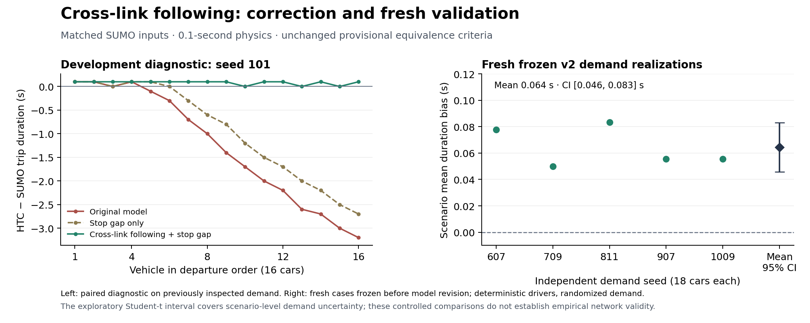

# MICRO following across Link boundaries

For the consolidated implementation status and remaining work, start with
[MICRO validation status](MICRO_VALIDATION_STATUS.md). This page specifies the
following protocol and its accepted v2 measurements.

The opt-in `LinkState.downstreamLookahead` keeps a following vehicle constrained
by its leader after the leader's front bumper enters another Link. Without this
observation, the approach's front vehicle sees free road as soon as its leader
leaves the approach queue, even while that leader's rear bumper is still nearby.
This error compounds during queue discharge.

## Input contract

Enable `downstreamLookahead` on single-lane MICRO Links with exactly one physics
step per runtime tick. The step must match the scenario's `tickDuration`. The
validated fractional-clock scope remains static-routing Car/Link/Node/TrafficSignal.
Defaults retain the existing mixed-model behavior. A downstream Link must also
provide single-lane MICRO observations with the same physics step; incompatible
observations fail instead of being treated as empty roads.

`VehicleInLane.nextLinkId` retains the requested next road. For finite junctions,
the approach must supply `downstreamConnectors`, mapping that road's ID to the
connector Link ID, consistently with the Node's `junctionMovements`. Point nodes
need no mapping. The SUMO fixture generator writes both representations from the
same compiled movement. This is not a general network geometry importer.

For example, if road 7 reaches road 9 through connector 8, road 7 supplies:

```json
{
  "downstreamLookahead": true,
  "microTimeStep": 0.1,
  "microTicksPerGlobalTick": 1,
  "downstreamConnectors": {"9": 8},
  "stopLineGapM": 1.0
}
```

The independent `stopLineGapM` places a red-signal stop before the lane end; its
native default remains zero. The matched v2 fixtures explicitly use one metre
in both simulators, matching SUMO's documented default `jmStoplineGap`.
See [SUMO junction parameters](https://sumo.dlr.de/docs/Definition_of_Vehicles%2C_Vehicle_Types%2C_and_Routes.html#junction_model_parameters).
No fitted crossing delay or per-vehicle correction is added.

## Exchange and ordering

On first vehicle entry for a next road, the approach subscribes to that road and
its optional connector through ordinary `sendMessageTo` transport. The downstream
Link sends an initial immutable occupancy snapshot and publishes after entry,
leave and occupied physics steps, including the final empty state. Its nearest
rear bumper, actual velocity and vehicle length define the boundary leader.
The approach also looks through an empty connector onto the next road, adding
the connector's measured length to the coordinate.

Each snapshot carries its tick and a checkpointed publication sequence. A
receiver keeps the latest sequence for each of two distinct tick cohorts.
Physics integrating `(t-1,t]` uses only a snapshot strictly before `t`; a
same-tick publication cannot overwrite that start-of-step view. Conservative
channel closure delivers preceding-tick output before the next tick, while late
optimistic delivery cancels and replays affected speculation normally.

Subscription and publication introduce no awaited reply or additional spontaneous
completion. Receivers do not republish upon receiving an observation, so cyclic
roads cannot create a same-tick publication loop. Existing Link spontaneous
branches continue to finish independently. Subscriber IDs, requested IDs,
publication sequence and observation histories all live in `LinkState`, and
JSON restore retains numeric map keys and typed snapshots. Existing owner-ledger,
positive/anti-message, GVT and report-commit paths remain authoritative.
If rollback undoes a subscription, a positive publication can still arrive before
its anti-message. The receiver consumes and ignores that publication while it has
no requested boundary, without creating state, new output or a wait obligation.

## Scope and cost

The implementation adds boundary messages and checkpoint state per subscribed
adjacency. It does not provide multi-lane downstream selection, cross-junction
conflict priority or a proof of city-scale cost. Observation extends through one
optional connector and the next road; very short sequences needing leaders beyond
that road require a longer observation horizon and are not established by these
fixtures. Snapshots contain lane-owned vehicles. The later opt-in
[`downstreamSpillback` extension](MICRO_SPILLBACK.md) retains a stopped lane
footprint during Node admission, validated separately for bounded single-lane
Car fixtures. Without that option, a vehicle waiting at a Node after leaving its
lane is still absent from these snapshots. Subscriber sets remain enrolled
for the static Link lifetime. Bounded policy/layout report comparisons are needed
alongside traffic measurements; engine termination alone is insufficient.

## Paired development diagnostic

The original v1 demand seed 101 has 16 cars. At 60.1 s, vehicle 12 enters the
connector. In the old model, follower 13 then accelerates at the full 2.6 m/s²
although the leader is still immediately ahead. The retained boundary samples
and focused strategy test exercise this exact loss of the following constraint.

The following final-build variants use identical departures and a SUMO stop-line
gap of one metre throughout. Native acceleration, deceleration, reaction time,
minimum vehicle gap and car-following formula are unchanged.
Route-position RMSE is the mean of per-vehicle route-distance RMSE values on
matched frames, following the frozen metric definition.

| Native variant | Trip-time MAE (s) | Route-position RMSE (m) | Discharge-headway MAE (s) |
|---|---:|---:|---:|
| Original v1 model | 1.325 | 8.283 | 0.214 |
| One-metre stop gap only | 0.994 | 6.292 | 0.221 |
| Cross-link following only, native stop gap zero | 0.131 | 0.933 | 0.079 |
| Cross-link following and one-metre stop gap | 0.081 | 0.479 | 0.007 |

The final queued car changes from 3.2 s early to 0.1 s late. These inspected
development data diagnose the correction; they are not an independent acceptance
set. The original [v1 results](MICRO_SCIENTIFIC_VALIDATION.md) remain unchanged.

## Predeclared v2 physical cases

Protocol `4c9f105` froze fresh geometries, demand seeds and the existing v1
acceptance thresholds before physics implementation `8ba005d`. All cases below
use 0.1-second runtime/physics steps with boundary remainder transfer. Results
agree exactly between conservative and optimistic execution.

| Case | Cars | Trip-time MAE (s) | Route-position RMSE (m) |
|---|---:|---:|---:|
| Left turn, 211/137 m centreline roads | 6 | <0.001 | 0.059 |
| Right turn, 229/149 m centreline roads | 6 | 0.100 | 0.642 |
| Signal-controlled right turn, 187/137 m roads | 18 | 0.061 | 0.494 |
| Eight unequal road segments, 1,080 m total | 4 | <0.001 | <0.001 |

The first v2 execution exposed an optimistic protocol error: a late positive
publication was rejected after rollback removed its subscription. Commit
`222f2d0` corrects that stale-input handling. The failed run is retained and
excluded from acceptance; the complete campaign is repeated on the repaired
executable. Traffic physics, physical parameters, cases and acceptance thresholds
remain fixed. The actual failure reproducer now completes through 1,330 rollbacks
and matches all 5,824 conservative report rows.

The five reserved demand seeds (607, 709, 811, 907, 1009) each contain 18 cars
with randomized departure headways and deterministic drivers. All five satisfy
the frozen criteria: trip-time MAE 0.050–0.083 s, p95 absolute error 0.100 s,
mean route-position RMSE 0.341–0.568 m, speed RMSE 0.078–0.112 m/s,
halted-queue-count RMSE 0.113–0.175 vehicles, and discharge-headway MAE
0.013–0.044 s. Every expected car completes. Completed-cohort throughput agrees;
this does not measure saturated capacity.

The paired scenario-level mean HTC-minus-SUMO duration is **+0.064 s**, with an
exploratory 95% Student-t interval **[+0.046, +0.083] s** (five independent demand
realizations, not 90 independent vehicles). A small positive bias remains.
The earlier v1 mean of −1.185 s came from different seeds with 16 cars each;
the same-demand correction is demonstrated separately in the seed-101 table.
The interval is conditional on the chosen demand distribution and deterministic
drivers. These results support controlled numerical agreement with SUMO under
provisional criteria; independent field following/discharge validation remains
open. The existing NGSIM isolated-cruising pilot does not establish that validity.

## Reproduction

Use the recorded implementation revision and SUMO 1.27.1. Each output directory
must be fresh. The v1 coarse-clock convergence study remains a separate experiment;
v2 following requires one physics step per runtime tick.

```bash
sbt test assembly
python3 scripts/scenario/run_sumo_scientific_campaign.py \
  --jar target/scala-3.3.5/hyperbolic-time-chamber-1.24.3.jar \
  --protocol scripts/scenario/sumo_scientific_protocol_v2.json \
  --stage held-out --output /tmp/htc-v2-heldout --base-port 22000 --parallel 3
python3 scripts/scenario/run_sumo_scientific_campaign.py \
  --jar target/scala-3.3.5/hyperbolic-time-chamber-1.24.3.jar \
  --protocol scripts/scenario/sumo_scientific_protocol_v2.json \
  --stage stochastic --output /tmp/htc-v2-stochastic --base-port 23000 --parallel 3
```

The accepted build (`222f2d0`) passes **653 Scala tests in 135 suites** and
**18 Python tests**. Across **23 HTC runs**, **19 real-SUMO comparisons** cover
**260 completed matched cars**. All **17 exact full-report comparisons** pass,
including four conservative physics comparisons against the pre-repair build,
one-/two-JVM layouts and legacy Car/transit behavior. The two-JVM signal case
matches 9,255 rows under both policies and exercises 3,297 optimistic rollbacks.
The default one-second Car fixture retains all 213 previous report rows; the
legacy Bus/Subway fixture retains all 2,183 rows and 39 completed Bus connectors.

Executable SHA-256:
`c13c6c51f73b4689bf151cbca5146bf41697f21de5c3d870fd3ec0453ac2696d`.
The [machine record](validation/micro-discharge-2026-10-25.json) retains exact
commands, input hashes, per-vehicle comparisons, all criteria, policy comparisons
and exclusions. Accepted raw output is in `/tmp/htc-discharge-accepted-20261025/`;
temporary paths may disappear on reboot. The tracked frozen protocol and source
revisions reproduce the main campaign. Earlier diagnostic executables and the
initial failed optimistic run are explicitly excluded from final acceptance.



The [plotting script](../scripts/scenario/plot_micro_discharge_validation.py) reads
the retained record; a [vector figure](validation/figures/micro-discharge-2026-10-25.svg)
is also available.
