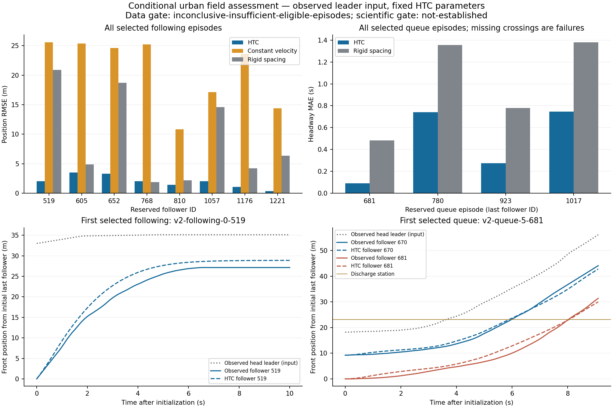

# Field input audit and prospective v2 assessment

The released v1 field cases now serve as development evidence. This audit checks
the speed-cap assumption, road/control context and queue observation coverage
before defining another reserved cohort. The prior [v1 result](MICRO_FIELD_VALIDATION.md)
and its frozen criteria remain unchanged.

**Completed result: the audit is reproducible, and the fresh v2 data gate remains
inconclusive.** Eight of ten required following episodes and four of five
required queues qualify. All comparative and physical checks pass on that
qualified subset, but the sample targets are not reduced. No empirical adequacy
or signal-phase validity is established. Engineering verification passes **780
Scala tests in 154 suites**, **49 Python tests**, assembly and exact offline
replay. See [audit evidence](validation/micro-field-input-audit-2026-10-26.json)
and [prospective v2 evidence](validation/micro-field-v2-2026-10-26.json).

## What the input audit establishes

The independent [FHWA Lankershim case study](https://ops.fhwa.dot.gov/publications/fhwahop08054/sect7.htm)
documents a **35 mph** posted site limit, equivalent to **56.32704 km/h**. V1 used
50 km/h. That is an input mismatch, but a posted limit is not an estimate of each
driver's desired speed. A one-second congested prefix cannot identify an
unconstrained desired speed. The new adapter accepts an explicit cap, with 50
km/h retained as its backward-compatible default; production Link physics and
its behavioral coefficients are unchanged.

All v1 predictions at 50 km/h reproduce exactly after this adapter extension.
Exploratory 40/50/56.32704/65 km/h runs use only released observations:

| Released v1 cohort | 40 km/h | 50 km/h | Documented 56.32704 km/h | 65 km/h |
|---|---:|---:|---:|---:|
| Ten former reserved following episodes: mean position RMSE | 1.740 m | 2.223 m | 2.363 m | 2.386 m |
| Two former reserved queues: mean position RMSE | 5.846 m | 6.074 m | 6.074 m | 6.074 m |
| Same queues: mean headway MAE | 0.625 s | 0.625 s | 0.625 s | 0.625 s |

The 40 km/h result is a sensitivity measurement, not a newly accepted calibration
or a reason to choose that cap for validation. Correcting the documented input
alone does not resolve the field discrepancy.

The largest development outlier starts with a **196.15 m bumper gap** between
vehicles in different road sections. Its follower remains stopped for 7.3 s
while the recorded leader-based safe-speed allowance exceeds its speed by at
least 2 m/s. That flags omitted context; it is not a measured red phase. Other
released episodes traverse recorded intersections, and several stopped followers
retain gaps larger than the fixed 2 m model minimum. These observations do not
identify a unique desired-speed, signal or following-coefficient correction.

Recording origin is observable as `global_time - 100 * frame_id`. The released
Lankershim rows contain origins `1118935679900` and `1118936699900`, separated by
17 minutes. V1 conservatively excluded numeric vehicle IDs across both. V2 uses
the tuple `(recording origin, vehicle ID)`, and excludes every such identity
exposed in v1 candidate snapshots or trajectory queries. It does not assume that
nominal 15-minute labels uniquely identify every source frame.

## Controls and coverage

The retrieved official supporting attachment is not accepted as usable signal
data: all 80,179,421 returned bytes were retained, but the file is not a valid ZIP.
Its first stored member declares 122,661,759 bytes and there is no usable central
directory. The source URL, headers, SHA-256 and diagnostic byte ranges are retained
as an external input/measurement failure. This does not establish why the
retrieval is invalid and is not a failure of the traffic model.

No phase state, green onset or clock alignment is fabricated from that attachment.
The v2 scope explicitly uses observed head-leader motion rather than claiming
traffic-signal reconstruction.

Simply trimming v1 queue windows to the last observed station crossing plus one
second recovers **zero** rejected candidates. In 43 rejected queue candidates,
not all subjects cross before common observation coverage ends. Arbitrary
snapshot timing therefore cannot be repaired by dropping unused tail samples
alone. V2 prospectively aligns queue initialization to observed head release and
retains explicit crossing-coverage failure for late model predictions.

## Frozen v2 design

The new [v2 protocol](../scripts/scenario/micro_field_protocol_v2.json) is frozen
before access to its fresh episode profiles and before error evaluation,
SHA-256:

```text
a65c7c6357278ccc83652f95c5067a9c4e6164b5e0572268dc9fe3d1d9bf5325
```

Fresh blocks lie 330–870 s after the original sampling origin, at 30 s intervals.
These are previously unopened first-recording intervals between v1's development
and reserved windows. Every source row must match recording origin
`1118935679900`; every selected participant must be absent from all v1 exposure
identities and from earlier v2 selections. Raw observations fetched but not
selected remain retained exposure for future studies.

Following requires both Cars to remain in one common nonzero road section with
no recorded intersection throughout the interval. Initial bumper gap is at most
30 m, and the initial safe-speed allowance must be at most 90% of the site cap.
This restricts the task to initially leader-dominated following; it does not claim
that the road is isolated from all indirect signal effects.

For queue release, a stopped chain is observed for up to 20 s to find the first
qualifying head-motion onset: annotated head speed exceeds 0.2 m/s after a stopped
prefix, with at least 0.3 m observed head displacement over the following second.
The one-second initialization prefix ends one sample before that onset, and
all three Cars must remain stopped under the fitted-prefix rule. No follower
prediction is used to identify onset or eligibility.

The station remains 5 m beyond the head front at initialization. The endpoint is
the last observed crossing plus one second, rounded up to the 0.1 s clock,
bounded between five and twenty prediction seconds. Complete shared observations
must cover that endpoint. A model that crosses late or never crosses fails
coverage; its horizon is not extended to rescue it. The extra headroom concerns
observation availability, not relaxed headway-error acceptance.

The primary cap is the independently documented 35 mph value. Predeclared 50 and
65 km/h sensitivities are diagnostics, never a way to select the best holdout
result. A sensitivity outside its initial-speed domain is explicitly unavailable;
the primary episode is retained. Acceleration, deceleration, reaction time and
minimum-gap coefficients stay unchanged.

The fixed ten-following/five-queue targets and v1 comparative skill rules remain:
complete output and crossing coverage, no predicted bumper overlap, and an upper
bootstrap bound below zero against each declared baseline. Data inadequacy,
scientific rejection and engine/measurement failure remain separate outcomes.
All CIs remain exploratory episode/platoon summaries; shared road/session
conditions do not become independent network replications.

## Prospective v2 measurements

| Measurement | HTC | Baseline or gate |
|---|---:|---|
| Qualifying following episodes | 8 | Required 10 |
| Mean following position RMSE | 1.980 m | Constant velocity 20.835 m; rigid spacing 9.228 m |
| HTC minus constant-velocity RMSE | −18.854 m | Exploratory 95% interval [−22.007, −15.281] m |
| HTC minus rigid-spacing RMSE | −7.247 m | Exploratory 95% interval [−12.196, −2.821] m |
| Qualifying queue episodes | 4 | Required 5 |
| Mean queue position RMSE | 4.041 m | Rigid spacing 9.714 m |
| Mean queue headway MAE | 0.463 s | Rigid spacing 0.999 s |
| HTC minus rigid headway MAE | −0.536 s | Exploratory 95% interval [−0.624, −0.448] s |
| Predicted crossing coverage | 100% | Every selected queue follower crosses within its sealed window |
| Predicted bumper overlap | None | Minimum gap 1.986 m against the noisy observed leader |

All 19 fixed blocks were inspected. There are 135 candidate trajectory
exclusions: 50 incomplete observation windows, 34 lane changes, 26 without a
qualifying observed queue release, 11 crossing a road section or recorded
intersection, five initial speeds outside scope, three class/direction/movement
changes, three reversed-motion cases, two leaders outside the initial following
horizon and one unsupported observed vehicle length. No poor prediction is an
eligibility exclusion.

The four head releases occur 4.3, 12.8, 1.4 and 5.4 s after their candidate
snapshots. Their sealed prediction windows are 9.1, 7.9, 8.5 and 8.3 s. These
times come from observed head movement and station crossings, not fitted green
phases or model-error alignment. All selected recording/vehicle identities are
disjoint from v1 and from each other.

Both predeclared speed-cap sensitivities reproduce the primary trajectories
exactly on this restricted cohort. This supports the intended leader-dominated
scope; it does not identify each driver's unconstrained desired speed. V1 and
v2 use different cohorts and definitions, so their mean RMSE values must not be
presented as a paired treatment-effect estimate.



The comparative checks pass on the observed subset. The overall frozen decision
remains `not-established` because completeness of the declared cohort is itself
a gate. Do not pool inspected cases or add favorable cases retrospectively to
turn that result into acceptance. The next scientific step is a new preregistered
cohort from additional uninspected observations with enough fixed sampling
opportunities to meet the original counts. Keep acceleration, reaction and gap
coefficients unchanged unless a separate development study motivates a revision.

## Reproduction and retained evidence

Raw v1 audit artifacts are under `/tmp/htc-field-v1-audit-20261026/`; raw v2
artifacts are under `/tmp/htc-field-v2-20261026/`. The executable is
`/tmp/htc-field-input-audit-20261026.jar`; its hash and source bindings are in the
machine records. A retained [audit snapshot](validation/micro-field-input-audit-snapshot-2026-10-26.zip)
preserves audit output and attachment-integrity diagnostics without committing
the unusable 80 MB supporting download. The [v2 raw snapshot](validation/ngsim-field-v2-snapshot-2026-10-26.zip)
preserves all queries, observations, exclusions, exposure identities, sealed
profiles, predictions, licensing and outcomes. Replay from that repository ZIP
reproduces predictions exactly, independently of the live service.

First extract the [retained v1 observations](validation/ngsim-following-discharge-snapshot-2026-10-26.zip)
into a fresh directory, then build the adapter:

```bash
python3 -m zipfile -e \
  docs/validation/ngsim-following-discharge-snapshot-2026-10-26.zip /tmp/htc-field-v1
sbt -J-XX:ActiveProcessorCount=4 test assembly
python3 scripts/scenario/audit_micro_field_inputs.py \
  --snapshot /tmp/htc-field-v1 \
  --jar target/scala-3.3.5/hyperbolic-time-chamber-3.2.0.jar \
  --output /tmp/htc-field-input-audit
python3 scripts/scenario/validate_micro_field_v2.py \
  --v1-snapshot /tmp/htc-field-v1 \
  --jar target/scala-3.3.5/hyperbolic-time-chamber-3.2.0.jar \
  --output /tmp/htc-field-v2
```

Use `--snapshot` to replay a completed v2 selection without network access, or
`--download-cache` to resume identical raw requests from an interrupted run into
a fresh output directory. The manifest is sealed before any new predictions;
every raw-response hash and selected eligibility profile is checked on replay.
Do not reclassify inspected v1 or v2 episodes as fresh validation after revising
the model.
