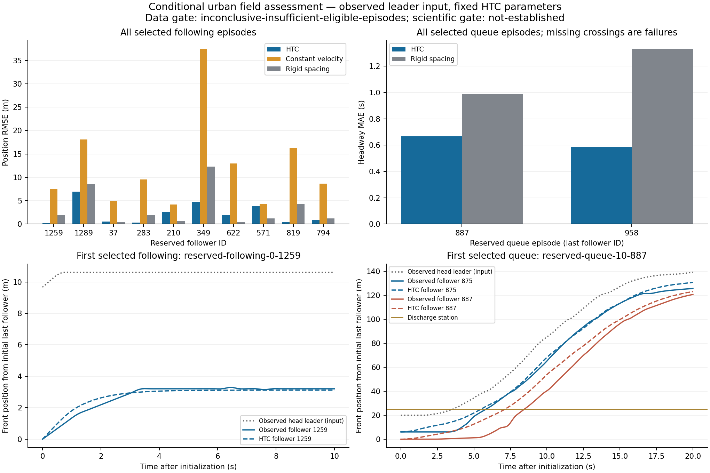

# Conditional urban field following and queue discharge

This study evaluates the active HTC Link physics against observed urban vehicle
trajectories. It is a conditional longitudinal component assessment: the head
leader's observed motion is supplied throughout the experiment, while followers
evolve using HTC physics. It does not predict the whole platoon autonomously or
validate actor scheduling, traffic-signal reconstruction, junctions or networks.
The separate [spillback campaign](MICRO_SPILLBACK.md) retains runtime evidence.

**Recorded outcome, 2026-10-26: empirical adequacy is not established.** Ten
reserved following episodes qualify, but only two of the required five queue
episodes qualify. Following improves on constant velocity, while its uncertainty
interval against rigid spacing includes zero. No threshold was relaxed and no
traffic parameter changed. Engineering checks pass: **779 Scala tests in 154
suites**, **44 Python tests**, assembly, and exact offline prediction replay.
See the [machine record](validation/micro-field-2026-10-26.json).

The subsequent [input audit and fresh v2 study](MICRO_FIELD_INPUT_AUDIT.md)
correct the independently documented site cap, restrict following context and
align observed queue release. V2 has positive comparative checks on eight
following/four queue episodes, but still misses the fixed ten/five sample targets.
This page preserves the original v1 outcome unchanged.

## Source and reserved design

The official [USDOT/FHWA NGSIM data](https://data.transportation.gov/d/8ect-6jqj)
contain Lankershim Boulevard observations, disjoint from the earlier US-101
isolated-cruising pilot. The retained source metadata identify longitudinal
`local_y` as front-center coordinates in feet, `v_length` as feet, `v_vel` as
feet/second, and `global_time` as milliseconds. Every downloaded response retains
its query URL, raw SHA-256 and license/attribution metadata.

The [v1 protocol](../scripts/scenario/micro_field_protocol_v1.json) was frozen
before trajectory downloads and error evaluation, SHA-256:

```text
e79261f236740ef2e84599a4098b73c9185da7d83fe458c8b6f24750e059407d
```

Five fixed development blocks start 30–270 s after the sampling-frame origin.
Fifteen reserved blocks start 930–1,770 s after it, at 60 s intervals. Reserved
selection excludes every vehicle ID appearing in the development candidate
snapshots, including unselected Cars. Selected episodes never reuse vehicle IDs.
This conservative identity exclusion also excludes reused numeric IDs that might
identify different Cars in another recording session.

The fixed target is ten reserved following pairs and five reserved queue
episodes. At most one episode of each kind is selected in each block, in numeric
vehicle-ID order. Selection depends on observed eligibility, never model errors.
The executable and source hashes are retained before reserved downloads; the
selected manifest is sealed before producing predictions. No traffic parameters
are fitted or changed in this study. Failing a sample-count target yields an
inconclusive data gate; failing prediction criteria is recorded separately.

## Eligibility and initialization

Subjects are northbound, through-moving passenger Cars with unchanged lane and
recorded immediate leader identity throughout initialization and prediction.
Following pairs start with an annotated follower speed of at least 1 m/s. Queue
episodes contain an observed head leader and two simulated followers, all stopped
through the one-second initialization prefix. Selection conditions on those
stable future identities and complete observed queue discharge; it does not
estimate how often such episodes occur in the whole road population.

Exact duplicates are removed. Conflicting duplicates, missing 100 ms samples,
frame discontinuities, nonfinite observations, substantial reversed motion and
overlapping observed bumpers are rejected under the frozen rules. Vehicle
lengths use prefix medians. Initial speeds use least-squares longitudinal
position slopes from the first second only, with no follower prediction sample
used for initialization. No fitted time offset or outcome-driven smoothing is
applied. Annotated-speed/position-derivative inconsistency is reported.

These checks do not establish that retained NGSIM coordinates are exact ground
truth. FHWA discusses both trajectory noise and systematic error, including
inter-vehicle consistency, and the need to assess them before model calibration.
See [FHWA data assessment](https://ops.fhwa.dot.gov/publications/fhwahop20057/ch3.htm)
and [trajectory-based calibration research](https://www.fhwa.dot.gov/publications/research/operations/21071/index.cfm).

## Actual physics and causality

`MicroFieldReplay` calls the production `DefaultMicroSimulationStrategy` for one
0.1 s step per runtime tick. It uses the same Krauss safe-speed expression,
2.6 m/s² acceleration, 4.5 m/s² deceleration, 1 s reaction time, 2 m minimum gap,
50 km/h desired-speed cap and opt-in geometric spacing guard. Individual vehicle
lengths come from observations. A long virtual Link prevents boundary exits.
No copy of the physics is reimplemented in Python.

At the step ending at `t`, the adapter uses the observed head leader at `t-0.1`.
Its boundary speed is fitted only from the previous one-second position window,
floored at zero. Other followers see the previous simulated leader state, as in
the normal Link batch. A synthetic causality test changes the observation at `t`
and verifies that it cannot change the update ending at `t`.

Only the head leader is forced. Follower positions are never reset from field
observations. Their initialization and all subsequent output samples remain
distinct. The adapter is a plain Scala CLI outside actors; it creates no runtime
messages or new model actor type and changes no production traffic physics.

## Measurements and decision rules

Following comparisons report position RMSE, speed RMSE against backward
position slopes, initial bumper gaps and steps constrained by another vehicle.
Episode means, rather than individual time samples, enter the skill comparison.
The baselines are constant velocity initialized from the same prefix and rigid
initial spacing behind the same observed head leader.

Queue episodes use a fixed virtual discharge station 5 m beyond the head
leader's initial front. Crossing times are linearly interpolated between 100 ms
samples. Headway errors compare consecutive matched vehicle pairs. A missing
predicted crossing fails coverage; it never removes that episode from the
evaluation or turns into a zero error. The rigid-spacing baseline uses the same
observed head-leader motion.

Acceptance requires complete selection/prediction/crossing coverage,
nonoverlapping predicted bumpers, and an upper 95% bootstrap bound below zero
for mean paired error differences against both following baselines and the
queue headway baseline. The zero-improvement null tests added predictive skill
without inventing an absolute field-accuracy tolerance. Absolute errors are
reported regardless. Passing this comparison would not establish that those
absolute errors are acceptable for every application.

Bootstrap resampling uses episodes/platoons, not frames or followers, with
10,000 resamples and a fixed seed. These are exploratory conditional intervals:
shared traffic conditions, signals and observation sessions can create temporal
dependence. Different episodes are not independent network replications.
Observed leader motion does not reconstruct all external controls; signal
changes, desired-speed heterogeneity and other omitted context can also cause
prediction error. Failure must not automatically be attributed to Krauss
coefficients alone.

## Recorded measurements and interpretation

| Measurement | HTC | Baseline or decision |
|---|---:|---|
| Following episodes | 10 | Required 10; full 100-step predictions for every follower |
| Mean following position RMSE | 2.223 m | Constant velocity 12.384 m; rigid spacing 3.301 m |
| Following episode RMSE range | 0.221–6.966 m | Reported without fitted time shifts |
| HTC minus constant-velocity RMSE | −10.161 m | Exploratory 95% interval [−16.074, −5.489] m; comparative gate passes |
| HTC minus rigid-spacing RMSE | −1.079 m | Exploratory 95% interval [−2.986, +0.562] m; comparative gate does not pass |
| Queue episodes | 2 | Required 5; data gate remains inconclusive |
| Mean queue position RMSE | 6.074 m | Rigid spacing 12.247 m |
| Mean queue headway MAE | 0.625 s | Rigid spacing 1.159 s; two platoons cannot close the declared five-platoon gate |
| Predicted bumper overlap | None | Minimum gap against observed/simulated leaders is 1.989 m; observed coordinate jitter can reduce the current-frame gap below the 2 m previous-step guard |

Both retained queues have complete predicted crossings. There are 62 candidate
trajectory rejections: 24 incomplete observation windows, 16 without complete
observed queue discharge, six reversed-motion cases, five lane changes, four
initial gaps outside scope, three initial speeds outside scope, three leader
changes and one queue not stopped through initialization. These are eligibility
exclusions; no episode is discarded for a bad model prediction. The development
stage had three qualifying following episodes and one queue, with 13 exclusions.

The ten following episodes exercise 881 constrained follower steps, and the two
queues exercise 722 constrained steps. This is actual interacting physics,
beyond the earlier isolated-cruising pilot. All prediction samples are retained;
offline replay reproduces both development and reserved prediction JSON exactly.

The original reserved acquisition timed out before a manifest was sealed or any
reserved prediction was produced. The completed run recovers identical query
responses, then finishes the remaining requests with bounded retry. Its executable
and physics are unchanged; the source record identifies the downloader-only
repair and excluded interrupted run. No physical or selection rule changed.

The lower mean error against rigid spacing is encouraging but does not satisfy
the frozen uncertainty criterion. The small queue sample is insufficient even
though both individual comparisons improve on the baseline. Some selected
observations traverse recorded intersections; omitted controls and driver
desired-speed assumptions remain possible error sources. These results do not
isolate a car-following coefficient as the cause and do not justify fitting one
to the reserved outcomes.



The figure shows every selected episode and the first selected following/queue
trajectories in chronological selection order. It does not select best-looking
cases by error. Dataset-derived figures and archived observations retain NGSIM
attribution and CC BY-SA 3.0 licensing.

The next step is a development audit of desired speed, controls and cohort
coverage using these now-inspected v1 episodes, followed by a new protocol and
fresh reserved observations. Independent field adequacy remains open.

## Reproduction

The retained executable `/tmp/htc-field-replay-20261026.jar` has SHA-256
`62a3fa70bb8b36c302afa22eb5d086f0277a1f45f1dda1af3ef0b602a4d5ff59`.
Raw live-run artifacts are under `/tmp/htc-field-20261026/`; the completed
reserved experiment is `reserved-final`, and `reserved` retains the interrupted
download. A repository [raw snapshot](validation/ngsim-following-discharge-snapshot-2026-10-26.zip)
preserves development and completed reserved responses, manifests, predictions,
license and outcomes after temporary directories disappear.

```bash
sbt -J-XX:ActiveProcessorCount=4 test assembly
python3 scripts/scenario/validate_micro_field.py \
  --jar target/scala-3.3.5/hyperbolic-time-chamber-3.2.0.jar \
  --output /tmp/htc-field-development --stage development
python3 scripts/scenario/validate_micro_field.py \
  --jar target/scala-3.3.5/hyperbolic-time-chamber-3.2.0.jar \
  --output /tmp/htc-field-reserved --stage reserved \
  --development-manifest /tmp/htc-field-development/selection.json
```

Use fresh output directories. `selection.json` retains all exclusions and raw
response identities. `selection-seal.json` binds the selected observations before
evaluation; `executable.json` retains the executable and physics/harness source
hashes. `assessment.json` separates valid measurements, data adequacy and the
scientific outcome. Measurement or engine errors produce `failure.json` and a
nonzero exit. Scientific rejection is a completed experiment and retains its
result rather than masquerading as an engine failure.

To replay retained observations without network access:

```bash
python3 scripts/scenario/validate_micro_field.py \
  --jar target/scala-3.3.5/hyperbolic-time-chamber-3.2.0.jar \
  --output /tmp/htc-field-replay --stage reserved --snapshot /path/to/reserved
```

Replay verifies the manifest seal and every raw-response hash, then recomputes
selected quality checks before invoking physics. Keep inspected results as
development data for later model work. A changed physical model or new acceptance
criterion requires a new protocol and fresh reserved observations.

An interrupted live download can resume identical requests into a fresh output
directory with `--download-cache /path/to/interrupted-run`. Recovered responses
are checked against their frozen location/time/vehicle query and any available
request hash. Every new response receives a request sidecar. Network reads use
three bounded attempts; an exhausted retry is a measurement failure. Resumption
does not alter selection or physics, and the interrupted run remains excluded.
