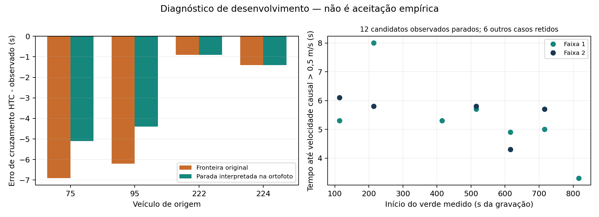

# MICRO: reconstrução, diagnóstico e primeiras implementações

Data: 18/11/2026. **Incremento executado de desenvolvimento e engenharia. A campanha empírica completa continua aberta.** Complementa o [plano de lacunas](MICRO_EMPIRICAL_GAPS_AND_ACCEPTANCE.pt.md), sem substituir resultados ou critérios congelados.

## Entregas executadas

1. Repetição do ensaio-base com o JAR preservado: mesmos 1.586 eventos físicos.
2. Recuperação da ortofoto oficial e do georreferenciamento, com hashes, CRCs e faixas HTTP verificadas; nenhuma trajetória nova adquirida.
3. Auditoria reproduzível das coordenadas, dos 16 sujeitos da aproximação e das partidas em todos os nove verdes da gravação já exposta.
4. Quatro execuções controladas de geometria, sem alterar parâmetros de tráfego.
5. Publicação nativa de ocupação por faixa e endereçamento Link/Node.
6. Snapshot inicial opt-in com posições exatas e rejeição de sobreposição.
7. Testes e cenários com atores nos dois runtimes, com uma e duas JVMs.

## Dados e reconstrução

A ortofoto recuperada tem 2.823 × 12.167 pixels. O TFW declara passo de 0,25 unidade de coordenada por pixel. Os metadados NGSIM descrevem as coordenadas como pés de levantamento dos EUA e acurácia relativa da ortofoto de 2,5 pés, aproximadamente 0,762 m. Foram preservados o original, a transformação e os pixels interpretados.

A linha pintada de parada foi interpretada manualmente, com partes ocultas por veículos. **Não é uma linha topograficamente levantada.** Na gravação PM, o registro afim entre coordenadas globais e locais fornece posições aproximadas de **38,774 m e 38,987 m** para as duas faixas diretas. O resíduo longitudinal do registro é aproximadamente 0,143 m; não mede a acurácia independente da linha pintada.

A mesma feição global tem deslocamento médio longitudinal de **5,273 m entre os sistemas locais das gravações**. Não transferir uma estação local entre sessões sem novo registro. Foi mantida a conversão histórica de 0,3048 m/pé. Os estudos condicionais anteriores usavam posições relativas dentro de cada gravação; este achado não reclassifica seus resultados como inválidos.

Na janela 600–1600 há dois sujeitos no snapshot inicial e **14 tracks cujo primeiro registro já está dentro da aproximação**. O primeiro registro não comprova entrada física pela fronteira a montante. Isso também afeta os sujeitos tardios 222/224 do ensaio menor.

O gerador registra a proveniência de entrada. `--require-observed-boundary-arrivals` recusa nascimentos internos e lacunas antes de uma entrada alegada. Mesmo uma transição observada entre seções ainda precisa corresponder às fronteiras físicas e ao grafo; a opção não certifica automaticamente todo o cenário.

## Diagnóstico de geometria e partida

O traço nativo reproduz o arquivo de sinais fornecido. Isso verifica a importação, **não uma sincronização independente com vídeo**.

A auditoria dos nove verdes e duas faixas reteve 18 situações: 12 candidatos observados parados, cinco candidatos não parados e uma ausência de candidato. Usando posição com operador causal de um segundo e cinco amostras consecutivas acima de 0,5 m/s, os 12 candidatos apresentam tempos de 3,3–8,0 s após o verde, mediana 5,5 s. Os limiares alternativos de 0,1 e 1,0 m/s também foram preservados.

Esse diagnóstico usa dados já expostos e definição registrada antes da extração dos resultados. Não são 12 filas independentes aprovadas, não alteram o gate anterior de zero filas elegíveis e não identificam causalmente reação do motorista. Sincronização, conflitos, características dos veículos e resposta de partida ainda precisam ser separados. **Não foi acrescentado um atraso de cinco segundos ao modelo.**

O protocolo de sensibilidade foi escrito antes das execuções. Mantiveram-se JAR, horizonte, sujeitos, velocidades iniciais e sinais. Alterou-se apenas `stopLineGapM`, parâmetro físico existente. A fronteira de pontuação ficou em 43,75 m; a parada usou a média das faixas interpretadas, com variações fixas de ±0,762 m. Essa faixa é sensibilidade geométrica, não intervalo de confiança.

| Configuração | Parada m | RMSE de progresso m | Erro de cruzamento 75 s | Erro de cruzamento 95 s |
| --- | ---: | ---: | ---: | ---: |
| Base preservada | 43,750 | 5,08156 | -6,9 | -6,2 |
| Foto: centro | 38,880 | 1,74295 | -5,1 | -4,4 |
| Foto: montante | 38,118 | 1,63711 | -5,1 | -4,2 |
| Foto: jusante | 39,642 | 2,02528 | -5,2 | -4,5 |

As quatro novas execuções concluíram sem erros. Centro conservativo e centro Time Warp produziram eventos físicos comprometidos iguais. Os sujeitos 222/224, admitidos após a abertura, mantiveram erros de -0,9/-1,4 s.

A geometria explica parte importante do erro espacial e aproximadamente 1,8 s da diferença de cruzamento nos sujeitos iniciais. Ainda restam 4–5 s. A configuração de menor erro não foi escolhida como calibração: todas as variações foram reportadas, incluindo a interpretação central independente do erro. A melhora é diagnóstico de entrada, não evidência nova de validade independente da física.



## Implementação: publicação por faixa

`MicroBoundarySnapshot` conserva o agregado e indicador de suporte legados, acrescentando `laneCount` e `laneBoundaries`. Cada `MicroLaneBoundary` representa uma faixa explícita, incluindo vazio conhecido, veículo traseiro e dianteiro, próximo link e footprint pendente. Uma lista ausente em payload legado significa detalhe por faixa indisponível, não todas as faixas vazias.

As assinaturas passam a guardar identidade de Node, além das de Link. O remetente real usa nome completo de classe: o handler normaliza pelo utilitário existente e o estado conserva identidade/shard sem ActorRef. IDs numéricos iguais em shards diferentes são destinos distintos. O envio usa o transporte normal, sem aguardar observadores nem agendar trabalho ao receber uma observação.

Testes verificam imutabilidade, faixa vazia, footprint, destinatários, JSON legado/novo, restauração da sequência e codecs frios independentes.

**Limite:** esta entrega cobre publicação e endereçamento de G02. Faltam seleção de caminho por faixa, segurança da faixa candidata a jusante e consumo pelo futuro controlador do Node. O consumidor longitudinal continua de faixa única. Não foram removidas proteções de `downstreamLookahead`, nem habilitados spillback multifaixa ou prioridade.

## Implementação: snapshot inicial exato

A admissão legada pode colocar uma entrada atrás dos veículos existentes, alterando sua posição solicitada. No primeiro fixture sintético, o veículo 101 entrou em 13,5 m em vez de 35 m. Esse comportamento continua padrão; não deve ser confundido com restauração de uma cena medida.

A nova opção é explícita no Link:

```json
{
  "microEntry": {
    "enabled": true,
    "initialSnapshotTick": 0
  }
}
```

No tick configurado, as entradas Car preservam posições fisicamente compatíveis independentemente da ordem espacial de chegada. A validação verifica ocupação à frente e atrás. Uma distância livre menor que o gap desejado não constitui, por si, sobreposição física. Sobreposições reais falham com diagnóstico, em vez de mover ou adiar veículos medidos. O ACK mantém o estado efetivamente admitido e a identidade da resposta. Limites de velocidade existentes continuam aplicáveis.

Não se pode restaurar o snapshot em tick posterior, carregar remainder na restauração ou habilitar a opção sem admissão enfileirada. Depois do tick inicial, as regras ordinárias continuam. Não há espera por rodada de inicialização de outros atores nem troca nova com o Time Manager. A configuração é serializável e checkpointada. As restrições de combinação com spillback permanecem.

O gerador oferece `--initial-snapshot`; isso não transforma tracks tardios não verificados em demanda observada de fronteira.

## Verificação e falhas preservadas

- **41 testes Scala, seis suítes, e assembly aprovados**, incluindo snapshot, publicação, admissão, spillback, codecs, partida e rejeição de comprimentos inválidos.
- **21 testes Python aprovados** nos módulos NGSIM e auditoria/recuperação de suporte.
- O controle de publicação com entradas escalonadas produz **160 eventos físicos iguais** no JAR anterior e na versão com publicação por faixa, nos dois runtimes e uma/duas JVMs. Estados de admissão são conferidos.
- O snapshot simultâneo preserva **35/20/3 m no tick zero** e produz **161 eventos físicos iguais** nos dois runtimes e uma/duas JVMs. Mantém o bloqueio a jusante e três viagens censuradas, sem fabricar saídas.
- A versão final conserva também os 160 eventos do controle legado com entradas escalonadas.

A primeira versão da publicação falhou nos quatro cenários novos: não normalizava o nome completo do shard. O erro foi corrigido, incluído no teste e os cenários foram repetidos em diretórios novos. Binário e logs defeituosos permanecem preservados. A primeira execução do build de snapshot foi interrompida com código 143 antes da conclusão; a repetição passou integralmente. Nenhuma execução interrompida foi contada como aprovação.

JAR final: `986d64f67cefa94745232562432bb7a471638a59659f1db68a649eea553bb8d4`.

O experimento geométrico usou o JAR preservado anterior: `f53ac8e0fa4d4f4155aa0ea96dfb4c2448c1921ce222cec367642d484ea2835b`.

São builds do workspace com alterações locais preexistentes. O hash identifica o executável; não se afirma reconstrução somente pelo commit desta entrega.

## Estado das lacunas

| Item | Avanço executado | Continua necessário |
| --- | --- | --- |
| G01 / E01 | Ortofoto, registro por gravação, auditoria de entrada, snapshot nativo | Grafo completo, movimentos, jusante e demanda de fronteira verificados |
| E02 | Parcela geométrica isolada; inventário de todos os verdes | Separar sincronização/contexto/veículo da resposta de partida restante |
| G02 | Publicação por faixa e assinatura Link/Node verificadas | Mapeamento/consumo por caminho e segurança da faixa candidata |
| G03 | Snapshot inicial preserva posições válidas | Handoff geral, fila com footprint retido e spillback multifaixa |
| G04/G05 | Metadados dianteiros e destinos preparados | Conflitos, prioridade e aceitação de brechas |
| G06/G07 | Auditorias e verificador de cobertura | Cadeias curtas quando necessárias; medições/campanha autônoma completas |

Nenhum avanço fecha o gate empírico anterior. A próxima dependência de engine é completar o mapeamento/consumo de G02 antes do controlador de conflitos integrado ao handoff. O resíduo de partida não será eliminado por ajuste de atraso sem identificar as condições observadas.

## Reproduzir e localizar evidências

Scripts em `scripts/scenario/`: `audit_ngsim_approach.py`, `audit_ngsim_releases.py`, `micro_boundary_publication_fixture.py` e `check_micro_boundary_publication.py`. O recuperador aceita explicitamente `--members aerial-ortho-photos`, mantendo a seleção padrão dos cinco pacotes menores.

No workspace, `experiments/micro-reconstruction-20261118/` conserva inputs, protocolos, fotos, executáveis e logs de todas as versões. A geometria está em `photo-stopbar.json`, o inventário em `approach-audit.json`, as partidas em `all-green-release-audit.json` e as verificações em `boundary-staged-acceptance.json` / `snapshot-final-acceptance.json`. Resumos publicados: `docs/validation/micro-reconstruction-20261118/`.

Fonte: USDOT/FHWA NGSIM, DOI 10.21949/1504477, catálogo `8ect-6jqj`. Metadados retidos identificam CC BY-SA 3.0; a imagem derivada mantém atribuição/licença. A interpretação manual e os limiares de diagnóstico estão declarados nos manifestos. Os relatórios PT/EN anteriores permanecem como registro das evidências daquela versão.
