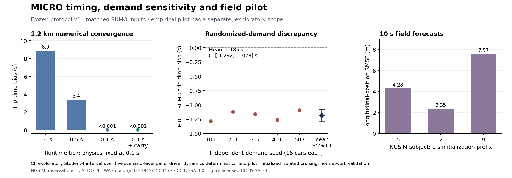

# MICRO timing and scientific validation

The [consolidated status](MICRO_VALIDATION_STATUS.md) distinguishes completed
verification/reference comparisons from the remaining empirical validation.

The later [cross-link following revision and frozen v2 campaign](MICRO_CROSS_LINK_FOLLOWING.md)
address the discharge discrepancy found here. This page retains the original v1
methods and results, including its failed demand realizations.

This stage separates implementation checks, agreement with SUMO and empirical
traffic validation. Passing a regression tolerance does not establish accuracy for
an arbitrary traffic study. Scientific criteria in
[`sumo_scientific_protocol_v1.json`](../scripts/scenario/sumo_scientific_protocol_v1.json)
are provisional numerical-equivalence targets for the specified experiments.
They were committed as `b68e5e0` before executing the held-out cases. The protocol
SHA-256 is `4c49d7e6e818d45dd5fc38fa062498c6fdbf9a6bc673315698b92b2327ddaacb`.
Any later revision needs a new version and fresh validation cases; failed criteria
remain in the results.

## Physical clock and remainder contract

`Simulation.tickDuration` now specifies physical seconds per integer runtime tick.
The default remains one second. Fractional clocks divide a second into an integer
number of ticks. Existing EventOrder, owner acceptance, anti-message, GVT and report
receipt protocols continue ordering integer ticks; floating-point physical times
never determine mailbox ordering. Configuration times, including departures,
signals and the horizon, must be expressed in the selected runtime ticks.
`SimulationUtil` installs the clock setting on each JVM before shard creation.

The first supported fractional-clock scope is MICRO Car, Link, Node and
TrafficSignal, with static routing and no model plugins, dynamic mode choice or
model-created actors. Startup rejects other source types; Link initialization
rejects MESO links and physics intervals different from `tickDuration`. Person,
Bus, Subway, Bicycle and Motorcycle continue using the one-second clock until
their physical-time calculations have explicit adapters. Their default behavior
is retained; this stage does not imply fractional-clock support for those models.

Setting `carryMicroRemainder=true` on a Link requires one physics step per runtime
tick and a link longer than a speed-limit physics step. A crossing's unused
fraction of that step travels through `MicroLeaveLinkData`, checkpointed
CarJourneyState and `EnterLinkData`. Node signal/capacity grants retain their
existing identities. Car uses the remainder only at the same tick with positive
carried velocity; a capacity/signal stop or later grant discards it. Destination
Link caps velocity to its speed limit and motion to space behind the downstream
rear bumper. A blocked remainder stops the entrant. The entry acknowledgment
contains the actual lane position and velocity, including curve coordinates.

This avoids retroactive integration of an entire old global interval on a Link
that has already advanced. The minimum-length restriction prevents an unsupported
multi-link jump within the same physics step. Supporting smaller links or different
time units requires another explicit transport/integration design.

All behavior-affecting values are in model state/message payloads, copied by
interning and cleared on trip reset. Cold-peer codecs cover nonzero remainders and
entry positions. Car tripinfo and Link elapsed-time/summary metrics use physical
seconds, while `tick` fields remain runtime ticks. The independent comparison
converts timestamps with the recorded clock and uses acknowledged entry positions;
it never fits a time shift. At an inclusive horizon, the accounted runtime owns
finalization: a final MICRO update must not prematurely finish the Car in its
legacy local cap branch.

Summary reductions sort registered vehicle IDs before adding floating-point
values, so replay cannot change a physical report through set iteration order.
MICRO relative speed normalizes both quantities to m/s. CSV calendar timestamps
use physical clock time; JSON's `real_time` remains wall-clock time.

## Experiment design

The convergence experiment holds 0.1-second integration fixed, compares runtime
quanta of 1, 0.5 and 0.1 seconds on a 1.2 km twelve-link route, and separately
enables remainder transfer at the finest clock. It uses a common one-second
comparison grid across resolutions. Both policies execute the finest carried case.

Held-out cases vary road lengths, turning direction and demand; they include a
heterogeneous ten-link route and a denser protected signal stream. They were not
used to select model parameters. Every case records exact physical inputs,
protocol/executable hashes, completed-trip coverage, signed bias, absolute errors,
trip-time distributions and trajectory errors. Full committed report multisets
compare conservative and optimistic execution.

Additional measures include halted approach queues sampled at equal times,
matched consecutive discharge headways within a green interval, and completed
cohort throughput over the fixed horizon. This throughput does not estimate
saturated capacity. Queue means speed below 0.1 m/s, rather than every slowed
vehicle. Definitions and thresholds are frozen with the protocol.

Five independent seeds perturb input demand headways, shared exactly by HTC and
SUMO. Driver dynamics remain deterministic. Paired inference uses scenario-level
mean errors, not vehicles/time samples as independent observations. A 95% Student-t
interval with four degrees of freedom is exploratory and assumes approximately
normal independent scenario-level differences. It measures variability conditional
on the specified demand distribution, not broader model or field-data uncertainty.
Trajectory RMSE uses common observed timestamps and averages per-vehicle RMSEs;
full terminal durations and per-trip sample counts are retained separately.
Percentiles use linear interpolation between ordered observations.

## Empirical pilot

The later [conditional Lankershim field study](MICRO_FIELD_VALIDATION.md) adds
actual leader/follower and two-follower queue replay. Its frozen field gate is
not established; it is separate from the historical isolated-cruising pilot below.

The official [USDOT/FHWA NGSIM dataset](https://data.transportation.gov/d/8ect-6jqj)
provides a bounded exploratory free-flow forecast. Metadata documents feet,
feet/second and 100 ms observations. The fetcher retains query URLs, raw hashes,
license and recommended attribution. It removes exact duplicates and rejects
conflicting timestamps, gaps, lane changes and recorded preceding vehicles.

Subject selection and quality rules are persisted before downloads or forecast
errors. For each of three qualifying subjects, a one-second prefix estimates
initial cruising speed; the next ten seconds are held out for position/speed
prediction by the actual HTC MICRO simulator. The speed is both the initial and
desired free-flow speed, and the link extends beyond the observation horizon.
No forecast observation fits those parameters. Horizon telemetry must remain
censored, with no invented completed trip distance.

This pilot tests a conditional isolated cruising forecast. It does not validate
following, queues, junctions or network performance. Annotation/position derivative
inconsistency is reported. There is no field-derived acceptance threshold or
empirical-validity claim. General traffic validation still needs study-specific
targets, appropriate observed conditions and independent validation data, consistent
with [FHWA validation guidance](https://ops.fhwa.dot.gov/trafficanalysistools/tat_vol3/sect0.htm).
Forecast errors include the estimated desired-speed assumption and unmodeled
context. These three subjects share an observation window and are not independent
network-validation replications.

The retained
[`ngsim-free-flow-pilot-snapshot-2026-10-25.zip`](validation/ngsim-free-flow-pilot-snapshot-2026-10-25.zip)
contains the original bounded responses, metadata, attribution/license and quality
rules. Snapshot replay rechecks every source hash and reruns quality control before
simulation. Tampered observations fail before network access or model execution.

## Reproduction

```bash
sbt test assembly
python3 -m unittest discover -s scripts/scenario -p 'test_*.py' -v
python3 scripts/scenario/run_sumo_scientific_campaign.py \
  --jar target/scala-3.3.5/hyperbolic-time-chamber-1.24.3.jar \
  --output /tmp/micro-convergence --stage convergence --base-port 20000
python3 scripts/scenario/run_sumo_scientific_campaign.py \
  --jar target/scala-3.3.5/hyperbolic-time-chamber-1.24.3.jar \
  --output /tmp/micro-held-out --stage held-out --base-port 21000
python3 scripts/scenario/run_sumo_scientific_campaign.py \
  --jar target/scala-3.3.5/hyperbolic-time-chamber-1.24.3.jar \
  --output /tmp/micro-stochastic --stage stochastic --base-port 22500
python3 scripts/scenario/ngsim_field_pilot.py \
  --jar target/scala-3.3.5/hyperbolic-time-chamber-1.24.3.jar \
  --output /tmp/micro-field-pilot --base-port 23500
python3 -m zipfile -e \
  docs/validation/ngsim-free-flow-pilot-snapshot-2026-10-25.zip /tmp/ngsim-pilot-snapshot
python3 scripts/scenario/ngsim_field_pilot.py \
  --jar target/scala-3.3.5/hyperbolic-time-chamber-1.24.3.jar \
  --output /tmp/micro-field-replay --base-port 23500 --snapshot /tmp/ngsim-pilot-snapshot
```

Use fresh output directories and the same executable on all JVMs. The campaign
returns failure on engine/measurement/parity failures; a failed scientific
equivalence criterion remains a recorded result in `campaign.json`. Inspect
`allScientificCriteriaPassed` explicitly. The empirical pilot separately reports
whether three eligible forecasts completed and always records that empirical
validity has not been established. Raw observations and simulator output belong
under temporary directories; retained acceptance records must identify any
excluded attempt and why it was excluded.

## Measured findings

The four priorities are implemented as a reproducible workflow. The tests support
the clock correction and the specified held-out comparisons. They also identify
a remaining discharge-dynamics discrepancy; they do not establish general traffic
accuracy or empirical calibration.

The final executable passes **644 Scala tests in 134 suites** and **17 Python
regressions**. SHA-256:
`0e5e51c14d3246e58b3cae1da4b171f2e83316aefe63fa4146607254689f6763`.
Build log: `/tmp/htc-scientific-20261024/reporting-fix-build.log`. Final inputs and
raw output: `/tmp/htc-scientific-final-20261025/`. The
[retained record](validation/micro-scientific-2026-10-25.json) includes all criteria,
successful measurements and failed equivalence hypotheses, commands, hashes,
per-trip sample coverage, seed-level inference and excluded diagnostic attempts.

The final campaign contains **21 real-SUMO comparison runs**, **169 completed
cars**, three field forecasts, one optimistic field replication, one CSV check
and two legacy transit regressions: **28 HTC runs** in total. All measurements
complete successfully. The four held-out cases pass; the five independent
randomized-demand realizations fail their equivalence criteria. These results
must not be summarized as all traffic-accuracy tests passing.

All **11 full-report comparisons match**, including four held-out policy pairs,
the stochastic policy pair, the finest convergence pair, one/two-JVM layouts
under each policy, two-JVM policy parity, legacy Bus service and field-horizon
replication. The two-JVM left-turn pair has 2298 reports per run; the optimistic
case exercises 135 rollbacks and records up to 459 cross-owner transfers. The
legacy one-second Bus runs each traverse 39 connectors and complete four Person
schedules, matching all 2183 reports across policies. Field-horizon replication
matches 205 reports; the CSV check independently verifies all 205 calendar times.
The comparator retains physical durations and only excludes wall-clock/simulation
IDs and the SUMO summary's CPU duration.

Initial held-out execution exposed a TCP bind failure on an auxiliary management
port and floating summary-reduction differences. They remain labeled diagnostic
artifacts. Only reporting order/units, CSV formatting and snapshot replay were
corrected after first held-out execution; physical parameters/dynamics and frozen
criteria were unchanged. The complete final campaign was rerun on the executable
above, using ports below the OS ephemeral range.



The figure and its [SVG version](validation/figures/micro-scientific-2026-10-25.svg)
are CC BY-SA 3.0, with NGSIM attribution. Regenerate them with
`python3 scripts/scenario/plot_micro_scientific_validation.py` from the retained
record. Numerical agreement, demand variability and empirical forecasts have
different scopes; none of these panels establishes general urban-traffic validity.

### Time convergence and boundary transfer

On the 1.2 km development route, with 0.1 s physics held fixed:

| Runtime tick | Remainder transfer | Trip-time bias | Route-distance RMSE |
|---|---|---:|---:|
| 1.0 s | Disabled | +8.9 s | 57.912 m |
| 0.5 s | Disabled | +3.4 s | 24.463 m |
| 0.1 s | Disabled | Below 0.001 s | 1.032 m |
| 0.1 s | Enabled | Below 0.001 s | Below 0.000001 m |

This is numerical agreement in a controlled constant-speed case. It does not
establish real-world position accuracy at sub-micrometre precision.

### Held-out cases

The physical model and parameters were frozen before these cases. All criteria
pass for both policies, with full completion coverage and matching cohort counts.

| Case | Cars per policy | Maximum trip-time difference | Route-distance RMSE | Speed RMSE |
|---|---:|---:|---:|---:|
| Short left turn | 6 | Below 0.001 s | 0.043 m | 0.016 m/s |
| Longer right turn | 6 | Below 0.001 s | 0.091 m | 0.022 m/s |
| Dense protected straight signal | 12 | 0.2 s | 0.928 m | 0.307 m/s |
| Heterogeneous ten-link route | 4 | Below 0.001 s | Below 0.000001 m | Below 0.000001 m/s |

The signal case reaches six halted approach vehicles in each simulator, with
queue-count RMSE 0.209 vehicles and matched discharge-headway MAE 0.070 s. Halted
vehicle-time is 96.3 versus 104.0 vehicle-seconds; a similar maximum queue does not
imply identical queue evolution.

### Stochastic demand exposes a remaining model gap

The five independent demand realizations each contain 16 cars making protected
right turns. Every realization completes and is measurable, but each fails the
frozen trip-time/trajectory equivalence criteria. Across seed-level pairs:

- Mean signed HTC-minus-SUMO trip time: **−1.185 s**.
- Exploratory 95% Student-t interval: **[−1.292, −1.078] s**, five seed-level pairs.
- Per-seed mean absolute trip-time error: **1.106–1.325 s**.
- Per-seed 95th-percentile absolute error: **2.55–3.05 s**.
- Mean route-distance RMSE: **7.093–8.444 m**.
- Halted queue-count RMSE: **0.160–0.219 vehicles**.
- Discharge-headway MAE: **0.171–0.214 s**.

In seed 101, the early free-flow vehicles agree within 0.1 s, while the final
queued vehicle finishes 3.2 s earlier in HTC. Error accumulation through discharge
points to following/discharge dynamics, rather than the corrected whole-tick
boundary loss. Identifying the responsible model term still requires a focused
audit. Thresholds and physical parameters were not changed to make these results
pass. These cases are now diagnostic development data for any subsequent model
revision; a new revision needs fresh validation cases and demand seeds.

### Empirical forecasts

The three NGSIM subjects each supply 100 held-out forecast observations after the
one-second initialization prefix:

| Subject | Position RMSE | Speed RMSE | Position bias at 10 s |
|---|---:|---:|---:|
| 5 | 4.284 m | 0.947 m/s | +6.048 m |
| 2 | 2.355 m | 1.129 m/s | −4.471 m |
| 9 | 7.574 m | 1.774 m/s | −14.699 m |

All trajectories pass the stated continuity, lane and recorded-leader checks.
Annotation speed versus position-derivative MAE is 0.082–0.126 m/s. There are no
exact duplicates in the selected three intervals, although preliminary dataset
inspection found duplicate records elsewhere. This remains an exploratory
forecast with estimated cruising speed; no empirical acceptance claim follows.
