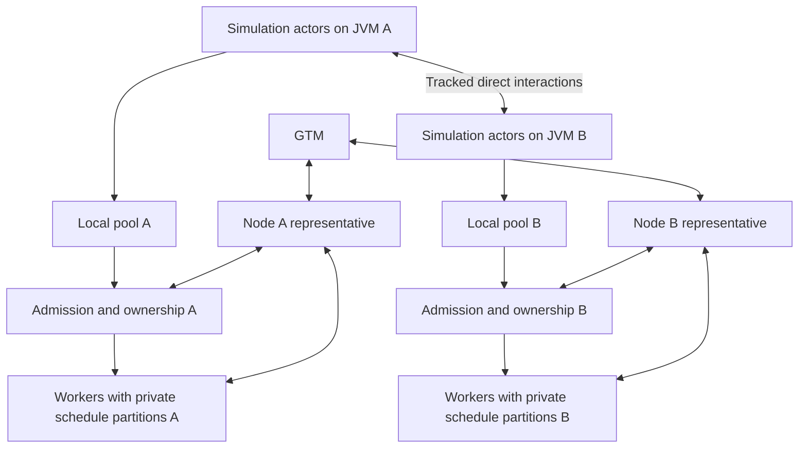

# Node-local Time Manager pools and scheduling partitions

Date: 2026-11-17. Status: implemented; selected by the 3.10.0 automatic default within the supported scope, with remaining scope and
performance questions. Source baseline inspected: `138588d`.

The [runtime guide](NODE_LOCAL_TIME_MANAGER.md) describes the implemented option,
configuration and limits. Sections below retain the design rationale and proposals;
implementation details in the runtime guide take precedence over unselected
alternatives. In particular, the enrollment handshake supplies the node-local
dispatcher reference without a separate process-global registry. Late current-tick
requests are normalized, and verified zero-delay model continuations stay inside
their tracked callback instead of requiring a second wake-up.

## Agreed strategy

Balance scheduled event counts within each tick across a fixed cohort of local
workers. Assign individual events, not permanent actor ownership or entire ticks,
to workers. Actors send through their JVM's local pool. Geography is not involved.

```text
Tick 10: 900 admitted events → 300 per worker with three workers
Tick 11: 600 admitted events → 200 per worker with three workers
```

Use an independent admission sequence per tick. For a new distinct wake-up, select
`workerIndex = sequence % workerCount`. A serialized node-local schedule dispatcher
behind the pool records the event and its assignment before enqueueing it to the
worker. An exact retry reuses its recorded assignment and does not advance the
sequence. Conflicting reuse of an identity must fail validation. With a fixed
cohort, admitted insertion counts differ by at most one; cancellations, execution
and generated interactions can change outstanding load. This balances counts,
not predicted execution cost. Cost estimation is not part of the agreed baseline.

Conceptually the node has `TreeMap[Tick, TickBucket]`, with event partitions and
their worker assignments. Physical storage is distributed:

| Component | Owned data |
|---|---|
| Schedule dispatcher | Per-tick sequences and event ownership directory |
| Each worker | `TreeMap[Tick, event collection]`, running executions and accounting records |

Each event record identifies its event, typed actor, tick, worker owner and status,
scoped by run and owner incarnation. The same actor can have pending events at
multiple ticks. Adding one does not replace another implicitly. Requests for the
same actor and tick coalesce into one spontaneous wake-up, as specified below.
Event cancellation and explicit replacement still require precise contracts.

```text
Car A runs E10 under Worker 1.
A separately admitted E11 for Car A remains scheduled.
finish(E10, nextTick=12) resolves E10 through Worker 1.
Its next schedule E12 enters tick 12's admission process and may go to Worker 2.
After tick 10 closes, Car A still has E11 and E12; its earliest tick is 11.
```

Completion routes through the pool using the recorded execution owner. Dispatch
claim belongs to that owner alone; workers do not concurrently mutate a shared
schedule tree. Finishing and admitting a successor can involve different
components, so an outstanding handoff must fence tick closure until acceptance.
The handoff contract and its message identities need implementation-level detail.

The admission path is a possible bottleneck to measure. Batching is a candidate
optimization, not a demonstrated speedup. Admission-to-worker publication, per-LP
serialization when multiple events target the same actor, callback effect ownership,
ledger routing and coordinated closure remain to be specified. Generated model
interactions retain direct transport and cascade accounting; round-robin scheduling
does not redistribute those messages or actor physics computation automatically.

### Schedule dispatcher routing and state

"Admission" means accepting and assigning a schedule through this dispatcher. It
does not mean asking the GTM for an individual grant. A separate dispatcher actor
or integration into a custom local router are implementation alternatives; no
choice between them has been implemented.

| Incoming operation | Routing behavior |
|---|---|
| New actor/tick wake-up | Use that tick's sequence and record the selected worker |
| Another request for the same actor/tick | Reuse the wake-up and its owner; no second insertion or assignment |
| Exact schedule retry | Reuse its existing assignment without another insertion |
| Execution finish | Route to the recorded execution owner; do not rebalance it |
| Successor schedule from a finish | Treat as a new event with its own assignment |

Conceptual types, scoped by run and owner incarnation:

```text
Schedule dispatcher:
  nextAssignment: Map[Tick, Sequence]
  wakeupIndex: Map[{ run, typedActorId, actorIncarnation, tick }, EventId]
  eventDirectory: Map[EventId, { typedActorId, tick, ownerWorkerId, acceptanceStatus }]

Each worker:
  scheduled: TreeMap[Tick, Map[EventId, ScheduledEvent]]
  running: Map[ExecutionId, RunningExecution]
```

These are actor-owned mutable structures, not a tree concurrently mutated by all
workers. Identity, directory reclamation and running-to-scheduled associations
still require precise contracts.

The proposed handoff is:

1. The origin retains a successor-admission obligation.
2. The dispatcher records the assignment as pending acceptance before forwarding.
3. The destination stores the event, then acknowledges acceptance.
4. The dispatcher records acceptance and acknowledges the origin's handoff.

Acceptance means stored, not executed. An event for tick 12 can therefore finish
its handoff during tick 10. Retried enqueue and ACK operations must be idempotent.
No actor blocks its thread; retained obligations fence closure until they settle.
The general handoff was proposed during discussion; exact messages and failure
behavior remain to be specified.

### Spontaneous completion and interaction effects

A Car can receive a spontaneous execution E10 at tick 10 and also process an
interaction from another actor. That interaction can schedule tick 11, while the
Car's eventual `finish(E10, nextTick=12)` independently schedules tick 12. Both
effects must reach the scheduler; neither implicitly replaces the other.

The direct runtime accounts interaction callbacks and their descendants separately
from the outstanding spontaneous execution. Processing an interaction does not
require a second `onFinishSpontaneous` merely because another message arrived.
An interaction callback can deliver a reply needed to resolve that execution.

Different authorized ticks are separated by global closure. Repeated scheduling
of the same actor at the same tick creates one wake-up, not multiple spontaneous
executions. These rules remove the motivating case for the additional cross-worker
execution guard suggested during discussion; that guard is not adopted. Interaction
callbacks remain independently accounted and can run while a spontaneous execution
awaits its required reply.

### Agreed wake-up coalescing

A spontaneous event means wake this actor at this tick. The unique wake-up key is
`(run, typedActorId, actorIncarnation, tick)`. Distinct requests for that key, even
with different request IDs or different senders, share one scheduled event and one
worker assignment. An exact request retry is idempotent as well. Retain the key
through scheduled, running and completed states until the authorized closure cut
makes reclamation safe; a later same-key request must not create another execution
at that tick. Requests for a closed tick must obey the runtime frontier contract.

The dispatcher checks this index before assigning a new wake-up. Only a new key
advances the tick's assignment counter. Each originating scheduling effect still
needs its own acceptance/accounting resolution; coalescing wake-ups must not drop
an origin's handoff obligation. Cancellation by one of several requesters and
explicit replacement semantics remain to be defined.

```text
request R1: Car A at tick 11 → create wake-up E11, assign Worker 2
request R2: Car A at tick 11 → reuse E11 and Worker 2
request R3: Car A at tick 12 → create a separate wake-up E12
```

Per-tick balance therefore counts distinct actor wake-ups, not raw scheduling
requests. This rule does not coalesce modeled interaction messages or their work IDs.

### Agreed tick-closure conditions

An empty tick bucket alone does not mean a worker is finished. Closure must account
for running spontaneous executions, message cascades and required business replies,
pending schedule handoffs and required reporting effects. For the Car example:

```text
E10 finished; interaction and descendants settled;
tick-11 and tick-12 events stored; required report receipts accepted.
```

Future schedules must be accepted and stored, not executed, to settle their
current-tick scheduling effects. Workers continue accepting authorized current-tick
interactions even after their own roots settle. A locally idle report is not a
permanent fence against incoming remote descendants.

Use two logical stages: establish global settlement of the current tick, then
collect fresh next-tick summaries. The dispatcher must have no unaccounted handoffs
affecting the cut. A node aggregates its worker minima and supplies its next tick
to the GTM; the GTM also respects other nodes and accepted input coverage. Retained
accounting obligations must cover every handoff so settlement cannot overlook work
in transit. Exact control messages and the proof of the coordinated cut remain
implementation design tasks.

## Assessment

This is a reasonable candidate for improving scheduling locality. It is not yet
demonstrated to be fast, faster than the current implementation, or scalable to a
particular cluster size. The expected benefit is reduced remote control traffic
between simulation actors and their scheduler. Shared-state contention, pool
routing, allocation and global synchronization can offset that benefit.

The proposal combines established principles with an HTC-specific architecture:
conservative synchronization, distributed termination detection, and linearizable
shared-state operations. It is not one published algorithm, and existing HTC
accounting has not been shown to implement Dijkstra–Scholten exactly.

The initial target is direct conservative execution. Keep the existing runtime
available for comparison and fallback. Time Warp requires a separate design for
acceptance ledgers, rollback, anti-messages and GVT; do not infer support from this
proposal.

## Motivation and current implementation

Currently `GlobalTimeManagerBase.createTimeManagersPool` creates one cluster router
with `RoundRobinPool`, `total-instances` and `max-instances-per-node`. Normal model
scheduling and completion use the actor's current owning LTM. They do not routinely
pass through the cluster pool for every update.

The direct transport already delivers modeled interactions directly to receivers.
Consequently, local pools principally target scheduler/control locality and owner
placement; they do not newly eliminate all intermediary model-message forwarding.
The actual fraction of remote owner traffic must be measured.

Current building blocks:

| Source | Relevant behavior |
|---|---|
| [`GlobalTimeManagerBase`](../src/main/scala/core/actor/manager/time/GlobalTimeManagerBase.scala) | Cluster-wide LTM pool creation |
| [`SimulationBaseActor`](../src/main/scala/core/actor/SimulationBaseActor.scala) | Current-owner scheduling, direct callbacks, child tracking, business reply obligations |
| [`DirectWorkId`](../src/main/scala/core/runtime/conservative/DirectWorkId.scala) | Source LP, incarnation and sequence identity |
| [`DirectWork`](../src/main/scala/core/runtime/conservative/DirectWork.scala) | Parent, receiver and tick |
| [`DirectWorkCompletion`](../src/main/scala/core/runtime/conservative/DirectWorkCompletion.scala) | Replacement of a callback by its emitted children |
| [`DirectWorkLedger`](../src/main/scala/core/runtime/conservative/DirectWorkLedger.scala) | Single-owner pending, early and completed records |
| [`ChannelAwareLocalTimeManager`](../src/main/scala/core/actor/manager/time/ChannelAwareLocalTimeManager.scala) | Owner effects, accounting forwarding, report receipts and batch closure |

`DirectWorkLedger` uses mutable collections under single-owner access. It cannot be
shared among concurrent workers unchanged. Also, actor-side validation currently
checks the physical current-owner reference for spontaneous dispatch. Allowing any
worker to dispatch requires explicit node authority and updated validation, not
just changing the destination to a pool.

## Proposed architecture

Each simulation JVM has one local pool, serialized admission and worker-owned
schedule partitions. The JVM owns the logical scheduling service; each scheduled
execution has a recorded worker owner that may differ from its actor's other events.



The representative handles membership, grants and coordinated node summaries. It
should not forward every scheduling or modeled interaction message. There is no
need to add a separate regional Time Manager layer merely to name this role.

A process-local registry must be scoped to the simulation run and ActorSystem,
initialized on every JVM before actors use it, and cleared at shutdown. One JVM
must not accidentally resolve another run's scheduler. Worker readiness and node
registration ACKs precede execution. Local workers use a local router, not remote
deployment through the cluster router.

This is an architectural direction. Exact actor names, registry API and
configuration keys remain to be specified; none are introduced by this document.

## Literature basis and limits

### Conservative synchronization

Conservative PDES executes events only when safe. Synchronous approaches use global
agreement, while asynchronous approaches such as Chandy–Misra–Bryant use channel
information and null messages. Park, Fujimoto and Perumalla compare their costs
and show that scalability depends on workload and synchronization strategy [1].

Our proposed starting point is globally authorized ticks with node-level summaries.
It is not an implementation of the null-message algorithm or a claim that barriers
are always faster. Reliable positive lookahead would be needed to justify larger
safe execution windows; arbitrary same-tick interaction chains cannot simply be
advanced independently.

### Distributed termination detection

Dijkstra–Scholten detects completion of a computation that spreads through messages.
Local inactivity alone cannot establish completion: remaining messages may activate
more work [2]. This motivates accounting for the entire tick's message cascades.

HTC's explicit callback identities and parent/child replacements are our engineering
mechanism. They are inspired by the same obligation-conservation principle, but
are not a demonstrated implementation of the paper's engagement-tree algorithm.
A multi-root, multi-JVM tick with input admission and reports needs its own proof.

### Linearizability

Herlihy and Wing define a correctness condition under which each concurrent
operation appears to take effect at one point between invocation and response [3].
We propose this contract for scheduler operations. It does not select a lock or
queue, guarantee throughput, require one global lock, or make the scheduler
lock-free. Individually atomic map updates do not automatically make a multi-record
closure decision atomic.

## Identity and ownership

Use identities with explicit scope, rather than a hash of payload contents:

| Identity | Purpose |
|---|---|
| Run epoch | Reject traffic belonging to a different run |
| Node/owner incarnation | Distinguish scheduler authority instances |
| Typed LP identity | Distinguish actor types even when numeric IDs coincide |
| Schedule revision | Reject superseded schedule changes |
| Execution identity | Identify one particular spontaneous dispatch |
| Work identity and parent | Account one callback and its emitted descendants |
| Grant/closure round | Correlate completion summaries with the current authorization |

Existing `DirectWorkId(source, incarnation, sequence)` is a useful building block.
The protocol envelope already carries the epoch. Define uniqueness, overflow and
retention explicitly. IDs support deduplication; they do not establish message
ordering, exactly-once delivery or crash recovery. Retries of one logical operation
reuse its identity; genuinely new work receives a new identity.

Distinguish three responsibilities:

1. The actor's home node provides admission and the scheduling service.
2. Each event's assigned worker owns its dispatch and completion record.
3. A cascade's accounting owner tracks descendants even when they execute remotely.

Preserve the current direct transport invariant: receiver effects must be accepted
before completion reaches the chain's accounting owner. The present implementation
does this through a fixed LP owner. Mapping callback effects and business reply
state to the proposed per-execution ownership is an open adaptation; it cannot be
obtained simply by changing the router. Moving execution does not silently move
the cascade's accounting responsibility.

## Schedule and execution lifecycle

An actor can have a running dispatch, business reply obligations and future schedule
entries at the same time. The earlier `Running -> Scheduled` example illustrates
an atomic finish operation; it is not a sufficient complete state representation.
Preserve current scheduling semantics, including separate schedule controls and
revisions, rather than assuming every actor has exactly one next event.

### 1. Register

Register a typed actor identity, incarnation, physical placement and scheduling
authority. Acknowledge only after registration is accepted. Passive actors that
receive interactions also need ownership. Fixed placement is the recommended
first implementation scope; this remains a proposal, not a completed decision.

### 2. Schedule

Accept a schedule update against the correct owner, incarnation and revision.
Record the authoritative schedule before publishing its ready-queue entry. Reject
or ignore stale updates according to an explicit idempotency contract. Concurrent
schedule and finish messages can be processed out of sender order at different
workers; revisions and causal rules must resolve this.

### 3. Claim and dispatch

Under the current grant, atomically claim a due schedule and reserve its execution
identity. Exactly one worker wins a particular claim. Enroll the accounting root
before sending the dispatch. Queue entries that are stale after rescheduling must
not dispatch. Bound active dispatches and batch sizes; do not enqueue all due work
without backpressure.

This is an at-most-one logical claim in a failure-free supported run. Worker or
node failure must not trigger unproven retries and duplicate model effects; the
first scope should fail the run rather than advertise independent recovery.

### 4. Execute callbacks and declare children

Each callback executes model code under tracked runtime scope. Sends get fresh work
IDs and retain the cascade accounting owner. Completion declares all children as
part of replacing the parent's obligation. A parent must never disappear from
accounting before its children are represented.

A child can finish before its parent's declaration reaches the ledger. Keep an
early receipt until the declaration arrives; it cannot erase an undeclared root.
Exact duplicate receipts are idempotent; conflicting payloads for the same identity
fail validation. IDs alone do not solve these races.

### 5. Finish the spontaneous execution

The model calls `onFinishSpontaneous` when its own work is resolved. Its execution
owner accepts the identified finish, preserving independent future events. A
successor schedule enters node admission and may have a different owner. The
finish-to-admission handoff must remain accounted until the successor is accepted;
do not require an unimplemented atomic transaction across the two actor mailboxes.

Fire-and-forget sends do not introduce model reply waits. Consistency-critical
requests retain their business reply obligation until the appropriate response;
transport completion is not a substitute. Models continue to use
`requestInteraction`, `replyInteraction` and `sendMessageTo`; runtime accounting
remains outside model handlers.

### 6. Settle accounting and effects

An actor's spontaneous finish and an entire cascade's settlement are different
facts. All declared descendants, including remote work, must settle. Apply the
receiver's schedule effects and register report obligations before publishing its
accounted completion. Actual report receipts still fence closure. End-of-run sink
flush is a further barrier, not equivalent to accepting an individual report.

### 7. Close the tick and obtain fresh summaries

Tick closure requires a consistent protocol, not a concurrent-map scan or an
approximate counter. The GTM waits for the authorized cohort, then obtains fresh
scheduling/frontier information before choosing the next grant. A node that has
finished its own roots may still receive work from another node's open cascade;
it must continue accepting authorized descendants until global settlement.

Required conditions include:

- Every authorized due root is enrolled and dispatched or otherwise accounted for.
- Running dispatches, required replies and descendant obligations are resolved.
- No early receipts or unapplied accepted effects remain.
- Reports, births, retirement and other supported lifecycle obligations are settled.
- Accepted input coverage and registration fences justify the frontier.
- All worker mutations affecting the summary belong to the coordinated cut.

Future scheduled work does not prevent the current tick closing. An empty future
queue also does not authorize final termination without producer closure and the
remaining reporting/lifecycle barriers. No timeout authorizes completion.

## Example: one cascade crossing two JVMs

```text
GTM grants tick 10.
Node A enrolls E1 and dispatches Car A.
Car A sends W2 to Node B's intersection actor; W2 has parent E1.
Car A returns from the callback while retaining its required admission reply.
Node B executes W2 and sends reply W3, declaring W3 as its child.
Car A processes W3, resolves admission, and finishes E1 with nextTick=12.
Each receiver's home node applies its effects before accounting completion.
The cascade ledger on Node A accounts E1, W2 and W3 in any receipt order.
Only after all roots, effects and obligations settle do nodes supply fresh summaries.
GTM chooses the next safe tick, also respecting accepted input coverage.
```

E1's callback receipt and E1's spontaneous finish may occur at different times.
A downstream actor completes its own callback; it does not arbitrarily finish the
original actor's spontaneous dispatch. Explicit delegation would require a separate
contract. Branching cascades must account every branch, not just the last observed
response.

## Scheduler API and storage

Names below are conceptual contracts, not implemented Scala signatures:

| Operation | Required guarantee |
|---|---|
| `register` | Unique accepted ownership before readiness |
| `schedule` | Revision-aware update and consistent queue publication |
| `claimReadyBatch` | At-most-one claim, grant validation and bounded enrollment |
| `finish` | Identity-aware finish plus next schedule, idempotent exact retry |
| `completeWork` | Parent/children replacement, early receipt handling, effect ordering |
| `prepareTickClosure` | Consistent worker cut correlated with the current round |
| `collectFrontier` | Fresh minimum after global settlement and admission fencing |

The agreed layout is serialized per-tick admission and worker-owned tick-ordered
event collections, execution records and ledgers. Ordinary mutable collections
are appropriate within a single owning worker; concurrent maps are unnecessary
there. Exact event-container choices, indexes, reclamation and closure remain open.
Admission waiting in a mailbox or a worker queue counts as outstanding work.

Earlier alternatives included one shared scheduler actor or concurrent workers
mutating shared records. These are alternatives for comparison, not the selected
baseline. Avoid blocking waits and I/O in actors. Batches must be bounded so workers
yield; no thread waits for another actor's reply.

## GTM communication and migration

The proposed GTM membership unit is a node scheduler. Worker identities can remain
visible for readiness and diagnostics, but each node contributes one coordinated
summary per round. Dispatch and completion effects do not all pass through the node
representative. Include epoch, membership and round identity in every grant/summary;
late or duplicate summaries cannot close a different round.

Migration means transferring an actor's placement and authority between JVMs. A
local registry lookup at the destination does not perform this transfer. Preserve
logical identity, schedule revisions, pending replies, reports and accepted-input
fences through a closed-batch freeze, restore and authority rebind. Resume only
after required ACKs; do not let source and destination dispatch concurrently.
See [`LOAD_BALANCING.md`](LOAD_BALANCING.md) for the existing conservative adapter.

Recommended first scope: fixed placement and explicit startup rejection of live
migration with this option. Existing supported policies retain their behavior.
Migration, dynamic births, progressive input and recovery need explicit scope
decisions; unsupported combinations must fail clearly rather than partly work.

## Performance hypotheses

These are engineering hypotheses about HTC, not measurements established by the
cited papers:

| Possible gain | Possible offset |
|---|---|
| Scheduler traffic stays within the actor's JVM | Router and worker handoff add local messages |
| Worker-owned partitions process concurrently | Serialized admission can limit throughput |
| Scheduled counts are balanced within each tick | Event costs and cascades can differ |
| One node summary replaces multiple worker summaries | Global barriers still wait for slow nodes |
| Batch claiming amortizes overhead | Large batches reduce fairness and increase memory |
| Existing direct accounting is reused | IDs, retained receipts and reports allocate memory |

A useful break-even question is whether remote scheduling/control cost removed is
larger than the added routing, synchronization and accounting cost. Costs overlap
in execution; this is a diagnostic model, not a reliable additive wall-time formula.
Local pools do not accelerate the traffic physics or remove cross-node interactions.
Cheap events and sparse ticks may expose scheduler/barrier overhead particularly
strongly. More workers need not improve throughput.

## Validation and benchmark plan

First establish correctness; then measure complete runs. Do not infer simulator
speed from map-operation microbenchmarks alone.

Compare three variants under equal core, dispatcher, JVM and memory budgets:

1. Current cluster-pool ownership with direct conservative transport.
2. Node-local assignment followed by direct communication to an assigned local LTM.
3. Proposed local pool with per-tick balanced admission and worker-owned partitions.

Variant 2 separates the benefit of locality from the benefit/cost of per-tick event
assignment. Without it, a faster result cannot identify which change helped.

Use one-, two- and four-JVM runs where resources allow, sweep worker counts, and
include cheap MESO events, heavier MICRO work, deep and branching cascades, skewed
actor distributions, remote interactions and reporting-heavy scenarios. Record
actual local/remote control-message fractions. Keep placement, inputs, seeds,
transport semantics, reporting and accepted input coverage comparable.

Measure end-to-end wall time, processed events/second, tick closure latency
(including p50/p95/p99), worker queue delay, GTM time, CPU, contention/CAS retries,
network bytes, allocation, GC, heap and ledger high-water marks. Export low-cardinality
metrics; never use entity IDs as Prometheus labels. Measure startup and simulation
separately and also report total user-visible elapsed time.

Record executable/config hashes, hardware and JVM settings. Use warm-up, repeated
runs, randomized variant order and uncertainty estimates. Choose practical
acceptance thresholds before inspecting evaluation results; no numeric speedup or
regression threshold has yet been agreed. A defensible acceptance requires improved
representative workloads, bounded memory and no unacceptable regressions, in
addition to correctness.

Correctness tests must cover concurrent claim, finish versus reschedule, reordered
controls, duplicate and conflicting completion, early child completion, remote
descendants arriving after local roots settle, delayed report ACKs, stale epochs,
new input near closure, horizon finalization and worker loss. Exercise the real
multi-JVM transport. Compare required mobility outcomes, not just successful exit.
Direct transport permits independent same-tick arrival order, so do not claim
bitwise replay equivalence beyond its existing ordering contract.

## Decisions still required before implementation

1. Exact first supported combinations: input sources, routing, births and placement.
2. Node/worker startup protocol and actor-side authority validation.
3. Full schedule semantics and revision rules under reordered worker processing.
4. Queue publication, claim and parent/child replacement linearization points.
5. Closure protocol, admission fencing and fresh frontier collection.
6. Backpressure, ledger retention, reclamation and failure behavior.
7. Benchmark workloads and preregistered performance acceptance criteria.

The next design exercise is to specify `schedule`, `claimReadyBatch`, `finish` and
`completeWork` as preconditions/postconditions, then walk through adversarial
interleavings before selecting storage. This document authorizes no runtime change.

## References

1. Alfred Park, Richard M. Fujimoto and Kalyan S. Perumalla (2004).
   *Conservative Synchronization of Large-Scale Network Simulations*.
   Proceedings of the 18th Workshop on Parallel and Distributed Simulation.
   [Author paper](https://www.cs.mcgill.ca/~carl/conservativenetworksim.pdf).
   Supports the distinction between synchronous/asynchronous conservative methods
   and workload-dependent performance; does not validate this HTC scheduler.
2. Edsger W. Dijkstra and C. S. Scholten (1980).
   *Termination detection for diffusing computations*.
   Information Processing Letters, 11(1), 1–4.
   [Original EWD684 text](https://www.cs.utexas.edu/~EWD/transcriptions/EWD06xx/EWD684.html).
   [DOI](https://doi.org/10.1016/0020-0190(80)90021-6).
   Supports message-obligation reasoning for distributed completion; the proposed
   HTC ledger needs an independent correctness argument.
3. Maurice P. Herlihy and Jeannette M. Wing (1990).
   *Linearizability: A Correctness Condition for Concurrent Objects*.
   ACM Transactions on Programming Languages and Systems, 12(3), 463–492.
   [Author paper](https://www.cs.columbia.edu/~wing/publications/HerlihyWing90.pdf).
   [DOI](https://doi.org/10.1145/78969.78972).
   Supports the concurrent-operation correctness contract; makes no performance
   claim for the proposed implementation.

Local sources: the source links above, [`AGENTS.md`](../AGENTS.md),
[`CONSERVATIVE_CHANNEL_RUNTIME.md`](CONSERVATIVE_CHANNEL_RUNTIME.md) for the reference
transport, and [`LOAD_BALANCING.md`](LOAD_BALANCING.md). The reference transport has
different ordering semantics from direct execution. At the inspected baseline,
`CONSERVATIVE_DIRECT_RUNTIME.md` is referenced by existing documentation but absent;
this proposal uses the direct implementation as its evidence and does not replace
that missing operational document.
