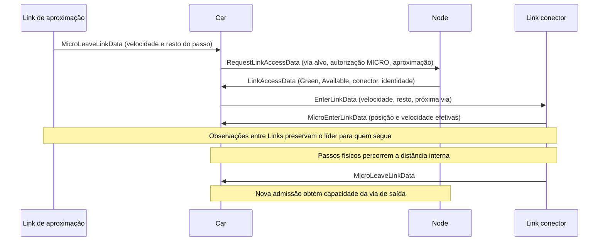

# Infraestrutura Viária — `Link`, `Node`, `TrafficSignal`

Estado consolidado em 2026-10-25:
[implementação e validação MICRO](MICRO_VALIDATION_STATUS.md). O contrato de
[geometria](JUNCTION_GEOMETRY.md) e o de
[seguimento entre Links](MICRO_CROSS_LINK_FOLLOWING.md) detalham os recursos
opcionais e seus limites. A validação atual usa uma faixa, relógio de 0,1 s e
movimentos protegidos; não estabelece validade empírica geral.

> Arquivos principais:
> - [src/main/scala/model/hybrid/actor/Link.scala](../src/main/scala/model/hybrid/actor/Link.scala)
> - [src/main/scala/model/hybrid/actor/Node.scala](../src/main/scala/model/hybrid/actor/Node.scala)
> - [src/main/scala/model/hybrid/actor/TrafficSignal.scala](../src/main/scala/model/hybrid/actor/TrafficSignal.scala)

---

## Visão Geral do Grafo Viário

O mapa da cidade é um **grafo dirigido** onde:Dois modos completamente distintos de operação:

MESO: o Link registra entrada/saída, atualiza métricas e responde com
`LinkInfoData`. O veículo calcula a velocidade/duração e agenda sua saída;
o Link não mantém um loop espontâneo para percorrer a via.
MICRO: o próprio Link agenda eventos espontâneos no TM da simulação e delega a
física a `LinkMicroSimulationHandler`. Mantém posição/velocidade por faixa em
`VehicleInLane`; por padrão executa 10 passos de 0,1 s por tick de um segundo.
Envia a atualização final de cada veículo no lote ou `MicroLeaveLinkData` na saída.
Node — a interseção
Puramente reativo. Três funções:

Armazena referências de BusStop e SubwayStation que se registram ao inicializar.
Mantém o estado atual de cada semáforo (signals), atualizado pelo TrafficSignal.
Responde a `RequestLinkAccessData` com `LinkAccessData`, verificando sinal e
capacidade. A ausência de sinal permite Green, mas não dispensa a capacidade.
TrafficSignal — o semáforo
Acorda nas transições de fase, calcula Green/Red e notifica os Nodes. O Node
também propaga o sinal à aproximação MICRO; o intervalo físico do Link determina
a travessia autorizada. Veículos consultam admissão pelo Node.

- **`Node`** = vértice (interseção, entroncamento, ponto de interesse)
- **`Link`** = aresta dirigida (trecho de via entre dois nós)
- **`TrafficSignal`** = controlador de semáforo associado a um ou mais nós

```
Node(A) ──[Link(A→B)]──► Node(B) ──[Link(B→C)]──► Node(C)
             │                          │
             │                TrafficSignal(B)
             │                (controla acesso a B→C)
```

Os três atores são **estáticos** — existem durante toda a simulação. Veículos (`Car`, `Bus`,
`Subway`, etc.) são dinâmicos e interagem com eles via mensagens.

---

---

# 1. Link

## 1.1 Responsabilidades

O `Link` representa um segmento de via e é responsável por:

1. **Controle de entrada/saída** de veículos (MESO e MICRO).
2. **Cálculo de velocidade** no modo MESO (modelo BPR-like via `SpeedUtil`).
3. **Simulação microscópica** no modo MICRO: sub-ticks, car-following, gerenciamento de faixas.
4. **Custo dinâmico** para roteamento: publica conforme a estratégia configurada;
   a validação com relógio fracionário mantém o roteamento dinâmico desabilitado.
5. **Métricas** estilo SUMO: resumo por tick de veículos carregados, saídos, tempo de viagem.

## 1.2 Modo MESO vs. MICRO

O campo `simulationMode: SimulationModeEnum` determina o comportamento do link:

| Aspecto | MESO | MICRO |
|---|---|---|
| Controle de tempo | Veículo agenda sua travessia | Link agenda eventos espontâneos no TM da simulação |
| Velocidade | `SpeedUtil.linkDensitySpeed` (agregado) | Krauss car-following por sub-tick |
| Veículos rastreados | `registered: Set[LinkRegister]` (só contagem) | `vehiclesByLane: Map[Int, Queue[VehicleInLane]]` (posição, velocidade) |
| Faixas | Não distingue | Múltiplas faixas, cada uma com fila de veículos |
| Comunicação com veículo | `LinkInfoData` ao entrar e ao sair | `MicroEnterLinkData`, `MicroUpdateData`, `MicroLeaveLinkData` |

## 1.3 Estado (`LinkState`)

Trecho dos campos relevantes; a assinatura completa e as validações estão em
[`LinkState.scala`](../src/main/scala/model/hybrid/entity/state/LinkState.scala).

```scala
case class LinkState(
  // Topologia
  startTick: Tick,
  from: Long,          // ID numérico do nó de origem
  to: Long,            // ID numérico do nó de destino
  length: Double,      // Comprimento (metros)
  lanes: Int,          // Número de faixas

  // Parâmetros de tráfego (MESO)
  speedLimit: Double,  // Limite de velocidade (km/h)
  capacity: Double,    // Capacidade máxima de veículos
  freeSpeed: Double,   // Velocidade em fluxo livre (km/h)
  currentSpeed: Double,       // MESO em km/h; MICRO em m/s
  congestionFactor: Double,   // Fator de congestionamento

  // Modo de simulação
  simulationMode: SimulationModeEnum,  // MESO | MICRO
  registered: mutable.Set[LinkRegister],  // veículos registrados (MESO)

  // MICRO
  microTimeStep: Double,           // Duração do sub-tick (s), padrão 0.1s
  microTicksPerGlobalTick: Int,    // Sub-ticks por tick global, padrão 10
  vehiclesByLane: Map[Int, mutable.Queue[VehicleInLane]],
  laneConfigurations: List[LaneConfig],
  junctionGeometry: Option[JunctionGeometry],
  exitSpeedLimitsMps: Map[Long, Double],
  carryMicroRemainder: Boolean = false,
  downstreamLookahead: Boolean = false,
  downstreamConnectors: Map[Long, Long],
  stopLineGapM: Double = 0.0,
  following: MicroFollowingState
)
```

### `LinkRegister` (MESO)
```scala
case class LinkRegister(
  actorId: Long,
  shardId: String,
  actorType: ActorTypeEnum,
  actorCreationType: CreationTypeEnum,
  actorSize: Double
)
```

### `VehicleInLane` (MICRO)
```scala
case class VehicleInLane(
  actorId: Long,
  shardId: String,
  position: Double,      // metros desde o início do link
  velocity: Double,      // m/s
  acceleration: Double,  // m/s²
  vehicleLength: Double, // metros
  entryTick: Tick,
  exitSpeedLimitMps: Option[Double],
  nextLinkId: Long
) {
  def rearPosition: Double = position - vehicleLength
  def gapTo(leader: VehicleInLane): Double = leader.rearPosition - this.position
}
```

### `LaneConfig` (MICRO)
```scala
case class LaneConfig(
  laneId: Int,
  laneType: LaneTypeEnum,     // NORMAL, BUS_LANE, BIKE_LANE, ...
  speedLimit: Option[Double], // limite específico da faixa (m/s)
  width: Double = 3.5         // largura (m)
)
```

## 1.4 Modelo de Velocidade MESO (BPR-like)

$$v = v_{free} \times \left(1 - \left(\frac{n}{C}\right)^\beta\right)^\alpha$$

com $\alpha = \beta = 1$ (simplificação linear):

$$v = v_{free} \times \left(1 - \frac{n}{C}\right)$$

onde:
- $v_{free}$ = velocidade em fluxo livre (`freeSpeed`, km/h)
- $n$ = número de veículos no link (`registered.size`)
- $C$ = capacidade do link (`capacity`)
- Retorna `1.0 km/h` quando $n \geq C$

```scala
// SpeedUtil.scala
def linkDensitySpeed(length, capacity, numberOfCars, freeSpeed, lanes): Double =
  if (numberOfCars >= capacity) 1.0
  else freeSpeed * pow(1 - pow(numberOfCars / capacity, beta=1), alpha=1)
```

Para o Car em MESO com o relógio suportado de um segundo, o handler converte
km/h para m/s e agenda a saída após:

$$t_{link} = \left\lceil \frac{\text{length}}{v/3.6} \right\rceil \quad \text{(ticks)}$$

Espera por sinal ou capacidade é tratada separadamente no Node.

## 1.5 Modo MICRO — Sub-ticks e Car-Following

No modo MICRO:

1. O `Link` agenda seu próximo evento espontâneo no TM da simulação.
2. Cada tick global executa `microTicksPerGlobalTick` sub-ticks de `microTimeStep` segundos.
3. Para cada sub-tick, `MicroSimulationStrategy` (padrão: `DefaultMicroSimulationStrategy`)
   calcula a nova velocidade e posição de cada veículo via modelo de Krauss.
4. Quando um veículo atinge `position >= length`, o link envia proativamente `MicroLeaveLinkData`.

O caminho ativo usa `NoLaneChangeStrategy`; a existência de helpers MOBIL/IDM
não estabelece troca de faixa integrada. Um lote terminado em t integra
`(t-1,t]`; entradas e mudanças de sinal efetivas em t regem o próximo intervalo.
Posição e velocidade MICRO usam metros e m/s.

O modo validado de 0,1 s usa `Simulation.tickDuration=0.1`,
`microTimeStep=0.1` e `microTicksPerGlobalTick=1`. A transferência opcional de
resto de passo preserva distância em uma continuação imediata no mesmo tick;
espera real invalida essa continuação. `downstreamLookahead=true` mantém o líder
observável através de um conector opcional e da próxima via, usando snapshots
anteriores ao tick integrado. Subscrições e histórico ficam no estado
checkpointado; não introduzem espera por resposta.

Consulte [configuração e escopo](MICRO_VALIDATION_STATUS.md#scope-and-configuration)
para restrições de atores, faixas, relógio, roteamento e comprimentos mínimos.
Veículos esperando no Node fora das filas de faixa ainda exigem representação e
validação próprias para handoff bloqueado e spillback.

### Período de graça (grace period)

Quando `vehiclesByLane` esvazia, o link permanece agendado no TM por mais `MICRO_GRACE_TICKS = 5`
ticks antes de se desregistrar. Isso evita race condition com veículos do próximo batch que ainda
não chegaram.

## 1.6 Custo Dinâmico para Roteamento

A publicação é limitada por `costPublishInterval` (padrão: 10 ticks). O custo
de [`DynamicLinkCost`](../src/main/scala/model/hybrid/entity/state/model/DynamicLinkCost.scala) é:

$$
\text{cost} = \text{length} \times \text{congestionFactor} \times \text{speedPenalty}
+ 2 \times \text{incidentFactor} \times \text{length}
$$

Com velocidade positiva, `speedPenalty=max(1, freeFlowSpeed/currentSpeed)`;
com tráfego parado, vale 10. O reporter converte as velocidades de roteamento
para m/s; Link MICRO vazio usa velocidade livre. Estratégias compartilhadas e
o adaptador reversível `accounted` seguem contratos distintos. Veja
[roteamento contabilizado](ACCOUNTED_ROUTING.md). Os testes fracionários atuais
usam rotas explícitas e `htc.routing.cache-strategy=disabled`.

## 1.7 Comunicação entre Atores

### Mensagens recebidas pelo `Link`

| Mensagem | Remetente | Handler |
|---|---|---|
| `EnterLinkData` | Qualquer `Movable` | `handleEnterLink` → MESO ou MICRO |
| `LeaveLinkData` | Qualquer `Movable` | `handleLeaveLink` → MESO ou MICRO |
| `LinkSignalStateData` | Node | Armazena fase atual/anterior e tick efetivo |
| `SubscribeMicroBoundaryData` | Link a montante | Registra observador e publica snapshot inicial, sem espera |
| `MicroBoundaryUpdateData` | Link a jusante | Atualiza histórico checkpointado; publicação tardia sem subscrição ativa é ignorada |

### Mensagens enviadas pelo `Link`

| Mensagem | Destino | Modo | Conteúdo |
|---|---|---|---|
| `LinkInfoData` | Veículo | MESO | `linkLength`, `travelTime`, `speed` |
| `MicroEnterLinkData` | Veículo | MICRO | `lane`, `linkLength`, `speedLimit`, parâmetros micro |
| `MicroUpdateData` | Veículo | MICRO | posição, velocidade e aceleração finais no lote |
| `MicroLeaveLinkData` | Veículo | MICRO | tempo de viagem, tempo de espera |
| `SubscribeMicroBoundaryData` | Link a jusante | MICRO opcional | Interesse no próximo trecho/conector, fire-and-forget |
| `MicroBoundaryUpdateData` | Observadores a montante | MICRO opcional | Tick, sequência, comprimento e veículo mais próximo da entrada |

## 1.8 Métricas SUMO (`emitSumoSummaryStep`)

A cada tick, o link emite um resumo com:

| Campo | Descrição |
|---|---|
| `loaded` | Veículos que entraram neste tick |
| `inserted` | Veículos inseridos nas faixas (MICRO) |
| `arrived` | Veículos que saíram neste tick |
| `mean_travel_time` | Tempo médio de viagem (s) |
| `vehicles_count` | Total atual no link |
| `density` | Veículos/metro |
| `mean_speed` | Velocidade média (m/s) |
| `processing_duration_ms` | Tempo de processamento do tick (ms) |

## 1.9 Configuração JSON

### Modo MESO (padrão)
```json
{
  "id": 2067,
  "typeActor": "hybrid.actor.Link",
  "data": {
    "dataType": "model.hybrid.entity.state.LinkState",
    "content": {
      "startTick": 0,
      "from": 60609822,
      "to": 4922987596,
      "length": 500.0,
      "lanes": 2,
      "speedLimit": 50.0,
      "capacity": 100.0,
      "freeSpeed": 50.0,
      "simulationMode": "MESO"
    }
  }
}
```

### Modo MICRO
```json
{
  "id": 1001,
  "typeActor": "hybrid.actor.Link",
  "data": {
    "dataType": "model.hybrid.entity.state.LinkState",
    "content": {
      "startTick": 0,
      "from": 1,
      "to": 2,
      "length": 500.0,
      "lanes": 3,
      "speedLimit": 50.0,
      "capacity": 150.0,
      "freeSpeed": 50.0,
      "simulationMode": "MICRO",
      "microTimeStep": 0.1,
      "microTicksPerGlobalTick": 10,
      "laneConfigurations": [
        { "laneId": 0, "laneType": "NORMAL" },
        { "laneId": 1, "laneType": "NORMAL" },
        { "laneId": 2, "laneType": "BUS_LANE" }
      ]
    }
  }
}
```

---

---

# 2. Node

## 2.1 Responsabilidades

O `Node` é o ator de **interseção** — o ponto de convergência de links, paradas de ônibus,
estações de metrô e semáforos. Suas responsabilidades:

1. **Registro de infraestrutura PT**: recebe e armazena referências de `BusStop` e `SubwayStation`.
2. **Admissão**: responde a `RequestLinkAccessData` com fase, capacidade e eventual
   conector; mantém obrigações de capacidade pendentes no estado checkpointado.
3. **Associação de sinais a links**: `connections` mapeia `linkId → phaseOrigin` para que um
   veículo possa obter admissão; `approachConnections` propaga fases às aproximações MICRO.

## 2.2 Estado (`NodeState`)

Trecho simplificado; campos de identificação numérica, capacidade e movimentos
estão completos em [`NodeState.scala`](../src/main/scala/model/hybrid/entity/state/NodeState.scala).

```scala
case class NodeState(
  latitude: Double,
  longitude: Double,
  links: List[Long],     // IDs dos links que chegam/saem deste nó

  connections: mutable.Map[Long, Identify],  // linkId → Identify da fase
  approachConnections: mutable.Map[Long, Identify],
  signals: mutable.Map[Long, SignalState],   // phaseOrigin → estado atual
  busStops: mutable.Map[String, Identify],     // label → Identify do BusStop
  subwayStations: mutable.Map[String, Identify], // line → Identify da SubwayStation
  capacityWaitQueue: mutable.Map[Long, mutable.Queue[PendingLinkAccessRequest]],
  availableCapacity: mutable.Map[Long, Int],
  junctionMovements: List[JunctionMovement]
)
```

### `SignalState`
```scala
case class SignalState(
  var state: TrafficSignalPhaseStateEnum,  // Green | Red
  var remainingTime: Tick,                 // ticks até próxima mudança
  var nextTick: Tick                       // tick da próxima mudança
)
```

## 2.3 Fluxo de Admissão por Sinal e Capacidade

```
Veículo ──[RequestLinkAccessData(targetLinkId, signalAlreadyCleared, approachLinkId)]──► Node
Node: identifica fase, eventual conector e capacidade do destino efetivo
Node ──[LinkAccessData(phase, nextTick, capacityState, requestSeq, junctionLink)]──► Veículo
```

Sem sinal aplicável, a fase é Green; a capacidade continua obrigatória. Red
permite uma nova tentativa no tick indicado. Full mantém o pedido original na
fila checkpointada até uma concessão ou cancelamento, preservando `requestSeq`,
alvo original, autorização MICRO e seleção de conector. Uma travessia MICRO já
confirmada usa `signalAlreadyCleared=true` e não recebe um atraso artificial de
ponto-nó nem perde autorização por uma mudança posterior de fase. Isso não
dispensa a admissão do conector/próxima via.

## 2.4 Registro de Infraestrutura PT

### BusStop → Node

```
BusStop ──[RegisterBusStopData(label)]──► Node
Node: state.busStops.put(label, event.toIdentity)
```

### SubwayStation → Node

```
SubwayStation ──[RegisterSubwayStationData(lines)]──► Node
Node: para cada line → state.subwayStations.put(line, event.toIdentity)
```

O `Bus` e o `Subway` consultam o Node para descobrir qual `BusStop`/`SubwayStation` está no nó
atual, usando `busStops(label)` ou `subwayStations(line)`.

## 2.5 Atualização de Sinal pelo `TrafficSignal`

```
TrafficSignal ──[TrafficSignalChangeStatusData(phaseOrigin, signalState)]──► Node
Node: state.signals.put(phaseOrigin, signalState)
```

O `Node` armazena o estado de cada fase, responde à admissão dos veículos e envia
`LinkSignalStateData` às aproximações MICRO registradas em `approachConnections`.
O Link preserva fase atual/anterior e tick efetivo para integrar o intervalo correto.

## 2.6 TimeManager

O `Node` é reativo e não mantém uma agenda espontânea recorrente. Continua sendo
um processo lógico do runtime selecionado; suas interações atravessam o transporte
e a contabilização do TM. Ao receber um evento espontâneo, chama
`onFinishSpontaneous(None)`.

## 2.7 Configuração JSON

```json
{
  "id": 2,
  "typeActor": "hybrid.actor.Node",
  "data": {
    "dataType": "model.hybrid.entity.state.NodeState",
    "content": {
      "startTick": 0,
      "latitude": -23.5505,
      "longitude": -46.6333,
      "links": [
        1001, 1002, 1003, 1004
      ],
      "connections": {
        "1002": {"id": 3001},
        "1003": {"id": 3002}
      },
      "approachConnections": {
        "1001": {"id": 3001},
        "1004": {"id": 3002}
      }
    }
  }
}
```

---

---

# 3. TrafficSignal

## 3.1 Responsabilidades

O `TrafficSignal` controla o ciclo semafórico de uma interseção. A cada mudança de fase:

1. Calcula o novo estado (Verde/Vermelho) para cada fase configurada.
2. Notifica os `Node` afetados com `TrafficSignalChangeStatusData`.
3. Agenda o próximo tick de mudança com base no `cycleDuration`.

## 3.2 Estado (`TrafficSignalState`)

```scala
case class TrafficSignalState(
  startTick: Tick,
  cycleDuration: Tick,  // Ticks do runtime; segundos apenas no relógio de 1 s
  offset: Tick,         // Deslocamento inicial do ciclo
  nodes: List[Long],    // IDs dos nós controlados por este sinal
  phases: List[Phase],  // Fases configuradas
  signalStates: mutable.Map[Long, SignalState]  // phaseOrigin → estado atual
)
```

### `Phase`
```scala
case class Phase(
  origin: Long,        // Identidade numérica da fase, usada pelas conexões do Node
  greenStart: Tick,    // Início do verde no ciclo (ticks desde início do ciclo)
  greenDuration: Tick, // Duração do verde (ticks)
  state: TrafficSignalPhaseStateEnum
)
```

## 3.3 Algoritmo de Ciclo Semafórico

A cada tick agendado, o sinal calcula a posição atual no ciclo e o estado de cada fase:

```
currentCycleTick = (currentTick - startTick + offset) % cycleDuration

para cada fase:
  se greenStart ≤ currentCycleTick < greenStart + greenDuration → Green
  caso contrário → Red
```

O próximo tick é calculado como o início do próximo ciclo:

```
ticksSinceStart = currentTick - startTick + offset
nextCycleStart  = ((ticksSinceStart / cycleDuration) + 1) * cycleDuration
nextTickTime    = startTick + nextCycleStart - offset
```

Isso garante que o sinal acorda exatamente uma vez por ciclo, independente do número de fases.

## 3.4 Modelo de Fases

Um semáforo típico com duas fases (Norte-Sul / Leste-Oeste) em ciclo de 90s:

```
cycleDuration = 90

Fase A (link Norte→Sul): greenStart=0,  greenDuration=40  → verde: ticks 0-39,  vermelho: 40-89
Fase B (link Leste→Oeste): greenStart=45, greenDuration=40  → verde: ticks 45-84, vermelho: 0-44, 85-89

Intervalo de 5 ticks entre fases = "all-red" (segurança)
```

## 3.5 Comunicação

### Mensagens enviadas pelo `TrafficSignal`

| Mensagem | Destino | Condição |
|---|---|---|
| `TrafficSignalChangeStatusData(phaseOrigin, signalState, nextTick)` | cada `Node` em `nodes` | Toda mudança de estado de fase |

### Mensagens recebidas pelo `TrafficSignal`

Nenhuma — o `TrafficSignal` só age espontaneamente via TM. É um ator **unidirecional**.

## 3.6 Integração com o Veículo

O veículo **nunca fala diretamente com o `TrafficSignal`**. O fluxo é sempre via `Node`:

```
Veículo ──[RequestLinkAccessData]──► Node ──[LinkAccessData]──► Veículo

TrafficSignal ──[ChangeStatus]──► Node  (atualiza state.signals)
Node ──[LinkSignalStateData]──► Link de aproximação MICRO
```

Em MESO, uma resposta Red agenda nova tentativa em `nextTick`. Em MICRO, o Link
mantém o veículo antes da linha durante Red e autoriza a travessia no intervalo
Green; o Node ainda controla capacidade e seleção de conector.

## 3.7 TimeManager

| Situação | Ação |
|---|---|
| Inicialização | `scheduleEvent(startTick + offset)` |
| Após cada transição de fase | `onFinishSpontaneous(Some(nextTickTime))` |
| Fim da simulação | `onFinishSpontaneous(None)` |

O campo legado `extendSimulationIfPendingEventsAfterEnd=true` faz o limite local
do modelo usar `Long.MaxValue`. Nos runtimes contabilizados, o horizonte e o
encerramento continuam sob controle do runtime; veja
[horizonte e relatórios finais](HORIZON_AND_TRANSIT_REPORTING.md).

## 3.8 Configuração JSON

```json
{
  "id": 3000,
  "typeActor": "hybrid.actor.TrafficSignal",
  "data": {
    "dataType": "model.hybrid.entity.state.TrafficSignalState",
    "content": {
      "startTick": 0,
      "cycleDuration": 90,
      "offset": 0,
      "nodes": [
        2
      ],
      "phases": [
        {
          "origin": 3001,
          "greenStart": 0,
          "greenDuration": 40,
          "state": "Green"
        },
        {
          "origin": 3002,
          "greenStart": 45,
          "greenDuration": 40,
          "state": "Red"
        }
      ],
      "signalStates": {
        "3001": { "state": "Green", "remainingTime": 40, "nextTick": 40 },
        "3002": { "state": "Red", "remainingTime": 45, "nextTick": 45 }
      }
    }
  },
  "dependencies": {
    "2": { "id": 2, "classType": "hybrid.actor.Node" }
  }
}
```

Este exemplo de semáforo usa o relógio de um segundo. Com 0,1 s por tick,
`cycleDuration`, `offset`, `greenStart`, `greenDuration` e os ticks do estado
precisam da conversão correspondente; um ciclo físico de 90 s usa 900 ticks.

---

---

# 4. Interação Completa — Veículo Atravessando Interseção com Semáforo

O exemplo MICRO abaixo mostra uma concessão imediata com geometria finita:



Uma espera real invalida a continuação imediata do resto do passo. Filas de
capacidade e mensagens de cancelamento preservam sua identidade durante rollback.
O diagrama não estabelece spillback físico para veículos esperando fora de filas
de faixa; esse caso permanece nos
[próximos critérios de aceitação](MICRO_VALIDATION_STATUS.md#remaining-work-and-proposed-acceptance-gates).

---

# 5. Referências

- [BUS_AGENT.md](BUS_AGENT.md) — Como o Bus usa Link e Node
- [PERSON_AGENT.md](PERSON_AGENT.md) — Roteamento via CityMapUtil
- [src/main/scala/model/hybrid/actor/Link.scala](../src/main/scala/model/hybrid/actor/Link.scala)
- [src/main/scala/model/hybrid/actor/Node.scala](../src/main/scala/model/hybrid/actor/Node.scala)
- [src/main/scala/model/hybrid/actor/TrafficSignal.scala](../src/main/scala/model/hybrid/actor/TrafficSignal.scala)
- [src/main/scala/model/hybrid/util/SpeedUtil.scala](../src/main/scala/model/hybrid/util/SpeedUtil.scala)
- **Bureau of Public Roads (BPR). (1964).** *Traffic Assignment Manual.* US Dept. of Commerce. — Modelo de função volume-demora (base do `SpeedUtil`).
- **Greenshields, B. D. (1935).** "A study of traffic capacity." *HRB Proceedings*, 14, 448–477. — Relação linear velocidade-densidade (limite superior do modelo BPR com α=β=1).
- **Krauss, S. (1998).** *Microscopic Modeling of Traffic Flow.* DLR. — Modelo car-following usado no modo MICRO.
- **Webster, F. V. (1958).** *Traffic Signal Settings.* Road Research Technical Paper No. 39, HMSO. — Teoria de otimização de ciclo semafórico.
