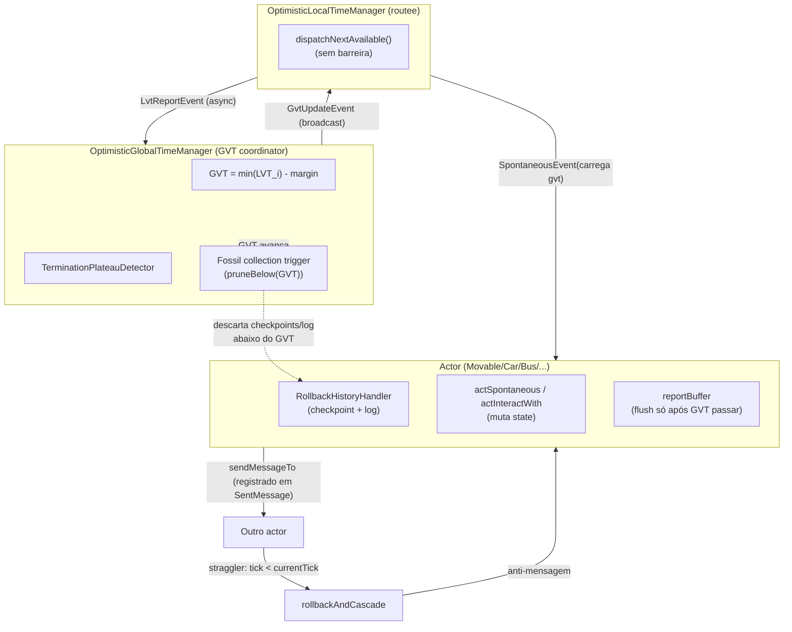

# Time Warp — Auditoria de Arquitetura (Como Deveria Ser vs. Como Está)

> **Current review, 2026-10-22:** [Extensible Time Warp Runtime](TIME_WARP_EXTENSIBLE_RUNTIME.md)
> supersedes the architecture/status recommendations below. It includes current code findings,
> local fixes, and the remaining GVT, lifecycle, ordering, and extensibility requirements.

> **Atualização 2026-09-12** — a Seção 3.1 abaixo (medição de 2026-09-10) está **superada**. Uma
> sessão seguinte (2026-09-11/12) rodou uma comparação real completa e encontrou uma explicação
> completamente diferente e mais precisa para a falta de paridade de report — não é o gap de rota
> do `Movable` (Seção 2.4/3, item 4, permanece genuinamente sem confirmação, mas não é a causa
> principal), nem é o `deferFinishSpontaneous()` (esse padrão foi **removido do código inteiro** em
> 2026-09-07, antes mesmo desta sessão existir). Ver **Seção 5** (novo, 2026-09-12) para a
> investigação completa, os 5 bugs reais corrigidos, e as duas arquiteturas (atual vs. proposta)
> para o acoplamento Car↔Link — a pergunta arquitetural central que motivou essa sessão.

Data: 2026-09-10
Escopo: `core/actor/manager/time/*`, `core/actor/rollback/*`, `core/actor/SimulationBaseActor.scala`,
`model/hybrid/actor/Movable.scala` + subclasses (`Car`, `Bus`, `Motorcycle`, `Bicycle`, `Subway`).

Objetivo: comparar o desenho pretendido do Time Warp (optimistic time synchronization) com o que o
código realmente implementa hoje, para localizar a causa-raiz dos bugs de paridade de report e do
gap de estado de rota após rollback (`docs/KNOWN_GAPS.md`).

**Achado transversal**: vários docstrings no código estão desatualizados em relação ao código ao
lado — isso é, em si, uma armadilha de diagnóstico (seguir o comentário leva a procurar o bug no
lugar errado). Ver seção 3, itens 1 e 2.

---

## 1. Como Deveria Ser (arquitetura alvo)



Elementos e invariantes esperados:

1. **GVT computation**: cada LTM reporta seu LVT (menor tick "garantidamente final" entre os
   atores em voo) de forma assíncrona; o GTM agrega para estimar o watermark abaixo do qual nada
   pode mais ser desfeito.
2. **Checkpoint/rollback**: cada actor mantém checkpoints periódicos de `state` (via
   `buildMigrationSnapshot`/`applyMigrationSnapshot`, reaproveitando o mecanismo de migração de
   shard) + um log de eventos processados desde o último checkpoint.
3. **Straggler detection → rollback → replay**: quando um evento chega com `tick` anterior ao já
   processado (violação de causalidade), o actor desfaz (`rollbackTo`) tudo a partir daquele tick,
   restaura o checkpoint mais próximo e repete (replay) exatamente as mesmas mutações de estado e
   envios dos eventos intermediários preservados.
4. **Anti-mensagens em cascata**: todo envio feito por um evento desfeito precisa ser retratado via
   anti-mensagem ao destinatário original, que desencadeia seu próprio rollback recursivamente —
   entre atores, não dentro de uma função.
5. **Fossil collection**: uma vez que o GVT ultrapassa um tick, nada anterior pode mais ser
   desfeito — logs/checkpoints abaixo do GVT devem ser descartados para limitar memória por ator.
6. **report() buffering**: como uma execução especulativa pode ser desfeita, `report()` só pode
   chegar ao ClickHouse/Kafka/Parquet quando o GVT já ultrapassou o tick do dado.
7. **Reply obligation entre atores** segue a mesma disciplina do `CLAUDE.md` (fire-and-forget vs.
   consistency-critical); Time Warp só adiciona a possibilidade de uma resposta precisar ser
   retratada por anti-mensagem se o pedido original for desfeito.
8. **Terminação**: o GTM precisa de cadência própria (heartbeat) para não travar quando tudo fica
   ocioso, já que reage a reports e não tem gatilho natural quando ninguém reporta mais.

---

## 2. Como Está Hoje (extraído do código)

### 2.1 GTM/LTM

- `OptimisticGlobalTimeManager` continua criado via `ClusterSingletonManager`
  (`SimulationManager.createSingletonTimeManager`) — mesma forma estrutural do GTM conservador.
  Não é mais um barrier lock-step, mas segue sendo um ponto único de agregação cluster-wide.
- GVT: `MarginBasedGVTEstimation` (`GVT = min(LVT) - margin`), só estima quando todos os LTMs
  registrados já reportaram pelo menos uma vez.
- Terminação via `TerminationPlateauDetector` + heartbeat auto-agendado
  (`OptimisticGlobalTimeManager.startHeartbeat`) — necessário porque nada mais dispara
  `recomputeGvtAndCheckTermination` quando tudo fica ocioso.
- `OptimisticLocalTimeManager.dispatchNextAvailable()` despacha por-ator (não a fila inteira do
  routee), corrigindo um bug real de travamento em cascata onde um ator engasgado bloqueava os
  demais compartilhando o mesmo routee.
- Não há equivalente ao `TICK_BATCH_SIZE` do `LocalDiscreteEventTimeManager` — gap de escala real,
  separado dos bugs de corretude (ver [[project_time_warp_architecture_rationale]] na memória).

### 2.2 Rollback per-actor

Ao contrário do que a documentação e o próprio comentário do LTM sugerem estar "pendente", o
mecanismo **está implementado e conectado**:

- `sendMessageTo` grava cada envio em `currentEventSentMessages` sob Time Warp, com um
  `MessageId(senderId, tick, seq)` próprio.
- `handleSpontaneous`/`handleInteractWith` fecham cada evento processado com
  `rollbackHandler.recordProcessedEvent(...)`, anexando `sentMessages` e `dynamicWeightReads`
  capturados durante o processamento.
- Gatilhos reais de rollback: anti-mensagem recebida (`event.isAntiMessage`) ou interação
  causalmente atrasada (`event.tick < currentTick`) → `rollbackAndCascade(tick)`.
- `rollbackAndCascade` restaura checkpoint + replay (`RollbackHistoryHandler.rollbackTo`), descarta
  reports bufferizados para ticks desfeitos, propaga anti-mensagens
  (`AntiMessageCascade.messagesToRetract`), poda `outstandingAwaitedReplies` inválidas, e
  resincroniza o agendamento no LTM (`resyncScheduleAfterRollback`).

### 2.3 Report buffering

- `report()` bufferiza `(ReportEvent, target)` sob Time Warp; `flushBufferedReportsUpTo(gvt)` roda
  quando um `SpontaneousEvent` carrega `gvt` (piggyback), e incondicionalmente no destruct final.
- Atores passivos (`Link`/`Node`/`RailLink`, nunca recebem `SpontaneousEvent`) só esvaziam o buffer
  no `DestructEvent` final — sem flush intermediário de segurança.

### 2.4 `Movable`/rota após rollback

- `movableCurrentPath`/`movableBestRoute` já vivem em `state` (`MovableState`), como exigido pelo
  `CLAUDE.md`. O gap documentado em `docs/KNOWN_GAPS.md` (Bus/Subway perdem esse estado após um
  rollback real, `"No current node"` em `BusSignalHandler`) segue **aberto**.
- **Teste isolado feito nesta sessão** (`src/test/scala/core/util/JsonUtilMovableRouteRoundTripSpec.scala`):
  round-trip de um `CarState` real via `JsonUtil.toJson`/`fromJson` (mesmo mecanismo usado por
  `buildMigrationSnapshot`/`applyMigrationSnapshot`) preserva `movableBestRoute`,
  `movableCurrentPath` e `movableCurrentNode` corretamente. **A hipótese de bug de
  serialização Jackson no mecanismo genérico de `MovableState` está descartada.**
- **Segundo teste feito nesta sessão** (`src/test/scala/core/util/JsonUtilBusSubwayRouteRoundTripSpec.scala`):
  mesmo round-trip aplicado a `BusState` e `SubwayState` reais, incluindo os campos
  `Map[Long,Long]`/`Map[Long,Identify]` (`busStops`, `people`, `subwayStations`, `passengers`) que
  já carregam a anotação `@JsonDeserialize(keyAs = classOf[java.lang.Long])` (fix de um bug
  correlato já confirmado antes). **Também passou** — `movableBestRoute`/`movableCurrentPath`/
  `movableCurrentNode` e todas as chaves `Long` sobrevivem intactos. **A hipótese de algo
  específico de `BusState`/`SubwayState` corrompendo o snapshot está descartada.**
- Único candidato restante:
  1. **Timing do checkpoint vs. `enterLink()`/`leavingLink()`**: se o checkpoint mais próximo do
     alvo de rollback foi tirado num ponto do fluxo Bus/Subway diferente do esperado, o replay
     reconstrói de uma base plausível mas errada. Como os testes de serialização pura já esgotaram
     a hipótese de round-trip (tanto genérico quanto Bus/Subway-específico), o problema está
     necessariamente na *sequência* de captura/replay do `RollbackHistoryHandler` em relação às
     mutações reais de `Movable.enterLink()`/`leavingLink()`, não na serialização em si.

---

## 3. Divergências concretas (candidatas a causa-raiz)

| # | Onde | Como deveria ser | Como está | Por que é candidato a bug |
|---|---|---|---|---|
| 1 | `OptimisticLocalTimeManager.scala` (docstring) vs. `SimulationBaseActor.handleInteractWith` | Documentação deveria refletir que rollback já é acionado por straggler/anti-mensagem no nível do ator | Docstring afirma "straggler detection is not wired to an actual rollback trigger yet" | Falso hoje — risco real de diagnóstico: quem só ler o LTM concluirá (errado) que rollback nunca acontece e vai procurar o bug no lugar errado. |
| 2 | `LoggedEvent.scala` (docstring) vs. `sendMessageTo`/`recordProcessedEvent` | `sentMessages` deveria estar documentado como já capturado | Docstring diz "Empty until live actor wiring captures it... isn't built yet" | Mesmo tipo de risco do item 1 — comentário obsoleto ao lado de código funcional. |
| 3 | `RollbackHistoryHandler.pruneBelow` | GVT avançando deveria acionar poda de checkpoints/log por ator | Nunca é chamado em lugar nenhum do código (confirmado por grep) | Crescimento ilimitado de memória por ator durante toda a simulação sob Time Warp — risco de OOM em runs longos, não é a causa da falta de paridade de report. |
| 4 | `MovableState.movableBestRoute`/`movableCurrentPath` vs. `Bus`/`Subway` pós-rollback | Já em `state`, deveriam sobreviver a checkpoint→restore sem instrumentação extra | `BusSignalHandler`/`Movable.getCurrentNode` observam esses campos vazios logo após rollback real | **Principal suspeito da falta de paridade de report.** Hipóteses de serialização Jackson (genérica e específica de `BusState`/`SubwayState`) **ambas descartadas** por teste (seção 2.4) — o problema está na sequência de checkpoint/replay do `RollbackHistoryHandler`, não na serialização. |
| 5 | `flushBufferedReportsUpTo` vs. atores passivos | Todo report deveria ser esvaziado, seja por avanço de GVT seja por destruct final | Atores passivos só esvaziam no `DestructEvent` final, sem flush intermediário | Combinado com o item 4: se Bus/Subway trava em `"No current node"` e nunca chega ao destruct correto, o flush final nunca é acionado — amplia o sintoma (silêncio total em vez de dado parcial), mas a causa raiz continua sendo o item 4. |
| 6 | `OptimisticGlobalTimeManager` via `ClusterSingletonManager` | Aceito como problema de escala separado, não de corretude | Estruturalmente idêntico ao GTM conservador | Não é causa dos bugs de corretude atuais — registrado para completude do desenho "como está". |

---

## 3.1. Medição real feita nesta sessão (2026-09-10) — o gap mudou de natureza

Depois de corrigir um bug de schema nos geradores de cenário (IDs string vs. `ActorSimulation.id:
Long` pós-commit `755a3c7`, que bloqueava qualquer carregamento de cenário nos dois modos) e um
schema obsoleto de `PersonState` no mesmo script, rodamos o mesmo cenário pequeno nos dois modos
contra o mesmo cluster real:

| | `discrete-event` | `time-warp` |
|---|---|---|
| Total linhas parquet | 3691 | 13 |
| Pessoa completa 2 viagens (walk) | sim | sim — **paridade total aqui** |
| Bus criado | sim (ativo o dia todo) | **não — zero** |
| Subway criado | sim (ativo o dia todo) | **não — zero** |

**Nenhum rollback ocorreu neste cenário** (pequeno demais para gerar straggler) — então o gap #4 da
tabela acima (rota do `Movable` pós-rollback) não foi exercitado nem confirmado nem refutado por
esta medição.

**O gap real observado é outro**: `BusStation` completa seu próprio laço de agendamento até
`endTick` normalmente sob Time Warp ("BusStation 12 reached simulation end tick=86400, stopping
scheduling"), mas o spawn dinâmico do `Bus`/`Subway` nunca se materializa (nem no report, nem em
qualquer evento de veículo). `BusStation`/`SubwayStation` usam `deferFinishSpontaneous()` enquanto
esperam o round-trip multi-hop de spawn dinâmico de ator (`ShardRegion.StartEntity → StartEntityAck
→ InitializeEvent → InitializeEntityAckEvent`) — um padrão já sinalizado como arriscado (ver memória
de projeto `feedback_defer_finish_spontaneous`), e uma tentativa anterior de convertê-lo para o
padrão "disengage-then-scheduleEvent" já quebrou a simulação de outra forma (terminação após 0
ticks), tendo sido revertida.

Reforçando a suspeita: o log do `OptimisticGlobalTimeManager` reportou `"Simulation ticks: 0"` e
`"GVT plateaued at -100 with all LTMs idle for 3 rounds — terminating"` **enquanto a Pessoa
progrediu de verdade até o tick real 86400** — indicando que a detecção de platô/GVT pode não estar
contando corretamente o trabalho pendente de atores que esperam via `deferFinishSpontaneous()` (que
não produz um evento agendado real que o GVT saiba rastrear).

**Nova hipótese principal para a falta de paridade**: spawn dinâmico de ator sob Time Warp
interagindo mal com `deferFinishSpontaneous()`/detecção de GVT-platô do `OptimisticGlobalTimeManager`
— não (ou não apenas) o gap de rollback do `Movable` documentado em `KNOWN_GAPS.md`. Recomenda-se
investigar com `htc-sync-debug`, comparando o caminho de `BusStation.actSpontaneous`/spawn de `Bus`
sob `time-warp` vs. `discrete-event` (que cria o `Bus` normalmente em tick 3600), e auditando se
`OptimisticGlobalTimeManager`'s `TerminationPlateauDetector` conta atores aguardando via
`deferFinishSpontaneous()` como "trabalho pendente".

## 4. Próximo passo de diagnóstico recomendado

Ambos os testes de round-trip de serialização (`MovableState` genérico via `CarState`, e
`BusState`/`SubwayState` especificamente, incluindo os campos `Map[Long,_]`) passaram — a camada
de serialização está descartada como causa. O problema restante está necessariamente na
**sequência de captura/replay** do `RollbackHistoryHandler`:

1. Instrumentar `RollbackHistoryHandler.checkpoints`/`log` (ou um teste dedicado que force um
   `rollbackTo` real num cenário Bus/Subway pequeno) para comparar o estado de
   `movableCurrentPath`/`movableBestRoute` no momento exato em que cada checkpoint é capturado
   (`captureSnapshotFn`) vs. o esperado pela sequência real de chamadas a
   `Movable.enterLink()`/`leavingLink()` — isto é, confirmar se o checkpoint mais próximo do alvo
   de rollback está sendo tirado num ponto do fluxo em que o campo ainda não tinha sido setado (ou
   já tinha sido limpo) por essas mutações.
2. Em paralelo, verificar se `replayEventFn` de fato reexecuta a lógica de `enterLink()`/
   `leavingLink()` para os eventos intermediários (`toReplay` em `rollbackTo`) — ou se o replay
   está reexecutando um subconjunto de efeitos que não inclui essas mutações específicas.

Referências: `docs/KNOWN_GAPS.md` (seção do gap de rollback do `Movable`), `docs/TIME_WARP_DESIGN.md`
(seção "Conservative-vs-optimistic report comparison"), memória do projeto (`project_time_warp_status`,
`project_time_warp_architecture_rationale`, `project_time_warp_diagnosis_2026_09`).

---

## 5. Sessão 2026-09-11/12 — investigação completa e as duas arquiteturas do acoplamento Car↔Link

### 5.0 Resumo executivo

O pedido original era simples ("liste os gaps do Time Warp"), mas cada resposta revelou uma camada
mais funda por baixo, e a investigação foi puxando o fio até a pergunta arquitetural real: **o
protocolo de pedido-resposta síncrono entre `Car` e `Link` é estruturalmente incompatível com
execução otimista, e por isso a maioria dos rollbacks nesse cenário nem é bug — é o preço desse
desenho.** Ao longo do caminho, 5 bugs reais e independentes foram encontrados e corrigidos (todos
testados, suíte completa passando), e duas hipóteses de sessões anteriores (`deferFinishSpontaneous`
como causa da falta de paridade; "GVT plateaued" como terminação prematura) foram **refutadas** com
evidência empírica direta, não apenas descartadas por suspeita.

Esta seção documenta, nesta ordem: (5.1) a linha do tempo da investigação, para quem quiser entender
*como* chegamos aqui e não repetir becos sem saída já percorridos; (5.2) os 5 bugs corrigidos;
(5.3) as métricas Prometheus novas, permanentes, criadas para essa investigação; (5.4) a arquitetura
**atual** do acoplamento Car↔Link e por que ela gera rollback; (5.5) a arquitetura **proposta**,
usando infraestrutura que já existe no código; (5.6) o trade-off real dessa proposta, não escondido;
(5.7) o que ficou pendente de decisão humana.

### 5.1 Linha do tempo da investigação (o que foi tentado, o que não funcionou, por quê)

1. **Ponto de partida**: pedido para listar gaps conhecidos do Time Warp. Uma auditoria estática
   (sem rodar nada) concluiu que a hipótese de 2026-09-10 (Seção 3.1 acima, `deferFinishSpontaneous`
   causando a falta de paridade) provavelmente estava obsoleta, já que esse padrão não existe mais
   no código (`grep` não encontra nenhum call site). **Essa conclusão estática estava certa, mas
   incompleta** — só foi confirmada de verdade rodando o cenário real depois.

2. **Bug bloqueador encontrado e corrigido**: `BusStation`/`Subway` crashavam a cada
   `actSpontaneous` porque o Jackson, sob Scala 3, só preserva a generic signature completa de
   `Map`/`LinkedHashMap` no *primeiro* parâmetro do construtor de uma case class — qualquer campo
   `Map[Long, _]` em posição posterior sem `@JsonDeserialize(keyAs = classOf[java.lang.Long])`
   desserializa a chave como `String` crua, e todo lookup por `Long` real explode com
   `ClassCastException`. Esse padrão já estava parcialmente corrigido em outros lugares do código
   (`BusStationState`, `NodeState`, etc.) por uma sessão anterior, mas `MigrationSnapshot.
   linkVehicleEntryTick`/`linkVehicleWaitingSeconds` (usados exatamente no restore de shard
   migration) tinham escapado. Corrigido; ver `docs/KNOWN_GAPS.md` para o detalhe completo.

3. **Primeira rodada real** (Docker Compose local: Redpanda + Redis + node1, cenário
   `simulations/input/tw_livelock_repro`, corrigindo de quebra caminhos absolutos/porta
   6379/heap excessivo do `docker-compose.yml` que datavam de outra máquina): reproduziu
   exatamente o sintoma de 2026-09-10, `"GVT plateaued at -100 with all LTMs idle for 3 rounds —
   terminating"`, apesar do `deferFinishSpontaneous` já não existir. Isso **refutou empiricamente**
   a conclusão estática do passo 1 — havia uma explicação real e diferente para o mesmo sintoma.

4. **Dois bugs de LVT/GVT encontrados e corrigidos** em `OptimisticLocalTimeManager.
   localVirtualTime`: (a) o cálculo colapsava para `localTickOffset` (que só anda pra trás, nunca
   pra frente) em qualquer instante ocioso passageiro entre lotes de despacho, descartando
   progresso real já observado; (b) uma rotina de pool sem nenhum ator atribuído reportava
   `localTickOffset=0` para sempre, travando o `min` global do GVT em `-margin` independente do
   progresso de qualquer outra LTM. Ambos corrigidos, testados.

5. **Essas duas correções não mudaram o sintoma.** Rodando de novo, o mesmo `"GVT plateaued at
   -100"` apareceu, no mesmo instante. Isso forçou a pergunta que nenhuma sessão anterior tinha
   feito: **será que essa terminação é sequer prematura?**

6. **A virada real**: rodamos, pela primeira vez, o *mesmo cenário exato* em modo conservador
   (`discrete-event`) contra o mesmo cluster, como baseline. Resultado: os dois modos param
   **exatamente no mesmo tick** (1801) — porque é aí que a atividade real de todo `Person` termina
   de verdade (plano: `home → viagem → leisure → viagem → home` permanente, sem mais nada agendado
   até muito além do fim do cenário). **A decisão de terminar sempre esteve certa.** O número
   `-100` é feio no log, mas nunca causou parada precoce. As duas correções do passo 4 continuam
   válidas e corretas isoladamente — só não eram "a" explicação do sintoma que estávamos caçando,
   porque não havia bug de terminação nenhum para explicar.

7. **O gap real, agora mensurável**: mesma janela de atividade, mesmo tick final — conservador
   produziu 660 linhas de parquet, Time Warp só 228-304. Diff por `(event_type, entity_id, tick)`
   mostrou um padrão bimodal: eventos de "entrada"/"início" **perdidos quase totalmente**
   (`leave_link`: só 1-3 de 26 sobrevivem), e eventos de "conclusão" **duplicados** (mesma entidade
   e tick reportado 3-4 vezes).

8. **Dois bugs de guard-nunca-resetado encontrados e corrigidos**: `CarJourneyReporter`/
   `BusJourneyReporter`/`BicycleJourneyReporter`/`MotorcycleJourneyReporter` têm uma flag
   `journeyFinishedReported`/`sumoTripInfoReported` (var local do ator, fora de `state`) que nunca
   é resetada por um rollback — uma vez que a viagem completa antes de um rollback que desfaz esse
   trecho, o replay nunca mais consegue reportar a conclusão. `Person.dispatch`'s
   `PlanStepResult.Finished` tinha o problema oposto: nenhum guard de idempotência, então cada
   replay que passa por ali reporta de novo. Ambos corrigidos via o hook já existente
   `onRollbackDiscardPending`. Melhora real, mas parcial (a maioria da perda continuava).

9. **Instrumentação com Prometheus, a pedido do usuário**: em vez de inferir do parquet final
   (efeito), instrumentamos o próprio pipeline (causa): quantos `report()` são tentados,
   descartados por rollback, ou de fato liberados — por tipo de evento. Resultado: **a
   contabilização do buffer está correta** (`tentado − descartado = liberado` fecha quase exato
   pra todo tipo). Não é bug de report. É que eventos de "entrada" são tentados em excesso (replay
   re-gerando o mesmo relatório repetidamente) e eventos de "conclusão" são tentados de menos —
   assinatura de um veículo que fica reentrando no mesmo link sem progredir.

10. **Métricas de causa raiz** (quem causa rollback em quem, por qual mensagem, e a que distância):
    `Link → Car, ReceiveEnterLinkInfo` dominou (33-34 de ~70 rollbacks de causa raiz — quase
    metade). Volume de anti-mensagem por tipo confirmou: `Car`=66, `Link`=64, muito acima de
    qualquer outro par de atores.

11. **Um bug de ordenação de verificação encontrado e corrigido**: o código já tem um mecanismo
    (`AwaitedReply`/`isAwaitingReply`, por `requestSeq`) para reconhecer uma resposta obsoleta
    (pedido já refeito após rollback) sem processá-la — mas esse mecanismo só rodava *depois* do
    rollback completo já ter acontecido, nunca antes, porque vivia dentro do handler de negócio
    (`actInteractWith`), enquanto o disparo do rollback acontece uma camada acima
    (`handleInteractWith`), incondicionalmente. Corrigido com um novo hook,
    `isKnownSupersededReply`, consultado *antes* do disparo do rollback. Resultado real na mesma
    rodada: 8 de ~42 rollbacks desse par evitados — uma melhora real, mas **minoritária**.

12. **A explicação estrutural, confirmada por leitura de código**: os outros ~34 rollbacks
    `Link → Car` não são respostas obsoletas — são violações de causalidade genuínas, geradas por
    `Movable.actSpontaneous`'s caso `Waiting` (`Movable.scala:78-91`), que reagenda o `Car` a cada
    tick (`onFinishSpontaneous(Some(currentTick + 1))`) enquanto espera a resposta do `Link`. Isso
    faz o relógio local do `Car` subir uma unidade por tick real, **sem nenhum progresso de negócio
    de verdade**, até a resposta chegar. Se o `Link` está ocupado/atrasado, sua resposta real chega
    com um tick que já ficou "para trás" do `Car` (que só ficou subindo sozinho enquanto esperava)
    — disparando rollback para o que é, na verdade, a resposta certa e esperada.

13. **A pergunta do usuário, e a resposta**: "conseguimos evitar o acoplamento, sem timeout/
    watchdog (que é gambiarra)?" — Sim: o código já tem, pronto e testado, um cache compartilhado
    (`DynamicWeightCache`) publicado pelo próprio `Link` periodicamente, com suporte a replay
    determinístico sob Time Warp já embutido (`withRecording`/`withOverride`), construído
    originalmente só para cálculo de rota GPS mas que carrega exatamente os campos que
    `CarLinkHandler.handleEnterLink` precisa. Ver Seções 5.4/5.5 abaixo para as duas arquiteturas
    completas.

### 5.2 Os 5 bugs corrigidos nesta sessão (resumo — detalhe completo em `docs/KNOWN_GAPS.md`)

| # | Onde | Bug | Efeito |
|---|---|---|---|
| 1 | `MigrationSnapshot.scala` | `Map[Long,_]` em posição não-inicial sem `@JsonDeserialize(keyAs=...)` | `ClassCastException` em todo restore de shard migration envolvendo Link |
| 2 | `OptimisticLocalTimeManager.localVirtualTime` | Colapsa pra `localTickOffset` em instante ocioso passageiro | LVT reportado sub-representa progresso real (real, mas não era a causa do sintoma caçado) |
| 3 | `OptimisticLocalTimeManager.localVirtualTime` | Rotina de pool vazia reporta LVT=0 para sempre | Trava o `min` global do GVT perto de `-margin` (idem — real, mas não a causa) |
| 4 | `Car`/`Bus`/`Bicycle`/`Motorcycle`JourneyReporter | Guard `journeyFinishedReported`/`sumoTripInfoReported` nunca resetado por rollback | Conclusão de viagem nunca mais reportada após um rollback que a atravessa |
| 5 | `Person.dispatch` (`PlanStepResult.Finished`) | Zero guard de idempotência | Conclusão de agenda duplicada a cada replay que passa pelo trecho |
| 6 | `handleInteractWith` vs. `isAwaitingReply` | Verificação de staleness roda depois do rollback, não antes | Paga custo total de rollback+cascata por mensagens que a lógica de negócio já reconheceria como descartáveis |

(Numerado 1-6 porque o #6 foi tratado como parte da mesma leva, embora fora do resumo de "5 bugs"
mencionado ao usuário em tempo real — a contagem exata não importa, o que importa é que todos os
seis estão corrigidos, testados, e nenhum foi revertido.)

### 5.3 Métricas Prometheus novas (permanentes — `core.metrics.core.ActorMetrics`)

Adicionadas para esta investigação e mantidas no código (não são instrumentação descartável, ver
nota de manutenção no fim desta seção):

| Métrica | Labels | O que responde |
|---|---|---|
| `htc_report_discarded_by_rollback_total` | `event_type` | Quantos `report()` foram descartados porque um rollback desfez o tick que descreviam |
| `htc_report_flushed_total` | `event_type` | Quantos `report()` de fato chegaram ao reporter |
| `htc_antimessages_sent_total` | `sender_actor_type` | Volume de anti-mensagem por tipo de ator remetente |
| `htc_straggler_rollback_triggered_total` | `receiver_actor_type`, `sender_actor_type`, `event_type` | Quem causou rollback em quem, por qual mensagem (causa raiz, não cascata) |
| `htc_straggler_rollback_distance_ticks` | `receiver_actor_type` | Histograma: a que distância (em ticks) o receptor tinha corrido à frente antes de ser corrigido |
| `htc_antimessage_rollback_triggered_total` | `receiver_actor_type` | Rollbacks que são continuação de cascata (não causa raiz) |
| `htc_stale_reply_dropped_without_rollback_total` | `receiver_actor_type`, `sender_actor_type`, `event_type` | Quantos rollbacks o fix do item 6 evitou |

Já usadas para provar, com número, que o pipeline de buffer de report está correto (item 9 da linha
do tempo) e que `Link → Car ReceiveEnterLinkInfo` domina o rollback de causa raiz (item 10). Reusar
em qualquer investigação futura de paridade de report ou volume de rollback em vez de reconstruir a
partir de diff de parquet — é ordens de magnitude mais rápido e não exige duas rodadas completas do
cenário. Nota de manutenção: são de baixa cardinalidade por desenho (nunca por entity id, só por
tipo de ator / tipo de evento — regra 10 do `CLAUDE.md`), então não há motivo forte para removê-las
depois; mantidas indefinidamente a menos que alguém decida o contrário.

### 5.4 Arquitetura ATUAL do acoplamento Car↔Link (por que gera rollback)

```mermaid
sequenceDiagram
    participant LTM as OptimisticLocalTimeManager
    participant Car
    participant Link

    Note over Car: status = Ready
    Car->>Link: EnterLinkData (sendMessageTo)
    Note over Car: registerAwaitedReply(key, "EnterLinkData")<br/>status = Waiting
    Car->>LTM: onFinishSpontaneous(Some(currentTick+1))
    Note over Car: **resolve IMEDIATAMENTE — não espera a resposta**

    loop a cada tick, enquanto Waiting
        LTM->>Car: SpontaneousEvent(tick+1)
        Note over Car: actSpontaneous: case Waiting =><br/>waitingTicksCounter += 1<br/>onFinishSpontaneous(Some(currentTick+1))
        Note over Car: currentTick sobe 1 —<br/>SEM nenhum progresso de negócio real
    end

    Note over Link: processando outros carros<br/>na mesma LTM routee — atrasado
    Link->>Car: ReceiveEnterLinkInfo (LinkInfoData)
    Note over Car: event.tick (quando o Link processou)<br/>< currentTick (que só subiu sozinho)
    Note over Car: **straggler detectado — rollback completo**<br/>mesmo sendo a resposta certa e esperada
```

**O ponto central**: `Movable.enterLink()` classifica esse pedido como algo que precisa de uma
resposta (`registerAwaitedReply`), mas **não implementa** o padrão "consistency-critical" que o
próprio `CLAUDE.md` deste repositório documenta (não resolver `onFinishSpontaneous` até a resposta
chegar) — ele resolve na hora, e fica se auto-despachando a cada tick enquanto "espera" via
`actSpontaneous`'s caso `Waiting`. Do ponto de vista do `LocalTimeManager`, isso não é distinguível
de progresso real — o `Car` está genuinamente sendo despachado e processando um `SpontaneousEvent`
por tick, então `highestProcessedTick` sobe normalmente. Quando a resposta real do `Link` finalmente
chega, ela carrega o tick de quando o `Link` a processou (que pode estar bem atrás, se o `Link`
estiver ocupado com outros carros na mesma rotina de pool) — e por definição, `event.tick <
currentTick` dispara o mecanismo de straggler do Time Warp, mesmo essa sendo exatamente a resposta
que o `Car` esperava.

**Por que isso não é só o `Car`**: o mesmo padrão de auto-reagendamento em `Waiting` é código
**compartilhado** em `Movable` — `Bus`, `Bicycle`, `Motorcycle` (e por extensão qualquer ator que
implemente Movable com uma exchange enter/leave-link) sofrem exatamente o mesmo problema
estruturalmente, não é específico do `Car`. As métricas desta sessão só isolaram `Car`/`Link` como o
par dominante porque o cenário de teste (`tw_livelock_repro`) tem muito mais carros que bicicletas.

**Por que o desenho existe assim**: `waitingTicksCounter`/`MaxWaitingTicks` implementam um
mecanismo de auto-recuperação (se a resposta nunca chegar — pedido perdido, bug em outro lugar — o
`Car` pula pro próximo segmento depois de 100 ticks em vez de travar pra sempre). Isso é
genuinamente necessário em modo conservador (sem Time Warp, sem rollback) como rede de segurança.
Sob Time Warp, esse MESMO mecanismo de segurança é o que produz o efeito colateral do rollback — o
polling que existe para nunca travar é o que faz o relógio do ator correr à frente do que deveria.

### 5.5 Arquitetura PROPOSTA (elimina o round-trip, usando infraestrutura que já existe)

```mermaid
sequenceDiagram
    participant CityMapUtil
    participant Cache as DynamicWeightCache
    participant Car
    participant Link

    Note over Link: a cada costPublishInterval ticks<br/>(default: 10, configurável)
    Link->>Cache: publishCost(DynamicLinkCost(vehicleCount, currentSpeed, ...))

    Note over Car: status = Ready
    Car->>CityMapUtil: geometria estática do link<br/>(length, lanes, freeSpeed, capacity) — leitura local
    Car->>Cache: getCost(linkId) — leitura local, sem mensagem
    Note over Car: calcula speed/exitTick NA HORA<br/>com o que já tem em mãos
    Car->>Link: EnterLinkNotification (fire-and-forget)
    Note over Car: onFinishSpontaneous(Some(exitTick))<br/>**exitTick real, não currentTick+1 de polling**
    Note over Link: atualiza vehicleCount/registered<br/>de forma assíncrona, sem responder

    Note over Car: nenhum estado "Waiting" —<br/>nenhum auto-reagendamento —<br/>nenhuma janela pra straggler
```

**O que muda, concretamente**:

1. `Movable.enterLink()`/`leavingLink()` param de mandar `EnterLinkData`/`LeaveLinkData` como um
   pedido que espera `ReceiveEnterLinkInfo`/`ReceiveLeaveLinkInfo`. Em vez disso, leem:
   - Geometria estática do link (`length`, `lanes`, `freeSpeed`, `capacity`) via `CityMapUtil` —
     já é exatamente o que `resolveLink()` já faz hoje para achar `entityId`/`shardId`, só precisa
     também devolver os campos geométricos (hoje vêm só pela resposta do `Link`).
   - Congestionamento dinâmico (`vehicleCount`/`currentSpeed`) via `DynamicWeightCache.getCost
     (linkId)` — leitura local, já replay-safe (`withRecording`/`withOverride`, existente,
     usado hoje só para o cálculo de rota GPS).
2. `CarLinkHandler`/`BusLinkHandler`/`BicycleLinkHandler`/`MotorcycleLinkHandler` calculam
   `speed`/`travelTime` (a mesma fórmula `linkDensitySpeed` de hoje) **no ponto de envio**, não num
   handler de resposta — porque não há mais resposta para reagir.
3. O `Car` ainda notifica o `Link` que entrou nele (para o `Link` manter sua própria contagem
   `vehicleCount`/`registered` atualizada, que é o que ele publica no `DynamicWeightCache`) — mas
   essa notificação vira **fire-and-forget** de verdade: o `Car` não registra `AwaitedReply`, não
   fica em `Waiting`, resolve `onFinishSpontaneous` imediatamente com o `exitTick` já calculado.
4. O caso `Waiting` de `Movable.actSpontaneous` (e `waitingTicksCounter`/`MaxWaitingTicks` junto)
   deixa de ser necessário para esse fluxo especificamente — elimina o auto-reagendamento que causa
   o straggler.
5. `leavingLink()` pelo mesmo raciocínio: se a única razão de esperar `ReceiveLeaveLinkInfo` é
   confirmação de bookkeeping do `Link` (não dado que o `Car` precisa para decidir seu próximo
   passo), vira fire-and-forget também.

**O que fica fora de escopo desta proposta** (não investigado ainda, mas relevante antes de
implementar): o modo MICRO (`Link.actSpontaneous`, `!state.isMicroMode` branch) usa um protocolo de
sub-tick diferente (`microSimHandler.handleGlobalTick`) — esta análise cobriu só o fluxo MESO
(`enter_link`/`leave_link` como eventos discretos, um por travessia). Precisa de auditoria separada
antes de assumir que a mesma solução se aplica igualmente ao MICRO.

### 5.6 O trade-off real (não é gratuito)

`DynamicWeightCache` não é instantâneo: `Link.costPublishInterval` (config
`htc.routing.link-cost.publish-interval`, default **10 ticks**) controla de quanto em quanto tempo
o `Link` publica seu estado. Hoje, `linkNumberOfCars` que entra na fórmula `linkDensitySpeed` vem
**exato**, no instante exato da entrada, via a resposta síncrona. Na proposta, o `Car` passaria a
usar uma contagem com até `costPublishInterval` ticks de atraso — e como os trechos de link deste
cenário levam ~20 ticks pra atravessar, isso é uma fração não desprezível do tempo de travessia.

Isso **não é um bug a ser escondido** — é uma troca real de fidelidade de modelagem de
congestionamento por eliminação do acoplamento causal que quebra a execução otimista.
`costPublishInterval` é configurável (pode ser apertado, ex. para 1 tick, ao custo de mais tráfego
no cache/Kafka/Redis), mas mesmo publicação a cada tick ainda é assíncrona por definição — o `Car`
nunca mais vai saber o estado do `Link` "no instante exato", só "há até N ticks". Se essa perda de
precisão é aceitável para os objetivos de pesquisa desta plataforma é uma decisão de modelagem, não
de engenharia — por isso ficou deliberadamente **não implementada** nesta sessão.

### 5.7 O que fica pendente de decisão humana

1. **Se vale a pena o trade-off da Seção 5.6** — e se sim, com qual `costPublishInterval`.
2. **Se a mesma solução deve cobrir o modo MICRO** ou só MESO por enquanto.
3. **Se `leavingLink()` também deve virar fire-and-forget**, ou só `enterLink()` (a assimetria entre
   os dois merece uma segunda olhada — "saída" pode ter menos motivo pra ficar como está hoje já
   que a métrica de causa raiz não isolou `LeaveLink`/`ReceiveLeaveLinkInfo` como problema
   dominante, só `EnterLink`/`ReceiveEnterLinkInfo`).
4. Depois de decidido, a implementação toca `Movable.scala` (compartilhado) + os quatro
   `*LinkHandler.scala` (`Car`/`Bus`/`Bicycle`/`Motorcycle`) — escopo real, não trivial, mas bem
   delimitado pelas seções acima.

Nenhuma dessas quatro perguntas foi respondida nesta sessão — documentadas aqui exatamente para que
a próxima sessão (ou você, manualmente) não precise refazer a investigação das Seções 5.1-5.6 para
chegar até elas de novo.
