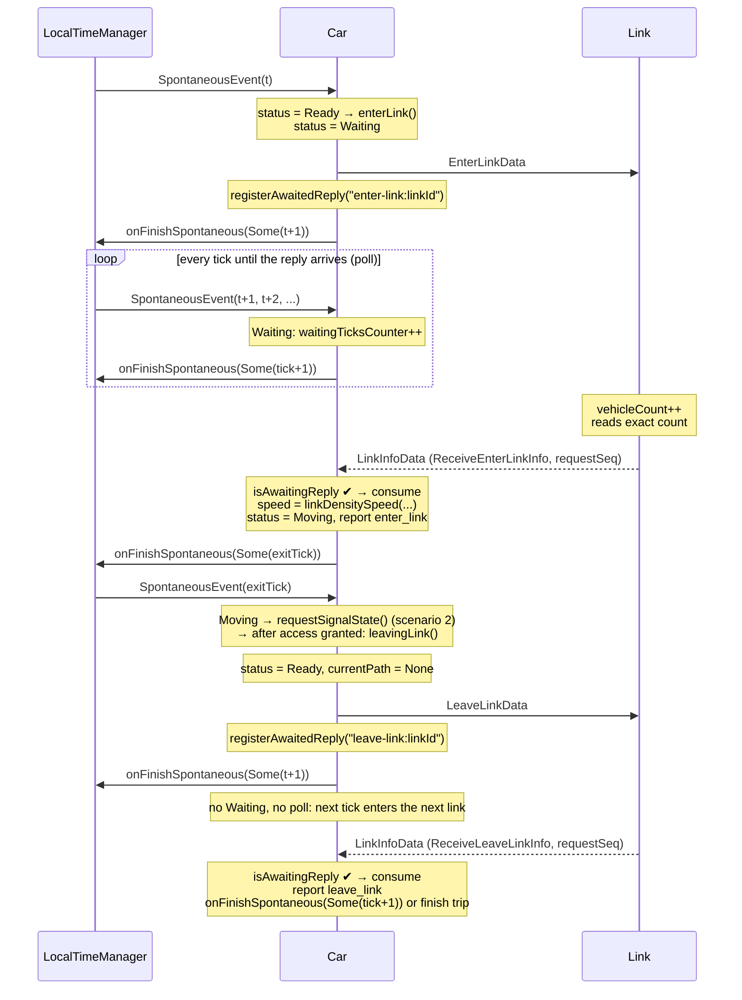
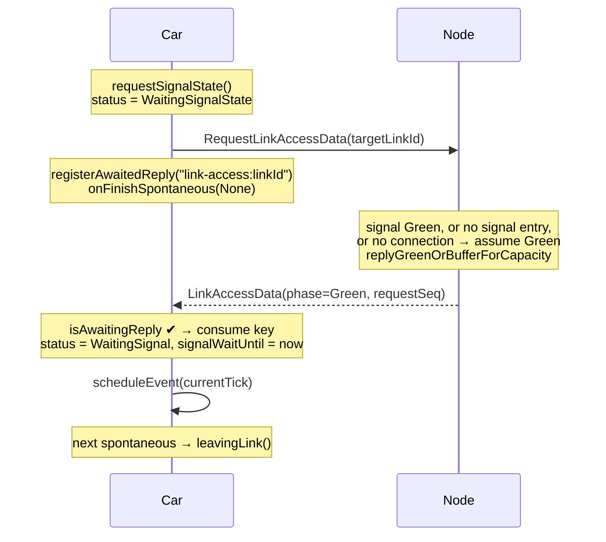
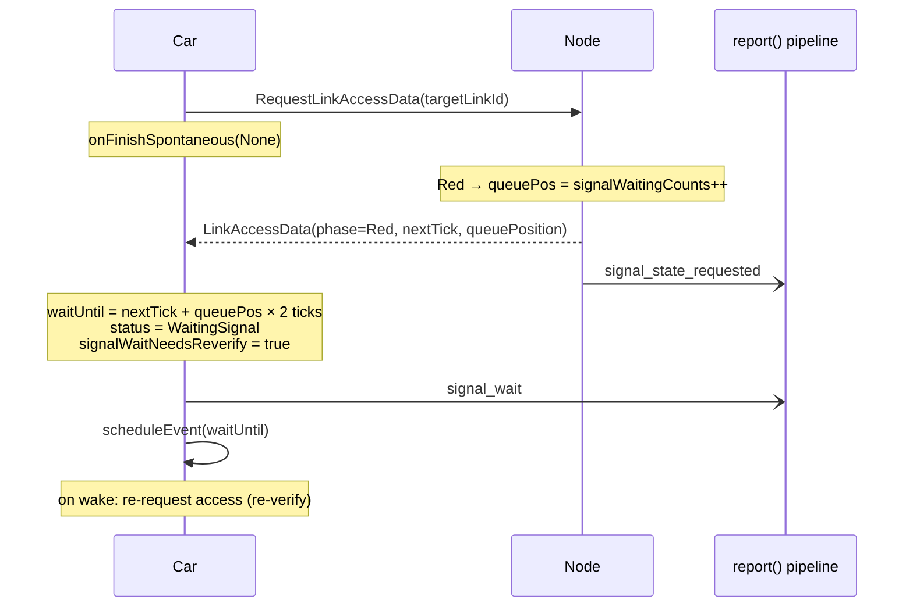
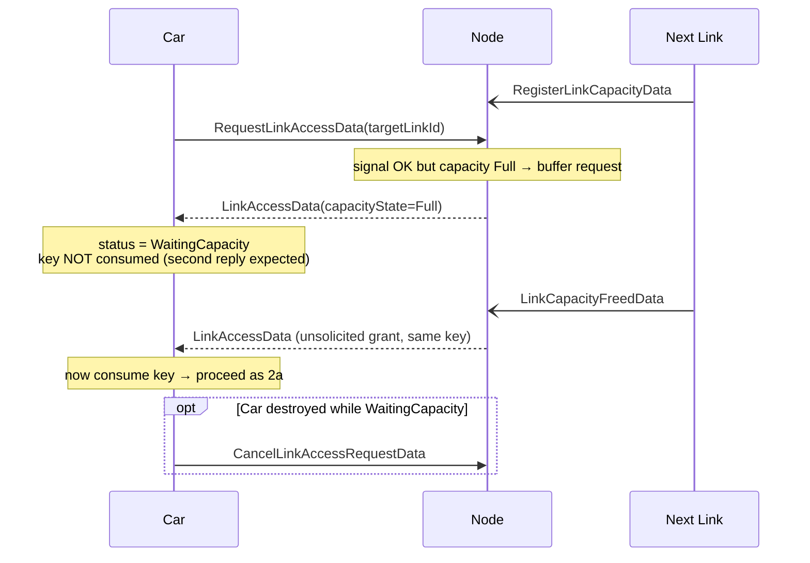
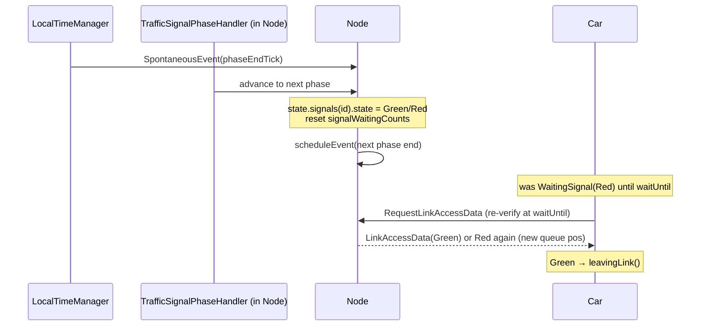
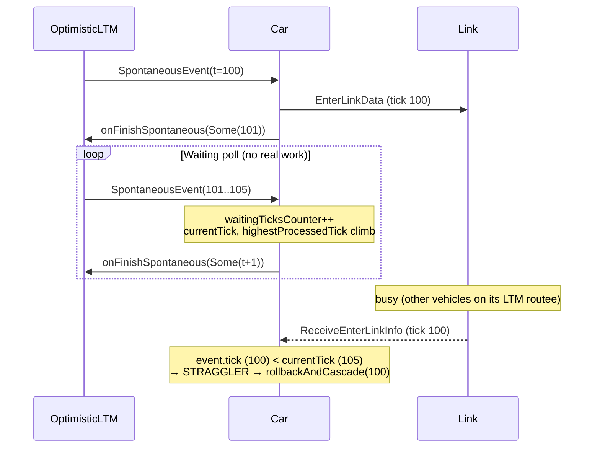
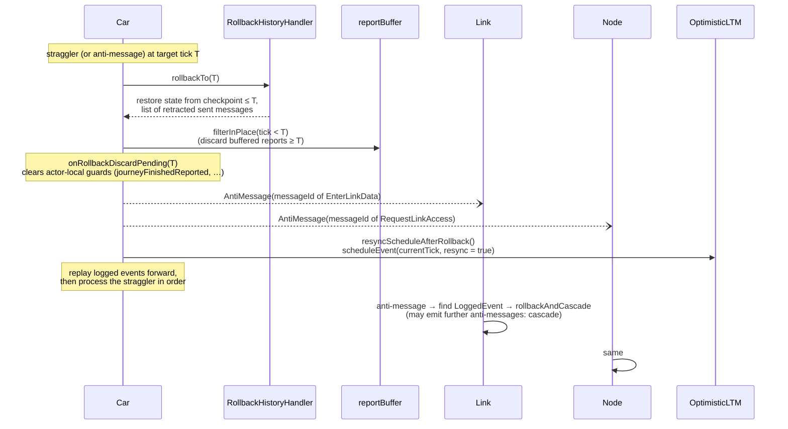
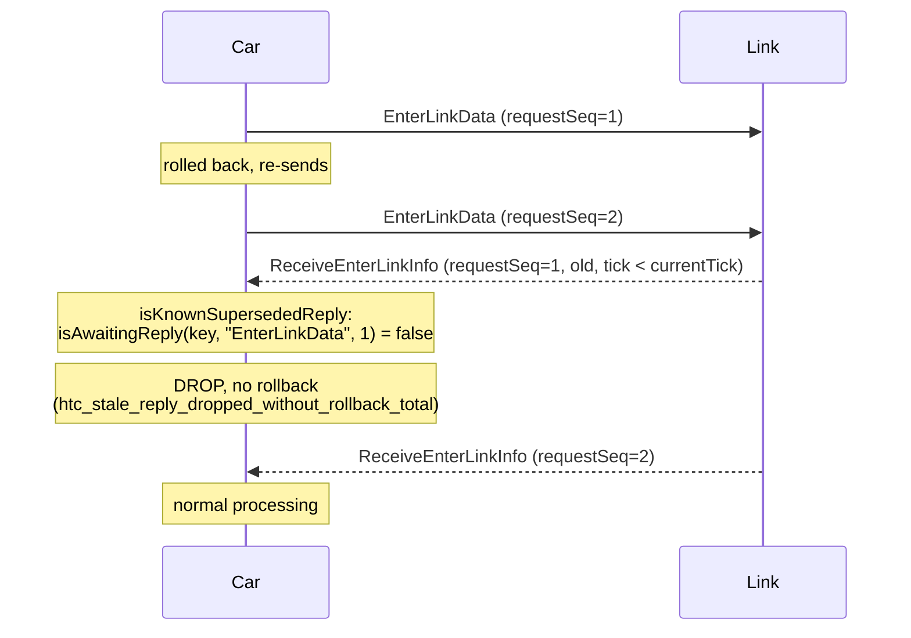
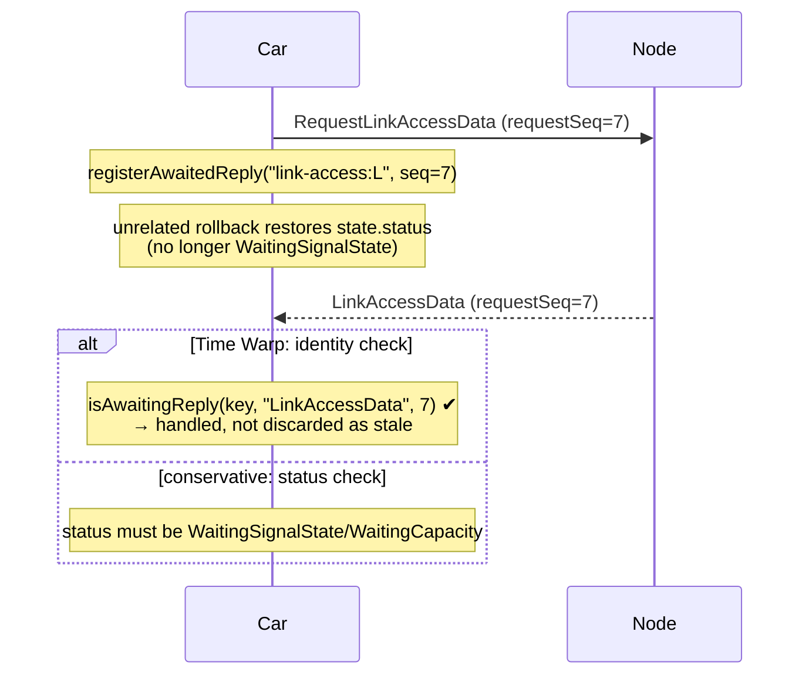
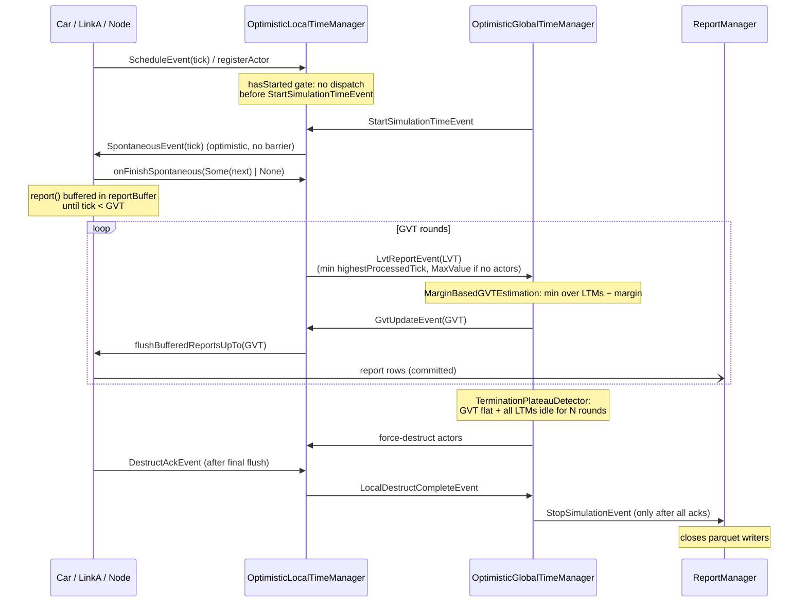

# Time Warp — Communication Scenarios (Car, Link, Node/Traffic Light, Managers, Rollbacks)

Current-state sequence diagrams, one per scenario. Derived from `Movable.scala`, `CarSignalHandler.scala`,
`NodeEventHandler.scala`, `SimulationBaseActor.scala` (`handleInteractWith`, `rollbackAndCascade`) and the
Optimistic GTM/LTM. Message names are the real event/data types; `Link` internals are summarized, not traced.

Legend: solid arrow = message; dashed = reply; `Note` = actor-local effect.

---

## 1. Meso link traversal — happy path (no rollback)

Enter-link: `Movable.enterLink()` sends `EnterLinkData`, registers an `AwaitedReply`, and calls
`onFinishSpontaneous(Some(t+1))` **immediately after the send** (it does not wait for the reply). The Car sits in
`Waiting` and is re-woken every tick (poll) until the reply arrives; the reply handler then calls
`onFinishSpontaneous(Some(exitTick))`.

Leave-link: `leavingLink()` sends `LeaveLinkData`, registers an `AwaitedReply`, clears `movableCurrentPath` and
calls `onFinishSpontaneous(Some(t+1))` immediately. There is no `Waiting` status and no poll; the Car moves on to
the next link while the reply is still in flight, and the reply handler only reports and reschedules.

---

## 2. Intersection: signal and capacity request (Car ↔ Node)

Before leaving a link the Car asks the **Node** for access to the next link. The Node replies on every branch.
The Car calls `onFinishSpontaneous(None)` immediately after sending (no reschedule, hence no poll), and the reply
handler re-wakes it via `scheduleEvent`. This is the difference from enter-link: no self-poll, so its clock does not
advance while waiting.

### 2a. Green / no signal / uncontrolled

### 2b. Red signal

### 2c. Target link full (capacity backpressure)

---

## 3. Traffic light phase change (TrafficSignal → Node → waiting Cars)

---

## 4. Time Warp: straggler caused by the `Waiting` self-poll (main gap)

Root cause documented in `KNOWN_GAPS.md` (Cause 3) and audit §5.4. The poll advances the Car's clock without
business progress; the Link's correct reply is then stamped earlier than `currentTick`.

---

## 5. Time Warp: rollback and anti-message cascade

`SimulationBaseActor.rollbackAndCascade` + `RollbackHistoryHandler`.

---

## 6. Time Warp: superseded reply dropped *without* rollback

`isKnownSupersededReply` (Movable) consulted before the straggler trigger.

---

## 7. Time Warp: rollback-orphaned reply (AwaitedReply protection)

Fix from 2026-09-05. A rollback restores `state.status` from before the request, which would make a
legitimately awaited reply look stale; the actor-local `AwaitedReply` registry (not in `state`) is the identity check.

---

## 8. Manager plane: scheduling, LVT/GVT, termination, report flush

---

## 9. Putting it together: where rollbacks originate today

| Source of rollback | Trigger | Scenario |
|---|---|---|
| Car ← Link `ReceiveEnterLinkInfo` behind `currentTick` (poll inflated the clock) | Straggler | 4 → 5 (dominant: ~34 of ~42) |
| Car ← Link reply for a superseded request | Dropped without rollback | 6 |
| Car/Link/Node ← anti-message | Cascade | 5 |
| Car ← Node `LinkAccessData` behind `currentTick` | Straggler (Car resolved with `None`, so no poll — rarer) | 2 → 5 |
| Rolled-back Car, reply from before the request | Handled via AwaitedReply identity | 7 |
