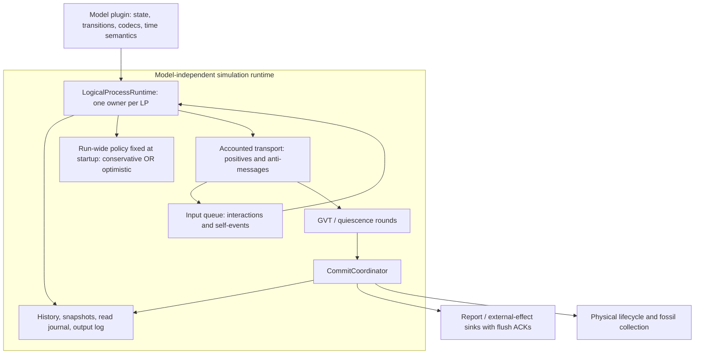

# Extensible conservative and Time Warp execution in HTC

Review date: 2026-10-22. Scope: the current core time managers, rollback machinery,
simulation actor, hybrid actors, and output pipeline. This is the current architecture
recommendation; the older Time Warp documents retain their historical investigations.

## Recommendation and scope

Each simulation run selects **one synchronization policy before execution**:
conservative or optimistic (Time Warp). Every actor and time manager in that run
uses the selected policy, which remains fixed until the run ends.

HTC should share model-independent execution infrastructure between these two
startup configurations. A model defines its state,
event transitions, event-time semantics, and deterministic inputs. The runtime owns
ordering, scheduling, transport identity, rollback, cancellation, commitment, and
lifecycle. Adding an energy, land-use, epidemic, or another mobility model should
not require modifying `SimulationBaseActor` or adding fields to a core checkpoint.

The current implementation contains working rollback components, but **does not yet
provide a correctness argument for general optimistic execution**. Most urgently,
the GVT estimator ignores messages in transit and termination reuses stale idle
reports. Increasing the margin or waiting longer cannot establish correctness.
First establish conservative correctness against independently expected outcomes,
then establish optimistic correctness in a separate run. The reproduced conservative
activation/termination failure is fixed; ordering and transport gaps remain below.
Once each mode works independently, compare separate runs of the
same input. Agreement alone is insufficient if both runs produce incorrect results.

This change implements bounded foundations and regression fixes. It does not claim
to implement the replacement runtime or solve distributed GVT. The architecture
and roadmap below implement a fixed policy for the entire simulation. Per-actor
policy selection and switching during execution are outside the design.

## Basis and review method

The foundational Time Warp model uses timestamped events, saved state, rollback,
and anti-messages to undo speculative computation. Irrevocable output must respect
the global progress bound. See Jefferson's primary paper,
[Virtual Time (1985)](https://worrydream.com/refs/Jefferson_1985_-_Virtual_Time.pdf).

A distributed snapshot must account for channel state as well as local state.
Mattern describes snapshot-based GVT methods that support non-FIFO delivery:
[Efficient Algorithms for Distributed Snapshots and Global Virtual Time Approximation (1993)](https://vs.inf.ethz.ch/publ/papers/snapshot_gvt.pdf).

Conservative execution avoids unsafe event processing; optimistic execution repairs
it. Both need an explicit event-time ordering contract. Fujimoto reviews these
approaches in [Parallel and Distributed Simulation (2015)](https://informs-sim.org/wsc15papers/004.pdf).

The implementation choices below are recommendations for HTC, inferred from the
checkout and these principles, rather than a claim that any cited paper specifies
HTC's actor protocols. Findings marked open are code-path findings unless a test or
scenario result is stated. Dated claims in older documents were not treated as proof.

## Findings in the current core and model

Paths in this table are relative to `src/main/scala`.

| Priority | Finding and concrete failure path | Status in this change |
|---|---|---|
| P0 | `core/actor/manager/time/gvt/MarginBasedGVTEstimation.scala`: local reports can all be at 1000 while a tick-10 positive or anti-message is delayed in a shard/router/mailbox. Subtracting 100 still allows commitment of tick 10. Simulation-time margin does not bound wall-clock delivery delay. | Open; corrected the safety claim and fixed subtraction underflow only. |
| P0 | `OptimisticGlobalTimeManager.recomputeGvtAndCheckTermination`: heartbeats repeatedly evaluate the same `latestReports`; unchanged idle observations do not prove a fresh consistent cut or empty channels. A delayed request, reply, anti-message, or creation can arrive after termination starts. | Open; replace with accounted quiescence. |
| P0 | `SimulationBaseActor.selfDestruct`: direct model calls flush every report and stop immediately. Stopping an actor does not prove its speculative history is committed. LTM deferred destruction is bypassed by these calls. | Open; runtime must retain a terminal LP until commitment. |
| P0 | `SimulationBaseActor.reportToSpecificReporter` sent directly, bypassing buffering, rollback discard, and replay suppression. `reportMirrored` therefore leaked speculative Kafka output even when its default output was buffered. `Link` uses targeted ClickHouse output. | Fixed: all reporting destinations now share `reportToTarget`. |
| P0 | `handleInteractWith` forgot an anti-message whose positive was absent. If cancellation arrives before the positive, or after the positive was undone but before it is reintroduced, the cancelled event can execute later. | Fixed: retain cancellation identities outside model state; filter positives and reprocessing. GVT-based reclamation remains open. |
| P1 | `OptimisticLocalTimeManager.dispatchNextAvailable` computed running IDs once. If an actor was queued at ticks 1 and 2 before startup, the same pass sent both, despite its first dispatch already becoming in flight. | Fixed: update the per-pass running-ID set after each dispatch. |
| P1 | `SimulationBaseActor.applyMigrationSnapshot` cleared relationships only if the saved map was nonempty. Restoring an empty map left relationships introduced by undone events. | Fixed: replace the map even when the checkpoint is empty. |
| P1 | `RollbackHistoryHandler.pruneBelow` could keep a checkpoint **at** GVT after processing an event at that tick, removing the earlier checkpoint needed to undo that event. | Fixed: retain a floor strictly before GVT. Collection is still not enabled by this patch. |
| P1 | `SimulationBaseActor` imported the mobility `DynamicWeightCache`. Its per-link map overwrote repeated reads within an event; replay could not reproduce two different observations of the same key. | Fixed foundation: generic ordered `EventReadJournal`; the mobility cache opts in at its read boundary. |
| P1 | `GPSUtil.calcRouteCompact` can miss its process-wide cache live and hit it during replay, skipping the weight reads made by the original search. Recording only cache-internal reads is therefore not a stable replay boundary. | Fixed: journal immutable route results above positive/negative cache lookup and reconstruct fresh mutable queues for each consumer. Nested reads belong to their outer observation. |
| P1 | The route cache key distinguishes walking from vehicle routes but does not distinguish dynamic/static weights or a committed cost version. A route computed with dynamic costs can remain cached after those costs change. | Open; cache immutable topology separately from time/version-dependent model decisions. |
| P1 | `Link.microTickScheduled`, `signalAtExit`, and `emptyGraceTick` were excluded from snapshots as caches. They gate MICRO scheduling, signal behavior, and grace termination; no deterministic rebuild ran on restore. | Fixed: capture and replace these through namespaced model snapshot hooks. |
| P1 | `handleSpontaneous` assigned `currentTick = event.tick` without checking whether interactions already advanced the actor beyond it. A delayed spontaneous event could execute against future state without rollback. | Fixed for earlier-tick dispatch: restore the prefix, cancel undone outputs, process the spontaneous event, then reprocess surviving interactions. Finish the incoming dispatch normally, without an extra clear/reschedule exchange. A unified queue and same-tick ordering remain target work. |
| P1 | Straggler detection compares only `event.tick < currentTick`. Same-tick noncommuting interactions follow mailbox arrival order; Lamport clock updates do not sort the mailbox or trigger rollback for an earlier same-tick order key. | Open; define superdense time and stable tie ordering. |
| P1 | `OptimisticLocalTimeManager.localVirtualTime` ignores pending scheduled ticks while `runningEvents` is nonempty; a queued earlier tick can be omitted from the minimum. Passive/reactive LP activity and interaction mailboxes are not represented by spontaneous dispatch bookkeeping. | Open; local minima must come from the LP runtime and input queues. |
| P1 | `OptimisticGlobalTimeManager` assigns the newest estimate directly to `currentGvt`. Late reports can lower it; already committed effects cannot be reversed. Merely clamping with `max` does not make an unsafe estimator safe. | Open; publish monotone, proven round results. |
| P1 | `LinkMetricsReporter.publishDynamicCost` writes the shared routing cache during speculative execution and coast-forward. Recording reads makes a surviving event repeat its observations, but does not retract a cache write or correct another LP that consumed it. | Open; route model feedback as timestamped events; commit external publication separately. |
| P1 | `BusStation`/`SubwayStation` defer child creation until GVT but can then initialize a child using an earlier planned start tick. Their polling and local pending/ACK variables are outside a general lifecycle log. Delaying creation alone does not prove absence of new work below GVT. | Open; represent creation as a cancellable logical event, or announce its lower bound until safe activation. |
| P1 | Completion guards in vehicle journey reporters and `Person.scheduleCompleteReported` were actor-local and cleared after rollback rather than restored with the exact state prefix. `Person.scheduleAlreadyTruncated` is also outside the snapshot. | Car's journey fields and completion guards now live in checkpointed `CarState.journey`; its reporter accesses that state through a callback. Person and other vehicle reporters still require the same audit. |
| P1 | `CarMicroHandler` initializes an entry's velocity from `CarJourneyReporter.sumoArrivalSpeed` when no MICRO state is active. That value survived a rewind, so replay could use a future speed (the focused regression observed 5 m/s instead of the original 0 m/s). | Fixed by moving the complete journey record to `CarJourneyState` within `CarState`. The handler remains an adapter over model state; no core mobility fields or ad hoc replay overrides were added. |
| P1 | Initial rollback checkpoints were captured before `onFinishInitialize` seeded Person's cursor. Restoring that floor produced an empty plan, so replay skipped the original decision and left recorded reads unused. | Fixed: finish state initialization before registering/capturing the floor. Regression tests reproduce the original exception, restore the exact plan and pending reply identity, and exercise cancellation/replacement through the runtime. |
| P1 | `PrivateVehicle` checkpoints restored the trip owner but omitted `tripRequestSeq` and `driverAttributes`. Restoring an earlier trip after a newer activation could echo the newer token in its completion, which Person rejected. | Fixed through namespaced model snapshot metadata, shared by Car/Bicycle/Motorcycle. A JSON checkpoint regression checks the actual completion token and restored driver after a second trip overwrites both. |
| P1 | Anti-message handling used `rollbackTo(logged.tick)`, undoing earlier events at the same tick, including the causal send that preceded the cancelled input. Report discard also used tick alone. Positive straggler rollback could likewise retract the request answered by an incoming same-tick reply. | Fixed: cancel from the exact processed-event sequence; positive interactions retain the existing prefix at their tick and undo strictly later processing. Buffered reports carry their producing event's sequence. Independent same-tick inputs still follow arrival order; a stable global ordering contract remains open. |
| P1 | Tick rollback could remove a future-tick entry while retaining a later-processed, earlier-tick spontaneous entry. Restored state then omitted an event still present in the retained log. | Fixed: undo a complete processing suffix from the earliest affected event. |
| P1 | `replayLoggedEvent` previously logged an exception and continued after partially reconstructing the LP. Live dispatch also catches exceptions and can log partial mutations as completed events. | Replay failure now propagates. A structured run-failure/transactional dispatch policy remains open. |
| P1 | The latest fixed-seed optimistic one-/two-link runs still fail expected completion: blocked work, repeated cancellation, inconsistent vehicle reports, and null-state late-message discards remain. Fixing the Person journal exception did not resolve the complete multi-actor protocol. | Observed open acceptance blocker; preserve the controlled traces and implement the input/lifecycle/commit contracts below. See the latest scenario acceptance table in the validation record. |
| P1 | `scheduleEvent`/`finishEvent` repair old timestamps by bumping them to an actor watermark plus one; rollback repair uses a privileged generation value and clear/reschedule messages. This changes event time rather than proving causal ordering. | Open; replace with identified, cancellable self-events and schedule revisions. |
| P1 | Conservative idle detection ignored interaction-driven waits/activation. The bounded generated case reported two person trip starts, then `No more scheduled events` and stop, with zero completed trips. | Fixed for tracked reply obligations: both policies record and consume waits, and conservative local reports carry `hasPendingWork`. The original case now completes four trips and stops without errors/stalls. See the termination follow-up in the validation record. Full channel accounting remains part of the target architecture. |
| P1 | `MessageId` contains sender numeric ID, tick, and send counter, but no run, model/type namespace, or incarnation. Counters are actor-local and not preserved across restart. Reuse can alias old cancellations. | Open; introduce typed LP identity and restart/run epochs. Migration remains disabled. |
| P1 | Shutdown acknowledgements confirm that actors sent reports; they do not confirm that every reporter persisted them. Report messages and stop messages reach sinks through different senders, so their cross-sender order is not guaranteed. | Open; per-sink drain and durable flush acknowledgements. |
| P2 | `pruneBelow` has no production caller; replay logs, checkpoints, cancelled identities, processed identities, and idle actors' output can grow without bound. Passive actors receive no periodic spontaneous GVT notification. | Open; safe collection and commit broadcast follow correct GVT. |
| P2 | The core `MigrationSnapshot` embeds many vehicle/link fields. A process-wide random stream or real-time TTL input also couples otherwise independent models and LPs. | Extension hooks added; migrate legacy fields incrementally and make random streams event/LP owned. |

P0 means the result/commit boundary can be wrong, rather than merely slow. P1 means
ordering, state, or lifecycle can violate the intended event semantics. P2 records
scale and maintainability work; it does not reduce the severity of the P0 blockers.

The previously reported Movable route-state gap remains a hypothesis requiring a
reproduction. Route fields are already in `MovableState`; that alone neither proves
correct replay nor identifies a separate route bug. Fixing incomplete model snapshots,
ordering, feedback, and replay inputs must precede attributing divergence to routing.

## Target architecture



Retain Pekko as the mailbox, sharding, and placement substrate. Pekko FIFO guarantees
for a sender/recipient pair are useful transport properties, but are not a global
event scheduler. A logical process is the unit of rollback; a worker/LTM may host
many independent LPs. A worker cannot claim that their interaction queues are idle
merely because its spontaneous-event batch finished.

Recommended responsibilities and interfaces (design sketch, **not current APIs**):

`SynchronizationPolicy` is an implementation boundary in the engine. Startup
chooses its implementation from the scenario configuration and propagates that
choice to every worker before execution begins. It is not an actor-level choice
or an API for changing a running simulation.

```scala
trait SimulationModel[S, E, Snapshot]:
  def capture(state: S): Snapshot
  def restore(snapshot: Snapshot): S
  def handle(state: S, event: E, ctx: EventContext): Transition[S]

trait EventContext:
  def now: VirtualTime
  def send(to: LogicalProcessId, at: VirtualTime, event: ModelEvent): Unit
  def scheduleSelf(at: VirtualTime, event: ModelEvent): Unit
  def observe[A](key: ReadKey[A])(read: => A): A
  def report(sink: SinkId, payload: ImmutableReport): Unit
  def create(spec: EntitySpec, at: VirtualTime): LogicalProcessId
  def retire(): Unit

trait SynchronizationPolicy:
  def mayExecute(lp: LogicalProcessView, event: ScheduledEvent): Boolean
  def onArrival(lp: LogicalProcessView, event: ScheduledEvent): RuntimeAction
```

The existing mutable state and lambda-based handlers can remain behind an adapter.
A wholesale conversion to immutable state is not required. Snapshot codecs must
deep-copy mutable queues/maps and cover every behavior-affecting field, including
reply obligations, completion guards, pending schedules, and deterministic RNG state.
Process-wide read-only graph handles can be rebuilt. A signal value that controls
the next transition is semantic state even if someone calls it a cache.

Keep model registration separate from synchronization configuration. A model plugin
registers event/state codecs, checkpoint version, and adapters; the scenario selects
one policy for the whole run before startup. Validate optimistic capability at load time. Unsupported external effects,
missing snapshot support, and incompatible timestamp semantics must produce a clear
configuration failure rather than silently selecting a partly supported path.

### One event-time contract

Use physical simulation time plus a delta/microstep for zero-delay causality. Define
a stable tie-break key for independent events at the same logical time. For example,
order by `(tick, microstep, logicalEventKey)` with logical keys derived from the
initial scenario and parent event/output ordinal. A send at the same physical tick
must advance the causal microstep. Keep the transport send identity separate: fresh
send counters after rollback must not change model tie-breaking or random choices.

Specify whether sub-tick MICRO updates are atomic within one LP event or externally
visible events with a common fixed-resolution timestamp. Do not introduce floating
point comparisons into cancellation or commitment. Validate timestamp overflow and
zero-delay cycles; runtime limits should report a model/protocol error with evidence.

All interactions and self-events enter the same ordered LP input queue. A smaller
order key arriving after execution triggers rollback in optimistic mode, including
same-tick cases. Conservative mode executes only when its channel/frontier proof
excludes any earlier arrival; it must also settle the chosen same-tick semantics.

### Rollback and replay transaction

1. Locate the earliest affected event by its full order key or exact cancellation
   identity. Restore a checkpoint before it.
2. Coast-forward through the surviving prefix. Rebuild state using the original read
   journal and original request correlation tokens. Suppress sends, scheduling,
   reports, creation, destruction, and external writes during this reconstruction.
3. Retract the recorded outputs of undone events with their original transport
   identities. Retain anti-before-positive tombstones; cancellation is transport
   history, not a model variable to roll back.
4. Requeue undone positive inputs except cancelled ones. Requeue self-events using
   runtime-owned schedule IDs and a schedule revision; invalidate already-issued
   stale dispatches. Execute the corrected suffix normally, producing fresh send
   identities and a fresh output log.
5. Abort the run explicitly if checkpoint restoration or deterministic reconstruction
   fails. Never continue with a partially replayed LP. A default actor restart is
   insufficient: history, pending work, and speculative messages are coordinated
   simulation state. Recovery needs its own protocol or must be rejected for that run.

Distinguish coast-forward of **surviving** events from live re-execution of **undone**
events. Suppressing sends in both would lose work; resending in both duplicates work.
Add replay checks for both read consumption and send/effect shape. Hashes can be a
debug validation aid; they are not a substitute for complete state and inputs.

The new `EventReadJournal` is the first adapter for this contract. It records an
ordered sequence, supports repeated keys, rejects reordered/missing/unused reads,
and restores nested scopes on exceptions. Its values must be immutable and its
scopes synchronous. It is currently an in-memory, convention-typed journal; typed
keys, codecs, and persistence are follow-up work. This journal reproduces an
observation during coast-forward; it does not turn shared speculative state into
causally correct model input.

Observe at a stable semantic boundary. In mobility, journaling `getWeight` alone
fails when a live route-cache miss becomes a replay cache hit. The route adapter
now journals `(cost, immutable path)` before the cache-dependent work can vary.
An outer observation temporarily suspends nested recording and stores its returned
value; replay skips its entire implementation. Mutable route queues are rebuilt
from that immutable record. Do not perform unlogged simulation side effects inside
an observation callback.

The new `captureModelSnapshot`/`restoreModelSnapshot` hooks use namespaced, versioned
string metadata, optionally containing model-owned JSON. `Link` demonstrates their
use. Prefer putting new semantic fields in model `state`; use the hooks to adapt
existing handlers and inherited actor fields. Later introduce typed snapshot codecs
without adding another bus/car-specific field to the core schema.

### GVT and termination: implement a provable baseline first

Choose the strict convention **commit time < GVT**. Events at GVT remain rollbackable.
Use the same comparison for output, lifecycle, tombstone collection, and history.
The current code still uses inclusive report/destruction comparisons; harmonizing
those is part of the GVT replacement, not silently claimed by these local fixes.

The minimum must include executing LP events, pending LP inputs/self-events, positive
and negative messages in transit, delayed creation, and lower bounds promised by
progressive/external input producers. Every LP, including reactive infrastructure,
has exactly one accounted runtime owner. Routing, buffering, and pending ACKs are
part of transport state, even if Pekko owns the physical buffer.

For HTC's first correct implementation, use an explicit **quiescent snapshot round**:

1. Fix the participant/ownership epoch. Pause new model-event execution, let current
   callbacks finish, and keep actor mailboxes processing control and delivery ACKs.
   Pausing is an actor state transition, never a blocking wait.
2. Register every send in an outgoing ledger before transmission. The receiver ACKs
   acceptance into its runtime input/cancellation structure, not merely arrival at
   a shard proxy. Include anti-messages and internal lifecycle messages.
3. Collect a fresh round-tagged report from every owner and producer. Wait until all
   callbacks are inactive and all outgoing deliveries from the frozen computation
   are accounted for. Repeat collection if processing a cancellation emits more
   anti-messages; do not reuse a previously idle report as a new round.
4. Compute the minimum of frozen pending work and producer lower bounds. Validate
   monotonicity before publishing. Unexpected work below a published watermark is a
   fatal invariant violation with its message history, not a reason to lower GVT.
5. Commit below that bound, collect fossils, acknowledge completion, and resume.
   Declare normal termination only when the same accounted snapshot proves no live
   work, no in-transit messages, no blocked obligations, and no future producer input.

This costs periodic pauses and ledger/ACK overhead, but gives a tractable baseline
for the current actor topology. A future asynchronous Mattern-style epoch/color
protocol can replace it after the same invariants pass. That implementation needs
epoch-tagged send/receive accounting, crossing-message minima, serialized epoch
metadata, and a defined membership policy. A pluggable estimator over the latest
LVT numbers alone is insufficient to implement that protocol.

For a fixed simulation end time, settle all causal work before the horizon before
committing truncation. Distinguish completed runs, horizon-truncated runs, externally
cancelled runs, and failed runs. A blocked request is live work and cannot be
converted into successful termination by a plateau detector.

### Outputs, model feedback, and entity lifecycle

Use one runtime effect log for reports to every sink, external publication, spawn,
and retirement. Effects belong to a logical event and disappear when it is undone.
Conservative execution can commit immediately only for events already established
safe by its policy. Optimistic effects wait for the proven commit frontier.

For mobility feedback, send a timestamped `LinkCostChanged` event to the relevant
model state or query service; include that service in rollback/GVT participation.
Use committed publication for external Kafka/Redis consumers. Disabling routing
feedback is useful for isolating a test, but does not validate dynamic routing.

Represent dynamic entities as logical lifecycle state. A speculative child may
process cancellable events, but physical creation must not make unlogged initialization
effects irrevocable. Cancellation retires its speculative incarnation; old messages
cannot recreate it as a fresh entity. As a simpler first migration, precreate inert
LP shells and make activation an ordinary timestamped event. Announce all deferred
activation bounds to GVT. Keep a terminal LP available for rollback until retirement
is committed; only then passivate the Pekko entity.

The commit coordinator must send a barrier to every sink and wait for a flush ACK
covering all effects in that barrier before reporting durable completion. Either
serialize writes/barriers through a single ordered sink owner, or account for every
producer channel. If crash/retry delivery is supported, sinks also need idempotent
effect IDs; the current actor transport does not imply exactly-once durability.

### Model and protocol obligations

Keep the repository's conditional reply discipline. A metrics notification is
fire-and-forget. A request needed for consistent state gets a reply on every branch,
including no-op/error branches. The runtime tracks unresolved obligations and
correlation IDs, but does not invent an extra reply round-trip for every message.

Do not let a reply require new work from the actor already waiting for it. During
rollback the obligation registry is restored with model state; surviving requests
retain their correlation token and undone requests are cancelled. Late replies are
matched by request instance, not by the current status field alone.

Use LP/event-owned random streams or counter-based draws keyed by run seed, stable
LP ID, logical event key, and draw ordinal. A process-wide seeded RNG can still be
order-dependent. Avoid wall-clock deadlines for model decisions; bound route work
by expansions and make environmental input a logged event or journaled immutable
observation. Separate diagnostic CPU timing from any value that affects decisions.

## Implementation order and acceptance gates

Validate each mode independently before comparing them. All comparisons below use
separate simulation runs; a run never contains both synchronization policies.

| Stage | Concrete changes | Evidence required before moving on |
|---|---|---|
| 0 — foundations (this patch) | Common reporting gate; retained cancellation; duplicate-input index; per-pass dispatch exclusion; empty-map replacement; generic reads and snapshot hooks; Link control state; prune floor and numeric underflow fixes. | Focused regressions and full existing test suite. These tests do not certify distributed Time Warp. |
| 1 — conservative correctness | Define stable event ordering, one ordered input queue, identified self-events, and accounting for interaction-driven work and reply obligations. Fix premature idle termination in conservative runs. | A small conservative-only scenario completes every expected trip and transition and matches a sequential reference, including delayed activation and same-tick cases. |
| 2 — optimistic LP correctness | Add complete snapshots, deterministic replay, cancellation, typed LP/run/incarnation identity, and schedule revisions on the same event contract. Adapt existing `act*` handlers. | Optimistic-only controlled tests restore the exact expected state after injected rollback, delayed spontaneous events, and anti-before-positive delivery; Person replay divergence is resolved. |
| 3 — optimistic coordination and GVT | Own every LP and positive/anti/lifecycle send; implement quiescent snapshot rounds with producer bounds. Replace plateau success and heuristic commitment. | Optimistic-only distributed tests account for delayed/reordered delivery through real serializers/sharding; no commit below pending channel work; no termination with a blocked obligation; monotone round results. |
| 4 — effect/lifecycle transaction | Move reports, feedback, activation, retirement, and sink drain behind runtime effect records. Migrate completion guards and station pending state. | Validate each mode separately. Optimistic rollback across trip completion, activation, child messages, and retirement leaves no ghost actors or premature output. Both modes acknowledge durable sink flush before successful completion. |
| 5 — separate-run comparison and model extensibility | Run identical inputs once with conservative mode and once with optimistic mode, then adapt a second small model unrelated to mobility. | Each run independently satisfies expected outcomes; committed state/output agree between the two runs for both models. |
| 6 — bounded memory and scale | Enable strict-boundary fossil collection, reclaim input indexes/tombstones, commit to passive LPs, add bounded dispatch work and speculation/memory budgets. | Long bounded runs demonstrate stable retained memory after GVT; no LP starvation; counters distinguish executed, undone, replayed, and committed events. |
| 7 — asynchronous optimization | Replace paused GVT with a proven nonblocking epoch protocol if measurements justify it; tune checkpoint intervals and partitioning. | Preserve all correctness tests; publish rollback rate, memory, GVT latency, committed events/s, and speedup against a separate conservative run of the same workload. |

Per-event full snapshots are a useful initial/debug reference for small models.
Periodic snapshots plus coast-forward are a reasonable production choice after
state completeness and deterministic replay are proven. Reverse computation,
adaptive cancellation and online shard migration should
follow that baseline rather than expand the first correctness milestone.

## Validation record

See [TIME_WARP_VALIDATION_2026_10_22.md](TIME_WARP_VALIDATION_2026_10_22.md) for commands,
observed results, and the limits of the checks performed for this patch.
