# HTC — Grafo de interações: managers, time managers e atores de simulação

Dois grafos (um por modo de sincronização), derivados de `SimulationManager`, `ConservativeGlobalTimeManager`,
`OptimisticGlobalTimeManager`, `LocalTimeManagerBase`, `ConservativeLocalTimeManager`,
`OptimisticLocalTimeManager`, `SimulationBaseActor` e dos docs `*_AGENT.md`. O modo é escolhido em
`SimulationManager` (`TimeManagerTypeEnum`): `OptimisticGlobalTimeManager` (Time Warp) ou
`ConservativeGlobalTimeManager` (`SelectiveBarrier`).

Legenda: seta cheia = mensagem; tracejada = assíncrona / não solicitada / fire-and-forget;
`⟲` = auto-mensagem. Nomes de arestas são os tipos reais de evento/dado.

Camadas (mesmas nos dois modos):

- **Control plane** — `SimulationManager`, `LoadDataManager`, `PostLoadRegistrationManager`, `WarmUpManager`,
  `SnapshotManager`, `ProgressiveLoadDataManager`, `LoadBalanceManager`, `ReportManager` → Reporters.
- **Time plane** — `GlobalTimeManager` (singleton) e pool de `LocalTimeManager`.
- **Simulation actors** — `Person`, `Car`/`Bicycle`/`Motorcycle`, `Bus`, `Subway`, `Link`, `RailLink`, `Node`
  (com `TrafficSignal`), `BusStop`, `BusStation`, `SubwayStation`.

---

## 1. Modo conservador (`SelectiveBarrier`)

O GTM só avança o relógio quando **todos** os LTMs reportaram o tick atual. O LTM só reporta quando
`runningEvents` esvazia. Relógio global único; sem rollback; `report()` vai direto aos reporters.

```mermaid
flowchart LR
    classDef ctrl fill:#e8eefc,stroke:#4a63b8,color:#111
    classDef time fill:#fff1d6,stroke:#c28a1b,color:#111
    classDef sim fill:#e3f5e8,stroke:#2f8f4e,color:#111
    classDef out fill:#f0e6f6,stroke:#7a4aa0,color:#111

    subgraph CTRL["Control plane"]
        SM[SimulationManager]
        LDM[LoadDataManager]
        PLR[PostLoadRegistrationManager]
        WU[WarmUpManager]
        SNAP[SnapshotManager]
        PLM[ProgressiveLoadDataManager]
        LBM[LoadBalanceManager]
        RM[ReportManager]
    end

    subgraph TIME["Time plane"]
        GTM["ConservativeGlobalTimeManager<br/>(SelectiveBarrier)"]
        LTM["LocalDiscreteEventTimeManager<br/>(pool de N routees)"]
    end

    subgraph SIM["Simulation actors"]
        P[Person]
        V["Car / Bicycle / Motorcycle"]
        BUS[Bus]
        SUB[Subway]
        LNK[Link]
        RL[RailLink]
        ND["Node (+TrafficSignal)"]
        BSTOP[BusStop]
        BSTA[BusStation]
        SSTA[SubwayStation]
    end

    REP[("Reporters<br/>parquet / csv / clickhouse / kafka")]

    %% --- startup / control plane
    SM -->|"cria"| GTM
    GTM -->|"cria pool"| LTM
    LTM -->|"TimeManagerRegisterEvent"| GTM
    GTM -.->|"refs dos LTMs"| SM
    SM -->|"cria"| RM
    RM -.->|"RegisterReportersEvent"| SM
    SM -->|"LoadDataEvent"| LDM
    LDM -->|"cria atores (creators/shards)"| SIM
    LDM -.->|"EagerLoadDataReadyEvent"| SM
    SM -->|"StartWarmUpWorkersEvent"| WU
    WU -.->|"warm-up done"| SM
    SM -->|"StartPostLoadRegistrationPhaseEvent"| PLR
    PLR -->|"EntityEnvelope (registro pós-carga)"| SIM
    PLR -.->|"PostLoadRegistrationDoneEvent"| SM
    SM -->|"RegisterSnapshotContextEvent"| SNAP
    SM -->|"RegisterProgressiveLoadManagerEvent<br/>StartProgressiveLoadingEvent"| GTM
    SM -->|"StartProgressiveLoadingEvent"| PLM
    GTM <-->|"TickWindowRequest ⇄ TickWindowReady"| PLM
    PLM -->|"cria atores da janela"| SIM
    SM ==>|"StartSimulationTimeEvent"| GTM

    %% --- barrier loop
    GTM ==>|"UpdateGlobalTimeEvent(t)<br/>só p/ LTMs com hasSchedule && tick≤t"| LTM
    LTM ==>|"LocalTimeReportEvent(nextTick, hasScheduled)<br/>BLOQUEANTE: barreira"| GTM
    GTM -->|"QueryNextTickEvent (grace period)"| LTM
    GTM -->|"Pause / Resume / Stop"| LTM

    %% --- LTM <-> atores
    SIM -->|"RegisterActorEvent / ScheduleEvent"| LTM
    LTM ==>|"SpontaneousEvent(t, generation)"| SIM
    SIM ==>|"FinishEvent(scheduleTick | None, destruct)"| LTM
    LTM -->|"DestructEvent"| SIM

    %% --- load balance (só conservador)
    LBM -->|"RequestMigrationPauseEvent"| GTM
    GTM -->|"MigrationSafeEvent"| LBM
    LBM -->|"MigrationCompleteNotifyEvent"| GTM
    LBM <-->|"migração de shards"| SNAP

    %% --- interações entre atores (Lamport clock)
    P -->|"StartTripData"| V
    V -.->|"TripCompletedData"| P
    P -->|"RegisterPassengerData"| BSTOP
    P -->|"RegisterSubwayPassengerData"| SSTA
    BUS -->|"BusRequestUnloadPassengerData"| P
    P -->|"BusUnloadPassengerData"| BUS
    BUS -.->|"PassengerBoardedVehicleData"| P
    BUS -->|"BusRequestPassengerData"| BSTOP
    BSTOP -->|"BusLoadPassengerData"| BUS
    SUB -->|"SubwayRequestUnloadPassengerData"| P
    P -->|"SubwayUnloadPassengerData"| SUB
    SUB -->|"SubwayRequestPassengerData"| SSTA
    SSTA -->|"SubwayLoadPassengerData"| SUB
    BSTA -.->|"cria Bus (sharding)"| BUS
    V -->|"EnterLinkData / LeaveLinkData"| LNK
    BUS -->|"EnterLinkData / LeaveLinkData"| LNK
    LNK -->|"LinkInfoData (enter / leave)"| V
    LNK -->|"LinkInfoData (enter / leave)"| BUS
    SUB -->|"EnterLinkData / LeaveLinkData"| RL
    RL -->|"LinkInfoData"| SUB
    V -->|"RequestLinkAccessData<br/>CancelLinkAccessRequestData"| ND
    BUS -->|"RequestLinkAccessData"| ND
    ND -->|"LinkAccessData (Green / Red / Full)"| V
    ND -->|"LinkAccessData"| BUS
    LNK -.->|"RegisterLinkCapacityData<br/>LinkCapacityFreedData"| ND
    BSTOP -.->|"RegisterBusStopData"| ND

    %% --- reports
    SIM -.->|"ReportEvent (imediato)"| REP
    RM -->|"cria / encerra"| REP

    %% --- shutdown
    GTM ==>|"StopSimulationEvent"| LTM
    GTM -->|"StopSimulationEvent"| SM
    SM -->|"StopSimulationEvent"| RM

    class SM,LDM,PLR,WU,SNAP,PLM,LBM,RM ctrl
    class GTM,LTM time
    class P,V,BUS,SUB,LNK,RL,ND,BSTOP,BSTA,SSTA sim
    class REP out
```

### Pontos-chave (conservador)

| Aspecto | Comportamento |
|---|---|
| Quem avança o tempo | GTM, pelo `min(tick)` entre LTMs com `hasSchedule` → `UpdateGlobalTimeEvent` |
| Sincronização | Barreira: LTM só reporta (`LocalTimeReportEvent`) quando `runningEvents` esvazia |
| Ator ↔ LTM | `SpontaneousEvent` → ator obrigatoriamente responde `FinishEvent` (em todo branch) |
| Ordem causal entre atores | Lamport clock (`lamportTick`); tick só avança por rodada da barreira |
| `report()` | Enviado imediatamente ao reporter |
| Destruct | `FinishEvent(destruct=true)` → LTM envia `DestructEvent` na hora |
| Término | Sem eventos agendados + 1 rodada `QueryNextTickEvent` (grace) ou duração atingida → `StopSimulationEvent` |
| Migração de shards | Suportada: `LoadBalanceManager` pausa o GTM entre ticks |

---

## 2. Modo otimista (Time Warp)

Sem barreira: cada LTM despacha o que tem agendado assim que possível. Violações de causalidade
(stragglers) são resolvidas por **rollback + anti-mensagens**. O GTM só estima o **GVT** a partir dos
LVTs reportados; `report()` fica em buffer até o GVT cobrir o tick.

```mermaid
flowchart LR
    classDef ctrl fill:#e8eefc,stroke:#4a63b8,color:#111
    classDef time fill:#fff1d6,stroke:#c28a1b,color:#111
    classDef sim fill:#e3f5e8,stroke:#2f8f4e,color:#111
    classDef out fill:#f0e6f6,stroke:#7a4aa0,color:#111

    subgraph CTRL["Control plane"]
        SM[SimulationManager]
        LDM[LoadDataManager]
        PLR[PostLoadRegistrationManager]
        WU[WarmUpManager]
        SNAP[SnapshotManager]
        PLM[ProgressiveLoadDataManager]
        RM[ReportManager]
    end

    subgraph TIME["Time plane"]
        GTM["OptimisticGlobalTimeManager<br/>(GVT coordinator)<br/>MarginBasedGVTEstimation<br/>TerminationPlateauDetector"]
        LTM["OptimisticLocalTimeManager<br/>(pool de N routees)<br/>dispatchNextAvailable()"]
    end

    subgraph SIM["Simulation actors (rollback: RollbackHistoryHandler)"]
        P[Person]
        V["Car / Bicycle / Motorcycle"]
        BUS[Bus]
        SUB[Subway]
        LNK[Link]
        RL[RailLink]
        ND["Node (+TrafficSignal)"]
        BSTOP[BusStop]
        BSTA[BusStation]
        SSTA[SubwayStation]
    end

    REP[("Reporters<br/>parquet / csv / clickhouse / kafka")]

    %% --- startup / control plane
    SM -->|"cria"| GTM
    GTM -->|"cria pool"| LTM
    LTM -->|"TimeManagerRegisterEvent"| GTM
    GTM -.->|"refs dos LTMs"| SM
    SM -->|"cria"| RM
    RM -.->|"RegisterReportersEvent"| SM
    SM -->|"LoadDataEvent"| LDM
    LDM -->|"cria atores"| SIM
    LDM -.->|"EagerLoadDataReadyEvent"| SM
    SM -->|"StartWarmUpWorkersEvent"| WU
    WU -.->|"warm-up done"| SM
    SM -->|"StartPostLoadRegistrationPhaseEvent"| PLR
    PLR -->|"EntityEnvelope"| SIM
    PLR -.->|"PostLoadRegistrationDoneEvent"| SM
    SM -->|"RegisterSnapshotContextEvent"| SNAP
    SM -->|"RegisterProgressiveLoadManagerEvent"| GTM
    SM -->|"StartProgressiveLoadingEvent"| PLM
    GTM <-->|"TickWindowRequest ⇄ TickWindowReady"| PLM
    PLM -->|"cria atores da janela"| SIM
    SM ==>|"StartSimulationTimeEvent"| GTM
    GTM ==>|"StartSimulationTimeEvent<br/>(gate hasStarted)"| LTM

    %% --- GVT plane (assíncrono, sem barreira)
    LTM -.->|"LvtReportEvent(lvt, isIdle)<br/>NÃO bloqueante"| GTM
    GTM -.->|"GvtUpdateEvent(gvt) — só se GVT avançou"| LTM
    GTM -->|"⟲ TerminationHeartbeatTick"| GTM

    %% --- LTM <-> atores
    SIM -->|"RegisterActorEvent<br/>RegisterPassiveActorEvent<br/>ScheduleEvent"| LTM
    LTM ==>|"SpontaneousEvent(t, generation, gvt)<br/>sem barreira; gvt piggyback"| SIM
    SIM ==>|"FinishEvent(scheduleTick | None, destruct)"| LTM
    SIM -->|"ScheduleEvent(resyncAfterRollback=true)"| LTM
    LTM -->|"DestructEvent (após GVT ≥ finish.end,<br/>ou force-destruct no fim)"| SIM
    SIM -.->|"DestructAckEvent"| LTM

    %% --- interações entre atores (com seq / messageId)
    P -->|"StartTripData"| V
    V -.->|"TripCompletedData"| P
    P -->|"RegisterPassengerData"| BSTOP
    P -->|"RegisterSubwayPassengerData"| SSTA
    BUS -->|"BusRequestUnloadPassengerData"| P
    P -->|"BusUnloadPassengerData"| BUS
    BUS -.->|"PassengerBoardedVehicleData"| P
    BUS -->|"BusRequestPassengerData"| BSTOP
    BSTOP -->|"BusLoadPassengerData"| BUS
    SUB -->|"SubwayRequestUnloadPassengerData"| P
    P -->|"SubwayUnloadPassengerData"| SUB
    SUB -->|"SubwayRequestPassengerData"| SSTA
    SSTA -->|"SubwayLoadPassengerData"| SUB
    BSTA -.->|"cria Bus (sharding)"| BUS
    V -->|"EnterLinkData / LeaveLinkData<br/>(+AwaitedReply)"| LNK
    BUS -->|"EnterLinkData / LeaveLinkData"| LNK
    LNK -->|"LinkInfoData (enter / leave, requestSeq)"| V
    LNK -->|"LinkInfoData"| BUS
    SUB -->|"EnterLinkData / LeaveLinkData"| RL
    RL -->|"LinkInfoData"| SUB
    V -->|"RequestLinkAccessData<br/>CancelLinkAccessRequestData"| ND
    BUS -->|"RequestLinkAccessData"| ND
    ND -->|"LinkAccessData (Green / Red / Full)"| V
    ND -->|"LinkAccessData"| BUS
    LNK -.->|"RegisterLinkCapacityData<br/>LinkCapacityFreedData"| ND
    BSTOP -.->|"RegisterBusStopData"| ND

    %% --- Time Warp: rollback e anti-mensagens
    V -.->|"AntiMessage(messageId)<br/>(vale p/ qualquer par remetente→receptor)"| LNK
    V -.->|"AntiMessage"| ND
    LNK -.->|"AntiMessage (cascata)"| V
    V -->|"⟲ rollbackAndCascade(T)<br/>straggler: event.tick < currentTick"| V

    %% --- reports com buffer
    SIM -.->|"ReportEvent — só após GVT ≥ tick<br/>(flush no SpontaneousEvent.gvt ou no destruct)"| REP
    RM -->|"cria / encerra"| REP

    %% --- shutdown em duas fases
    GTM ==>|"StopSimulationEvent<br/>(plateau: GVT parado + todos idle)"| LTM
    LTM -.->|"LocalDestructCompleteEvent"| GTM
    GTM -->|"StopSimulationEvent<br/>(só após TODOS os acks)"| SM
    SM -->|"StopSimulationEvent"| RM

    class SM,LDM,PLR,WU,SNAP,PLM,RM ctrl
    class GTM,LTM time
    class P,V,BUS,SUB,LNK,RL,ND,BSTOP,BSTA,SSTA sim
    class REP out
```

### Pontos-chave (otimista)

| Aspecto | Comportamento |
|---|---|
| Quem avança o tempo | Cada LTM, sozinho: `dispatchNextAvailable()` despacha todo ator pronto (não em `runningEvents`) |
| GTM | Não manda tick. Estima GVT = `min(LVT) − margem` e transmite `GvtUpdateEvent` |
| LVT | `min(highestProcessedTick)` dos atores em voo; `Long.MaxValue` se o routee não tem atores |
| Detecção de straggler | `handleInteractWith`: `event.tick < currentTick` → `rollbackAndCascade(event.tick)` |
| Exceção ao rollback | `isKnownSupersededReply` (resposta de request já substituído) é descartada sem rollback |
| Anti-mensagem | Para cada `SentMessage` desfeita → `ActorInteractionEvent(isAntiMessage=true)` ao receptor, que faz seu próprio rollback |
| Ressincronização | Após rollback: `ScheduleEvent(resyncAfterRollback=true)` redefine o watermark do LTM |
| Reply identity | `AwaitedReply` (var local, só em Time Warp) em vez de checar `state.status` |
| `report()` | Em `reportBuffer`; enviado quando `GVT ≥ tick`, ou no destruct (`Long.MaxValue`) |
| Destruct | Especulativo: `pendingDestruct` só é executado quando `GVT ≥ finish.end` |
| Término | Plateau do GVT + todos LTMs idle por N rodadas (heartbeat) → force-destruct → acks → `StopSimulationEvent` ao SM |
| Migração de shards | Não suportada (`RequestMigrationPauseEvent` não é tratado pelo GTM otimista; migração desativada no projeto) |

---

## 3. Diferenças lado a lado

| Eixo | Conservador | Otimista (Time Warp) |
|---|---|---|
| GTM → LTM | `UpdateGlobalTimeEvent(t)`, `QueryNextTickEvent` | `GvtUpdateEvent(gvt)` apenas |
| LTM → GTM | `LocalTimeReportEvent` (bloqueante) | `LvtReportEvent` (assíncrono) |
| Despacho de `SpontaneousEvent` | Após permissão da barreira | Imediato, sem permissão |
| Ator → ator | `ActorInteractionEvent` | `ActorInteractionEvent` + `seq` + anti-mensagens |
| Rollback | Inexistente | Por ator, com cascata |
| `report()` | Imediato | Bufferizado até o GVT |
| Destruct | Imediato | Adiado até GVT confirmar |
| Término | Fila vazia + grace period | Plateau de GVT + acks de destruct |
| `LoadBalanceManager` ↔ GTM | `RequestMigrationPause` / `MigrationSafe` / `MigrationComplete` | Não suportado |
| Gargalo conhecido | Barreira global a cada tick | GTM singleton + LTM sem batching; polling `Waiting` do `Movable` causa stragglers (ver `TIME_WARP_ARCHITECTURE_AUDIT.md`) |
